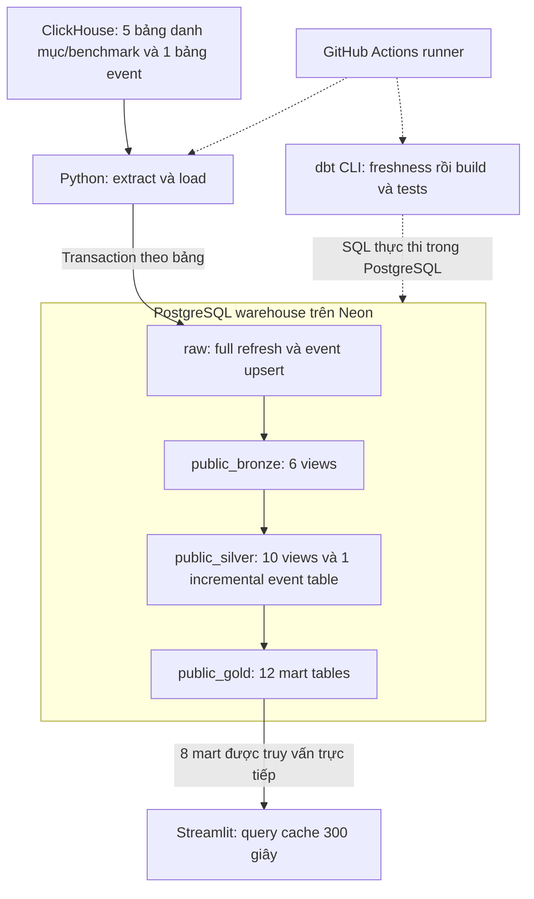

# LaplapTech Analytics Pipeline

Project học và nghiên cứu Data Engineering: trích xuất ClickHouse, nạp PostgreSQL trên Neon, biến đổi bằng dbt và phục vụ phân tích qua Streamlit.

## 1. Trạng thái hiện tại

| Phần | Trạng thái đối chiếu source ngày 19/10/2026 |
|---|---|
| Ingestion | Atomic theo từng bảng, dedup theo version, staging riêng, lookback 2 giờ và backfill CLI |
| Transformation | 29 model: 6 Bronze views, 10 Silver views + 1 incremental table, 12 Gold tables |
| Data quality | 34 dbt data test đã parse; source freshness là lệnh riêng |
| Kiểm chứng | 21/21 Python test pass, gồm 9 PostgreSQL integration test local |
| Điều phối hiện tại | GitHub Actions: main push, manual trên main, lịch 08:15 và 16:45 Việt Nam |
| Airflow Docker | Hướng học tiếp; chưa triển khai |
| End-to-end sau đợt sửa | Chưa chạy ingestion/dbt build trên Neon thật; chưa xác nhận 34 data test pass trên đó |

Kết quả test local không thay thế kiểm chứng dữ liệu thật. Dataset từng được mô tả ở mức 760k+ event; số dòng và thời gian chạy cần đo lại theo từng run.

## 2. Data flow



Neon lưu warehouse; runner thực thi Python và dbt CLI. Workflow không deploy Streamlit. Bronze/Silver/Gold là quan hệ trong PostgreSQL, không phải ba máy chủ riêng.

Chi tiết transaction, failure path, backfill, lineage và CI: **[Data flow hiện tại](docs/architecture/data_flow.md)**.

### Thứ tự job cập nhật

1. Ingestion full refresh 5 bảng bằng TRUNCATE + insert trong cùng transaction.
2. Event extract từ MAX raw timestamp trừ 7.200 giây; dedup rồi upsert qua staging riêng.
3. `dbt source freshness`: warn sau 24 giờ, error sau 48 giờ.
4. `dbt build`: materialize model và chạy tests theo DAG.
5. Upload artifact dbt đã sinh, kể cả khi bước trước lỗi.

Ingestion/freshness lỗi thì không chạy bước xử lý phía sau. Khi build lỗi giữa chừng, một số mart có thể đã cập nhật; chưa có publish snapshot chung cho toàn bộ warehouse.

### Chạy lại và dữ liệu đến muộn

- Dimension insert lỗi: rollback, giữ dữ liệu cũ và view.
- Event: chọn timestamp lớn nhất theo ID; batch cũ không ghi đè version mới.
- Cùng ID/timestamp nhưng payload khác: fail để điều tra nguồn.
- Staging tạo/nạp/drop trong một transaction, tên có hậu tố UUID.
- Transaction lock bảo vệ writer cùng quy tắc; workflow concurrency tránh các run cùng group chạy chồng.
- Lookback hữu hạn không bắt được mọi bản nguồn mang timestamp quá cũ. Raw không phải lịch sử bất biến của mọi version.
- Chunk insert tối đa 1.000 dòng, nhưng extraction vẫn giữ toàn bộ DataFrame trong RAM.

## 3. Model và ý nghĩa phân tích

| Nhóm | Mart |
|---|---|
| KPI và hành vi | `mart_daily_site_kpis`, `mart_behavior_funnel_daily`, `mart_user_os`, `mart_search_analytics` |
| Quan tâm thương hiệu | `mart_brand_interest`, `mart_brand_comparison` |
| Cấu hình và xu hướng | `mart_cpu_trend`, `mart_gpu_trend`, `mart_spec_popularity` |
| Benchmark và pin | `mart_performance_ranking`, `mart_performance_efficiency`, `mart_battery_vs_interest` |

Daily KPI đếm event thực tế theo ngày server nhận ở giờ Việt Nam. `total_sessions` là session hoạt động trong ngày; cộng nhiều ngày thành **session-days**. Funnel hiện đo các bước từng xuất hiện trong session, chưa đo trình tự chuyển đổi.

Search volume phản ánh từ khóa được tìm; chưa đủ chứng minh zero-result/product gap. Model comparison suy từ thiết bị cùng xuất hiện trong session. Cần chốt thêm các định nghĩa trước khi rút kết luận nghiệp vụ.

Exposure khai báo 12 mart; UI hiện truy vấn trực tiếp 8. Xem [grain từng model và các giới hạn](docs/architecture/data_flow.md).

## 4. Cài đặt và chạy

Ví dụ PowerShell từ root repository. CI hiện dùng Python 3.13; dependencies chưa khóa version.

```powershell
python -m venv venv
.\venv\Scripts\Activate.ps1
python -m pip install -r requirements.txt
Copy-Item .env.example .env
```

Điền credential của môi trường muốn chạy vào `.env`. Với Neon, database phải có sẵn, đặt `POSTGRES_SSLMODE=require` và giữ `POSTGRES_CREATE_DATABASE=false`. Kiểm tra cả biến môi trường shell vì chúng được ưu tiên hơn `.env`.

```powershell
# Có ghi dữ liệu: chỉ chạy sau khi kiểm tra đúng database đích.
python ingestion/clickhouse_to_postgres.py
python -m dotenv -f .env run -- dbt source freshness --project-dir dbt --profiles-dir dbt
python -m dotenv -f .env run -- dbt build --project-dir dbt --profiles-dir dbt

streamlit run streamlit_app/app.py
```

dbt không tự đọc `.env`; ví dụ dùng CLI python-dotenv để truyền cấu hình. Không cần chạy `dbt test` toàn bộ ngay sau `dbt build`.

### Backfill

```powershell
python ingestion/clickhouse_to_postgres.py --start "2026-10-01T00:00:00+07:00" --end "2026-10-02T00:00:00+07:00"
```

Khoảng `[start, end)` áp dụng cho server timestamp; dimension vẫn refresh về hiện tại. Dữ liệu raw cũ hơn cửa sổ Silver cần rebuild/backfill Silver và downstream. Full-refresh dbt không tự kéo lại ClickHouse.

Chi tiết: [Hướng dẫn vận hành ingestion](docs/guides/ingestion_operations.md).

### Kiểm tra offline

```powershell
python -m unittest discover -s tests -v
python -m dotenv -f .env run -- dbt parse --project-dir dbt --profiles-dir dbt
```

Không set `TEST_DATABASE_URL` thì integration tests skip. Hướng dẫn tạo PostgreSQL test và chạy đủ 21 test nằm trong tài liệu vận hành. `dbt parse` không chạy SQL/data tests lên warehouse.

### CI và lịch cập nhật

- [validate.yml](.github/workflows/validate.yml): PR hoặc push develop, compile Python, test bằng PostgreSQL service riêng, rồi dbt parse với cấu hình giả; không cần Neon secrets.
- [sync-pipeline.yml](.github/workflows/sync-pipeline.yml): chỉ main được ghi warehouse chính; giữ lịch hai lần/ngày và concurrency group cố định.
- Lịch là cấu hình dự kiến, không bảo đảm job bắt đầu đúng phút. Không chạy laptop/Airflow cùng lúc với sync trên cùng warehouse.
- Artifact hiện lưu manifest, run results và source freshness nếu có; chưa có audit table hoặc webhook thông báo riêng.

## 5. Tài liệu và việc tiếp theo

| Tài liệu | Nội dung |
|---|---|
| [Data flow](docs/architecture/data_flow.md) | Sơ đồ triển khai hiện tại, control/data flow, transaction, grain và CI |
| [Việc còn lại](docs/architecture/remaining_work.md) | Backlog có ưu tiên và tiêu chí nghiệm thu |
| [Upgrade plan](docs/architecture/upgrade_plan.md) | Quyết định kiến trúc, lịch sử thay đổi và hướng Airflow |
| [Ingestion operations](docs/guides/ingestion_operations.md) | Cấu hình Neon, lệnh chạy, backfill và tests |
| [Pipeline fix guide](docs/guides/pipeline_fix_guide.md) | Code mẫu và giải thích các bước sửa; một phần đã triển khai |
| [System design guide](SYSTEM_DESIGN_GUIDE.md) | Các quyết định thiết kế và bài học từ project |

Ưu tiên tiếp theo là dashboard/metric, timezone, khóa dependency và một lượt end-to-end dev có bằng chứng. Với mục tiêu học, Airflow Docker local là bước sau phù hợp; có thể giữ Neon, chưa bắt buộc thuê VPS.

## 6. Cấu trúc repository

```text
.github/workflows/         # validate CI và sync warehouse
ingestion/                 # extraction, full refresh, event upsert, CLI backfill
dbt/models/bronze/         # 6 pass-through views
dbt/models/silver/         # 10 views + incremental event table
dbt/models/gold/           # 12 mart tables
dbt/models/model_tests.yml # generic model tests
dbt/models/sources.yml     # source tests và freshness
dbt/tests/                 # 2 singular tests
tests/test_ingestion.py    # unit/config và PostgreSQL integration tests
streamlit_app/app.py       # giao diện phân tích
docs/architecture/         # data flow, backlog và quyết định kiến trúc
docs/guides/               # hướng dẫn sửa/vận hành
```

## Dataset attribution

Dataset contributed by **Nguyễn Ngọc Duy Luân (Duy Luân Dễ Thương)** to the
[Xóm Data community](https://www.facebook.com/groups/xomdata). Used for educational analytics and portfolio development.

License: [MIT](LICENSE).
