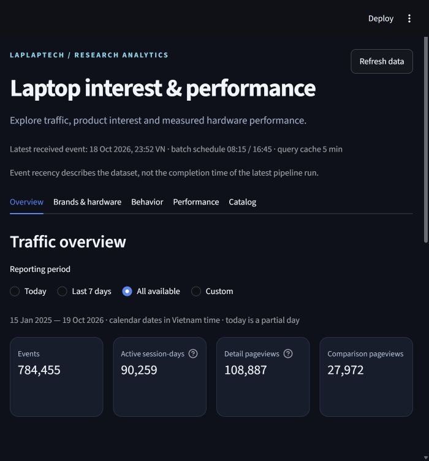

# LaplapTech Analytics Pipeline

**Bản nâng cấp mới:** [Gold, metrics, dependency lock và dashboard](docs/guides/gold_upgrade.md). Đã kiểm chứng nguồn ClickHouse thật trên dev local, không ghi Neon.

Project học và nghiên cứu Data Engineering: trích xuất ClickHouse, nạp PostgreSQL trên Neon, biến đổi bằng dbt và phục vụ phân tích qua Streamlit.

## 1. Trạng thái hiện tại

| Phần | Trạng thái đối chiếu source ngày 19/10/2026 |
|---|---|
| Ingestion | Atomic theo từng bảng, dedup theo version, staging riêng, lookback 2 giờ và backfill CLI |
| Transformation | 31 model: 6 Bronze views, 12 Silver views + 1 incremental table, 12 Gold tables |
| Data quality | 47 dbt data test pass trên dev local; source freshness là lệnh riêng |
| Kiểm chứng | 28/28 Python test pass, gồm 9 PostgreSQL integration và 2 Streamlit AppTest |
| Điều phối hiện tại | GitHub Actions: main push, manual trên main, lịch 08:15 và 16:45 Việt Nam |
| Airflow Docker | Hướng học tiếp; chưa triển khai |
| End-to-end sau đợt sửa | Đã chạy nguồn thật 784.455 event → PostgreSQL dev local → 31 model/47 tests; Neon chưa deploy |

Nguồn thật có 784.455 event ở lần kiểm chứng 19/10/2026; raw, Bronze và Silver event khớp nhau, Gold totals đối soát pass và replay không đổi row counts. Đây là kết quả dev local, không phải deploy Neon.

## 2. Data flow


Mũi tên liền biểu diễn dữ liệu/dependency; mũi tên đứt biểu diễn thứ tự chạy hoặc lệnh SQL. Sơ đồ dùng SVG tĩnh để chữ hiển thị đầy đủ trên GitHub; có thể mở ảnh để xem lớn.

Neon lưu warehouse; runner thực thi Python và dbt CLI. Workflow không deploy Streamlit. Bronze/Silver/Gold là quan hệ trong PostgreSQL, không phải ba máy chủ riêng.

Chi tiết transaction, failure path, backfill, lineage và CI: **[Data flow hiện tại](docs/architecture/data_flow.md)**.

### Thứ tự job cập nhật

1. Ingestion full refresh 5 bảng bằng TRUNCATE + insert trong cùng transaction.
2. Event extract từ MAX raw timestamp trừ 7.200 giây; dedup rồi upsert qua staging riêng.
3. `dbt source freshness`: warn sau 24 giờ, error sau 48 giờ.
4. `dbt build`: materialize model và chạy tests theo DAG.
5. Upload artifact dbt đã sinh, kể cả khi bước trước lỗi.

Ingestion/freshness lỗi thì không chạy bước xử lý phía sau. Khi build lỗi giữa chừng, một số mart có thể đã cập nhật; chưa có publish snapshot chung cho toàn bộ warehouse.

### Chạy lại và dữ liệu đến muộn

- Dimension insert lỗi: rollback, giữ dữ liệu cũ và view.
- Event: chọn timestamp lớn nhất theo ID; batch cũ không ghi đè version mới.
- Cùng ID/timestamp nhưng payload khác: fail để điều tra nguồn.
- Staging tạo/nạp/drop trong một transaction, tên có hậu tố UUID.
- Transaction lock bảo vệ writer cùng quy tắc; workflow concurrency tránh các run cùng group chạy chồng.
- Lookback hữu hạn không bắt được mọi bản nguồn mang timestamp quá cũ. Raw không phải lịch sử bất biến của mọi version.
- Chunk insert tối đa 1.000 dòng, nhưng extraction vẫn giữ toàn bộ DataFrame trong RAM.

## 3. Model và ý nghĩa phân tích

| Nhóm | Mart |
|---|---|
| KPI và hành vi | `gold_daily_site_kpis`, `gold_behavior_funnel_daily`, `gold_user_os`, `gold_search_analytics` |
| Quan tâm thương hiệu | `gold_brand_interest`, `gold_brand_comparison` |
| Cấu hình và xu hướng | `gold_cpu_trend`, `gold_gpu_trend`, `gold_spec_popularity` |
| Benchmark và pin | `gold_performance_ranking`, `gold_performance_efficiency`, `gold_battery_vs_interest` |

Daily KPI đếm event thực tế theo ngày server nhận ở giờ Việt Nam. `total_sessions` là session hoạt động trong ngày; cộng nhiều ngày thành **session-days**. Funnel dùng cùng session-day với KPI; các bước đo reach độc lập, chưa đo trình tự chuyển đổi.

Search volume phản ánh từ khóa được tìm; chưa đủ chứng minh zero-result/product gap. Comparison bridge chuẩn hóa tên trang/event nguồn và mở rộng device_ids; cặp brand đo co-occurrence trong session-day, không khẳng định một comparison action đồng thời.

Exposure và UI hiện đều dùng đủ 12 Gold model. Xem [grain từng model và các giới hạn](docs/architecture/data_flow.md).

## 4. Cài đặt và chạy

Ví dụ PowerShell từ root repository. CI hiện dùng Python 3.13; dependencies runtime đã khóa trong requirements.lock.txt (85 package).

```powershell
python -m venv venv
.\venv\Scripts\Activate.ps1
python -m pip install -r requirements.txt
Copy-Item .env.example .env
```

Điền credential của môi trường muốn chạy vào `.env`. Với Neon, database phải có sẵn, đặt `POSTGRES_SSLMODE=require` và giữ `POSTGRES_CREATE_DATABASE=false`. Kiểm tra cả biến môi trường shell vì chúng được ưu tiên hơn `.env`.

```powershell
# Có ghi dữ liệu: chỉ chạy sau khi kiểm tra đúng database đích.
python ingestion/clickhouse_to_postgres.py
python -m dotenv -f .env run -- dbt source freshness --project-dir dbt --profiles-dir dbt
python -m dotenv -f .env run -- dbt build --project-dir dbt --profiles-dir dbt

streamlit run streamlit_app/app.py
```

dbt không tự đọc `.env`; ví dụ dùng CLI python-dotenv để truyền cấu hình. Không cần chạy `dbt test` toàn bộ ngay sau `dbt build`.

### Backfill

```powershell
python ingestion/clickhouse_to_postgres.py --start "2026-10-01T00:00:00+07:00" --end "2026-10-02T00:00:00+07:00"
```

Khoảng `[start, end)` áp dụng cho server timestamp; dimension vẫn refresh về hiện tại. Dữ liệu raw cũ hơn cửa sổ Silver cần rebuild/backfill Silver và downstream. Full-refresh dbt không tự kéo lại ClickHouse.

Chi tiết: [Hướng dẫn vận hành ingestion](docs/guides/ingestion_operations.md).

### Kiểm tra offline

```powershell
python -m unittest discover -s tests -v
python -m dotenv -f .env run -- dbt parse --project-dir dbt --profiles-dir dbt
```

Không set `TEST_DATABASE_URL` thì integration tests skip. Hướng dẫn tạo PostgreSQL test và chạy đủ ingestion tests; AppTest cần Gold fixture đã build nằm trong tài liệu vận hành. `dbt parse` không chạy SQL/data tests lên warehouse. Để tái lập build/replay và đối soát: `python -m scripts.run_dev_pipeline --source fixture` với DEV_DATABASE_URL local.

### CI và lịch cập nhật

- [validate.yml](.github/workflows/validate.yml): PR hoặc push develop, compile Python, PostgreSQL tests, fixture end-to-end build/replay và AppTest; không cần Neon secrets.
- [sync-pipeline.yml](.github/workflows/sync-pipeline.yml): chỉ main được ghi warehouse chính; giữ lịch hai lần/ngày và concurrency group cố định.
- Lịch là cấu hình dự kiến, không bảo đảm job bắt đầu đúng phút. Không chạy laptop/Airflow cùng lúc với sync trên cùng warehouse.
- Artifact hiện lưu manifest, run results và source freshness nếu có; chưa có audit table hoặc webhook thông báo riêng.

## 5. Tài liệu và việc tiếp theo

| Tài liệu | Nội dung |
|---|---|
| [Data flow](docs/architecture/data_flow.md) | Sơ đồ triển khai hiện tại, control/data flow, transaction, grain và CI |
| [Việc còn lại](docs/architecture/remaining_work.md) | Backlog có ưu tiên và tiêu chí nghiệm thu |
| [Upgrade plan](docs/architecture/upgrade_plan.md) | Quyết định kiến trúc, lịch sử thay đổi và hướng Airflow |
| [Ingestion operations](docs/guides/ingestion_operations.md) | Cấu hình Neon, lệnh chạy, backfill và tests |
| [Gold upgrade](docs/guides/gold_upgrade.md) | Metric contract, migration Gold, dependency lock và dev E2E |
| [System design guide](SYSTEM_DESIGN_GUIDE.md) | Các quyết định thiết kế và bài học từ project |

Dashboard, timezone/metric, lock và end-to-end dev đã hoàn thành; xem báo cáo và hướng dẫn migration trong tài liệu Gold upgrade. Các việc tiếp theo gồm audit/quarantine, constraint/index và Airflow lab. Với mục tiêu học, Airflow Docker local là bước sau phù hợp; có thể giữ Neon, chưa bắt buộc thuê VPS.



## 6. Cấu trúc repository

```text
.github/workflows/         # validate CI và sync warehouse
ingestion/                 # extraction, full refresh, event upsert, CLI backfill
dbt/models/bronze/         # 6 pass-through views
dbt/models/silver/         # 12 views + incremental event table
dbt/models/gold/           # 12 mart tables
dbt/models/model_tests.yml # generic model tests
dbt/models/sources.yml     # source tests và freshness
dbt/tests/                 # 6 singular tests
tests/                    # ingestion, PostgreSQL integration và dashboard AppTest
scripts/                  # lock generator, fixture và dev E2E runner
streamlit_app/app.py       # giao diện phân tích
docs/architecture/         # data flow, backlog và quyết định kiến trúc
docs/guides/               # vận hành ingestion và migration Gold
assets/                    # SVG data flow và screenshot dashboard
```

## Dataset attribution

Dataset contributed by **Nguyễn Ngọc Duy Luân (Duy Luân Dễ Thương)** to the
[Xóm Data community](https://www.facebook.com/groups/xomdata). Used for educational analytics and portfolio development.

License: [MIT](LICENSE).
