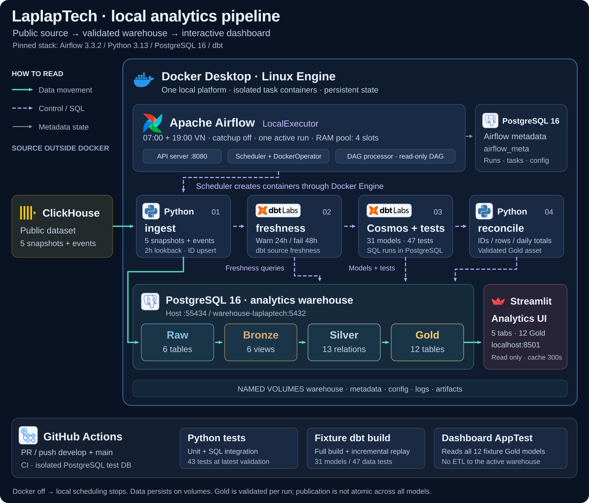

# LaplapTech Analytics Pipeline

Pipeline học Data Engineering: đọc ClickHouse public, nạp PostgreSQL, biến đổi bằng dbt và phục vụ phân tích qua Streamlit. Toàn bộ hệ thống chạy trên Docker local; Airflow điều phối ETL, GitHub Actions kiểm thử code bằng fixture.

**Nếu mới đến repo:** đọc mục 2 để hiểu luồng dữ liệu, làm mục 3 để chạy. Khi đã chạy được, chỉ mở guide đúng với công việc ở mục 4; không cần đọc hết tài liệu trước. Các giới hạn và kế hoạch nâng cấp được ghi riêng để không nhầm với chức năng hiện có.

## 1. Hệ thống hiện tại

| Thành phần | Cấu hình |
|---|---|
| Điều phối | Airflow 3.3.2 / LocalExecutor và Cosmos 1.15.1, DAG `laplaptech_pipeline` |
| Lịch | 07:00 và 19:00, timezone Việt Nam; một active run/writer |
| Warehouse | PostgreSQL 16, `127.0.0.1:55434/laplaptech_pipeline_dev` |
| Transformation | 31 dbt model: 6 Bronze views, 13 Silver relations, 12 Gold tables |
| Data quality | Source freshness, 47 dbt data tests và đối soát raw → Gold |
| Runtime | Python 3.13, 85 dependency được pin; task UID 10001 |
| Dashboard | Streamlit Docker, 5 tab sử dụng đủ 12 Gold model |
| CI | PostgreSQL fixture, full build/replay và Python/AppTest; không cần nguồn thật |

[Báo cáo hệ thống](docs/validation/system_check_2026-10-20.json) và [regression](docs/validation/regression_check_2026-10-20.json) ghi bằng chứng theo ngày/phạm vi, không xác nhận trạng thái realtime. Danh sách report ở [testing guide](docs/guides/testing.md#8-báo-cáo-kiểm-chứng-theo-ngày).

## 2. Data flow



Airflow tạo các runtime container theo thứ tự `ingest → freshness → Cosmos model tasks → dbt_tests → collect_dbt_results → reconcile`. Cosmos đọc graph từ manifest của release; PostgreSQL thực thi SQL. Metadata Airflow tách khỏi warehouse Raw/Bronze/Silver/Gold. Dashboard đọc Gold và cache 300 giây.

Ingestion snapshot atomic theo từng bảng cho 5 bảng và dedup/upsert event theo ID/version. Raw và Silver dùng chung cấu hình lookback, mặc định 2 giờ. Freshness warn 24 giờ/error 48 giờ. Một task lỗi sẽ chặn downstream; Gold chưa có transaction publish chung cho toàn bộ model.

[Sơ đồ kiến trúc, ingestion, watermark, dbt và cách xử lý lỗi](docs/architecture/data_flow.md) giải thích từng bước bằng Mermaid. Nguồn logo của ảnh tổng quan ở [tool-logos.json](assets/tool-logos.json).

## 3. Chạy nhanh bằng Docker

Cần Git, PowerShell 7, Docker Desktop đang chạy **Linux containers** và credential nguồn ClickHouse public. Runtime đã đóng gói nên không cần tự cài Python/dbt/PostgreSQL trên host để chạy pipeline và dashboard. Hướng dẫn hiện hỗ trợ Windows Docker Desktop; [Docker guide](docs/guides/docker.md) ghi cấu hình RAM/cổng và phạm vi kiểm chứng.

Nếu chưa có repo, mở PowerShell tại thư mục muốn chứa project:

```powershell
git clone https://github.com/PhucTruong11/laplaptech_pipeline.git
if ($LASTEXITCODE -ne 0) { throw 'Clone failed; inspect Git output before continuing.' }
Set-Location -LiteralPath laplaptech_pipeline
```

Nếu đã clone thì chuyển vào **root repo** hiện có, không clone lồng thêm. Tiếp theo:

```powershell
if (-not (Test-Path -LiteralPath '.env')) {
    Copy-Item -LiteralPath '.env.example' -Destination '.env'
}
# Mở .env bằng editor, điền CLICKHOUSE_PASSWORD và lưu trước khi chạy.
.\scripts\Start-LocalStack.ps1 -InitializePlatform
```

`-InitializePlatform` chỉ dùng cho workspace mới/rỗng. Đã có platform thì chạy `.\scripts\Start-LocalStack.ps1` không kèm cờ đó: giữ nguyên cấu hình chung, chỉ cập nhật runtime/config của dự án. Hai login pipeline/dashboard có mật khẩu sinh riêng trong `.env` platform. Không cần tài khoản Neon.

Dataset public vẫn yêu cầu login: `.env.example` đã có host/user/database, còn password phải lấy từ người duy trì dataset/repo. Nếu chưa có credential này thì chưa chạy được ingestion nguồn thật; [testing guide](docs/guides/testing.md) có lựa chọn fixture không cần login ClickHouse.

1. Mở [Airflow](http://localhost:8080), đăng nhập bằng `.env` của **platform**.
2. Unpause `laplaptech_pipeline` và kiểm tra tab **Runs**. Nếu Airflow chưa tạo lượt chạy và bạn muốn kiểm tra ngay, chọn **Trigger** với `full_refresh=false`. Dùng `true` khi cần rebuild Silver incremental từ Raw.
3. Đợi `reconcile` thành công, bật dashboard và mở địa chỉ host mặc định hoặc cổng đã chọn. [Lệnh bật/tắt dashboard](docs/guides/docker.md#bật-tắt-riêng-dashboard) · [Dashboard mặc định](http://localhost:8501).

Dashboard chỉ cần bật khi xem. Tắt riêng dashboard thì Airflow vẫn chạy lịch **07:00 và 19:00 giờ Việt Nam** nếu DAG đang unpaused và warehouse còn chạy. [Lệnh bật/tắt dashboard](docs/guides/docker.md#bật-tắt-riêng-dashboard).

Các lượt thường để `full_refresh=false`. Khi tạm nghỉ, dùng `.\scripts\Set-LocalStack.ps1 -State Off` từ root repo để tắt Airflow, warehouse và dashboard; `-State On` bật lại Airflow/warehouse, dashboard vẫn bật riêng khi cần. Công tắc này tác động đến toàn bộ Airflow dùng chung, nên khi có project khác tham gia cần kiểm tra run của tất cả project trước khi tắt. Khi Docker/laptop tắt, lịch ETL và dashboard dừng; CI không chạy ETL thay Airflow. Named volumes giữ dữ liệu qua stop/recreate. Hướng dẫn đầy đủ và đăng nhập PostgreSQL: [Docker](docs/guides/docker.md).

## 4. Hướng dẫn theo công việc

README là điểm bắt đầu. Mỗi guide là tài liệu tra cứu cho **một việc**, không phải bài đọc bắt buộc theo thứ tự.

| Bạn muốn làm gì? | Hướng dẫn |
|---|---|
| Setup, start/stop, kết nối DB, rebuild và backup | [Docker](docs/guides/docker.md) |
| Giới hạn RAM/CPU, pool dùng chung và thêm project | [Tài nguyên](docs/guides/resources.md) |
| Chạy DAG, đọc logs/Assets, hiểu retry và pool | [Airflow](docs/guides/airflow.md) |
| Run/test/build, source freshness, exposures và dbt docs | [dbt](docs/guides/dbt.md) |
| Điều tra ingestion, replay và backfill có kiểm soát | [Ingestion](docs/guides/ingestion.md) |
| Kiểm tra full system, fixture và regression/CI | [Testing](docs/guides/testing.md) |
| Hiểu Compose, Dockerfiles, mounts và volumes | [Cấu trúc hạ tầng](infra/README.md) |
| Hiểu Airflow/PostgreSQL dùng chung, thêm project, bảo trì và dung lượng ổ | [Kiến trúc platform dùng chung](docs/architecture/shared_platform.md) |

Các việc có thể nâng cấp được xếp ở [roadmap](docs/plans/roadmap.md). [Hướng dẫn Cosmos](docs/plans/cosmos.md) ghi cách phát hành manifest, retry theo model và quay lại luồng cũ.

## 5. Model và giới hạn

| Nhóm | Gold models |
|---|---|
| KPI và hành vi | `gold_daily_site_kpis`, `gold_behavior_funnel_daily`, `gold_user_os`, `gold_search_analytics` |
| Thương hiệu | `gold_brand_interest`, `gold_brand_comparison` |
| Cấu hình/xu hướng | `gold_cpu_trend`, `gold_gpu_trend`, `gold_spec_popularity` |
| Benchmark/pin | `gold_performance_ranking`, `gold_performance_efficiency`, `gold_battery_vs_interest` |

**Today** dùng ngày server nguồn nhận event theo giờ Việt Nam. Một lượt chạy hôm nay vẫn có thể bổ sung event cho các ngày trước. Cộng daily sessions qua nhiều ngày là **session-days**. Funnel đo reach trong cùng session-day, chưa chứng minh thứ tự chuyển đổi. Search volume không tự chứng minh zero-result/product gap.

Raw không lưu mọi version. Event nằm ngoài lookback có thể phục hồi bằng [lệnh recovery theo khoảng](docs/guides/ingestion.md#4-backfill-event-theo-khoảng-thời-gian) nếu nguồn vẫn còn dữ liệu. Extraction vẫn giữ DataFrame trong RAM. Xem giới hạn về correction incremental, quarantine và Gold publication trong [data flow](docs/architecture/data_flow.md).

## 6. Kiểm tra hệ thống

Từ root repo, với Python 3.10+ và Docker CLI:

```powershell
python scripts/verify_local_stack.py --output scratch/system-check.json
```

Mặc định verifier kiểm stack và dữ liệu hiện có. Thêm `--run-pipeline` để chạy một lượt incremental và xác nhận artifacts của đúng run. Thêm `--with-dashboard` khi dashboard đã bật. Fixture/reset dùng database `laplaptech_pipeline_test` riêng. [Hướng dẫn kiểm thử](docs/guides/testing.md).

## Dataset attribution

Dataset contributed by **Nguyễn Ngọc Duy Luân (Duy Luân Dễ Thương)** to the [Xóm Data community](https://www.facebook.com/groups/xomdata). Used for educational analytics and portfolio development.

License: [MIT](LICENSE).
