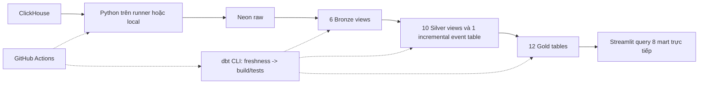
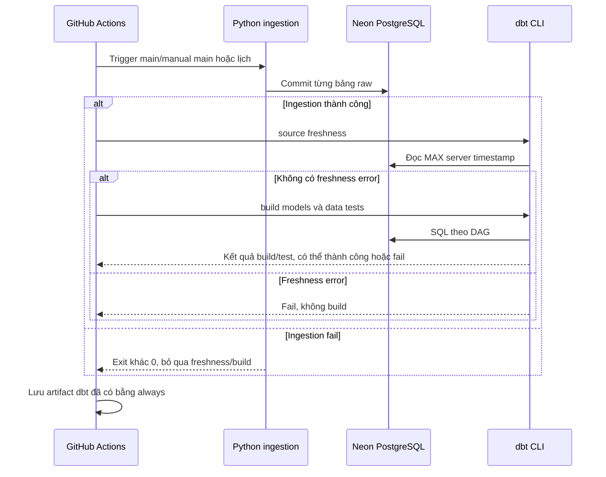
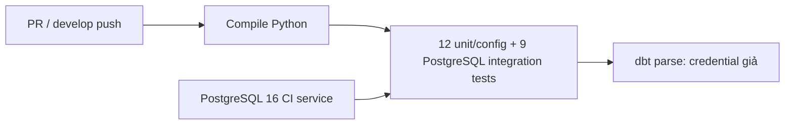
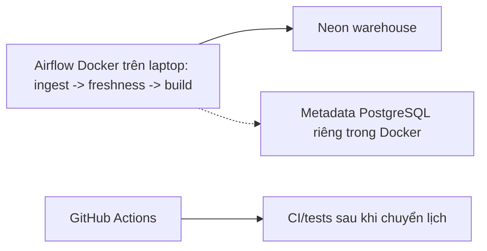

# Hướng dẫn thiết kế hệ thống dữ liệu từ LaplapTech

Cập nhật theo code ngày 19/10/2026. Project dùng để học và nghiên cứu. Các sơ đồ “hiện tại” chỉ mô tả thành phần đã có code; Airflow là hướng phát triển tiếp.

Tài liệu triển khai chi tiết: [data flow](docs/architecture/data_flow.md). Danh sách công việc: [remaining work](docs/architecture/remaining_work.md).

## 1. Bắt đầu từ yêu cầu

Trước khi chọn công cụ, xác định:

| Câu hỏi | Áp dụng cho project |
|---|---|
| Volume | Nguồn từng được ghi nhận khoảng 760k+ event; cần đo số mới theo run |
| Velocity | Batch hai lần/ngày, không có yêu cầu realtime đã được triển khai |
| Variety | Danh mục/benchmark dạng bảng và event chứa JSON |
| Veracity | ID/version, dữ liệu NULL, JSON lỗi, event trễ và grain của metric |
| Mục tiêu | Học pipeline end-to-end, thử tình huống lỗi và giải thích kết quả |

Số công cụ không phải thước đo duy nhất của engineering. Thiết kế có ý nghĩa khi giải thích được invariant, failure path, replay và bằng chứng kiểm thử.

## 2. Luồng đang triển khai



dbt CLI chạy trên runner; SQL được thực thi trong PostgreSQL Neon, gồm cả việc tạo Bronze. Streamlit được khởi chạy riêng; job sync không deploy app. Pipeline áp dụng ELT với phân lớp raw/Bronze/Silver/Gold.

## 3. Thiết kế ingestion

### Watermark và dữ liệu đến muộn

Bảng event dùng server-received timestamp làm watermark, không dùng thời điểm client xảy ra event. Lượt thường lấy MAX raw trừ 2 giờ; Silver có watermark riêng và cửa sổ 2 giờ.

Event xảy ra từ lâu nhưng server vừa nhận có thể vẫn được lấy bình thường. Ngược lại, bản xuất hiện ở nguồn sau đó mà giữ timestamp quá cũ có thể nằm ngoài lookback. Vì vậy phải có backfill, không khẳng định lookback xử lý được mọi trường hợp.

CLI backfill đã có `--start` và `--end`, khoảng đầu bao gồm/cuối không bao gồm. Nó mới giới hạn extraction event; dimension vẫn là snapshot hiện tại.

### Atomicity và idempotency

```mermaid
flowchart TD
    FULL["Dimension DataFrame"] --> FTX["BEGIN -> lock -> schema check -> TRUNCATE -> insert -> COMMIT"]
    EVENT["Event DataFrame"] --> DEDUP["Chọn version mới nhất theo ID"]
    DEDUP --> ETX["BEGIN -> lock -> staging UUID -> version check -> DELETE/INSERT -> DROP staging -> COMMIT"]
    FTX -->|\"Bất kỳ lỗi trong transaction\"| ROLLBACK["ROLLBACK transaction bảng đang nạp"]
    ETX -->|\"Bất kỳ lỗi trong transaction\"| ROLLBACK
```

- TRUNCATE giữ view, nhưng phải dùng cùng Connection/transaction với insert để rollback được dữ liệu.
- Staging riêng ngăn job xóa bảng tạm của job khác. Transaction lock bảo vệ writer cùng quy tắc.
- Replay event không tăng bản ghi theo ID trong trường hợp đã kiểm thử; bản cũ không thay bản mới.
- Cùng ID/timestamp nhưng payload khác phải điều tra, vì timestamp không đủ phân xử version.
- Chưa có transaction bao trùm toàn bộ 6 bảng và dbt; bảng đã commit trước lỗi vẫn giữ dữ liệu mới.
- Raw lưu version được chọn, không phải immutable event history; xóa bản ghi ở nguồn chưa được đồng bộ bằng CDC.

Extract toàn bộ kết quả vào RAM; chia chunk lúc insert chỉ giảm kích thước câu INSERT. Muốn học scale thêm, đo memory/thời gian rồi mới cân nhắc extraction theo trang/stream.

## 4. Thiết kế warehouse và transformation

Neon giữ database PostgreSQL; không dùng nó làm scheduler. Với profile `schema: public` và custom schema trong dbt, các tầng là:

| Schema | Materialization | Vai trò |
|---|---|---|
| `raw` | 6 tables do ingestion quản lý | Snapshot danh mục và event upsert |
| `public_bronze` | 6 views | Ánh xạ nguồn 1:1; chưa enforce data contract |
| `public_silver` | 10 views + 1 incremental table | Kiểu dữ liệu, JSON, catalog enrichment, session/event views |
| `public_gold` | 12 tables | Aggregate và join phục vụ phân tích |

Tầng Bronze không tự làm sạch và `SELECT *` không phải schema contract. Loader hiện chặn thêm/bớt tên cột ở bảng đã có; kiểm tra type/schema evolution đầy đủ vẫn là việc tiếp theo.

Gold hiện rebuild theo model, không phải incremental. DataFrame/SQL source không tự tạo unique index chỉ vì dbt có `unique_key`; data tests và constraint là hai lớp khác nhau.

### Grain phải đi trước metric

Daily KPI mới là một ngày server nhận event theo giờ Việt Nam. Session qua nửa đêm có thể tính ở hai ngày; SUM daily sessions là session-days.

Funnel session hiện là các bước đã từng xuất hiện và ngày bắt đầu session, không phải sequential conversion. CPU/GPU vẫn có timezone theo DB session và lọc nhóm >= 5 view. Không cộng/chia các aggregate khác grain để suy ra conversion mà chưa kiểm tra tập session.

Join benchmark theo laptop ID cần xác định một hay nhiều benchmark/laptop để tránh fanout. Brand comparison cần quy định cặp có hướng hay không và thế nào là một lần so sánh.

## 5. Orchestration và kiểm soát chất lượng



Freshness warn 24 giờ/error 48 giờ được chạy riêng trước build. MAX timestamp mới không chứng minh mọi ID/version đã đầy đủ. Chưa có bảng audit phân biệt một run thành công không có traffic mới với job không chạy.

Có 34 data test đã parse (32 generic + 2 singular). Test nguồn/Silver ID và daily event count hỗ trợ invariant; chưa có đối soát đầy đủ raw-Silver version hay quarantine row lỗi. Exposure chỉ là metadata lineage.

## 6. Tách kiểm chứng code khỏi dữ liệu thật



21 Python test đã pass local với PostgreSQL test riêng. Parse thành công cho 29 model và 34 data test; không đồng nghĩa SQL chạy hết hay data tests pass trên Neon.

Môi trường CI không cần secrets dữ liệu thật. Dependencies chưa khóa nên còn cần lock/constraints phù hợp nền tảng và một lần cài sạch.

## 7. Serving cũng cần kiểm tra tính đúng

App đọc 8 Gold mart, cache 300 giây; exposure khai báo 12. Nếu build cập nhật được một số mart rồi fail, app vẫn có thể đọc các version khác nhau. Chưa có publish snapshot đồng loạt.

Dashboard hiện còn các việc cần sửa: Today lấy ngày mới nhất của dataset, All-Time SUM session-days mang nhãn sessions, fallback pin 8.8 và search regex. Xem [backlog có tiêu chí nghiệm thu](docs/architecture/remaining_work.md).

## 8. Airflow Docker cho giai đoạn học tiếp



Đây là thiết kế dự kiến, chưa có DAG/runtime triển khai trong repo. Có thể giữ Neon khi chuyển nơi điều phối sang laptop. Chưa bắt buộc VPS nếu chấp nhận chỉ chạy khi máy/Docker bật.

Bài học nên thực hành: retry không nhân dữ liệu, rerun dbt riêng, timeout, không chạy chồng, failed task và backfill theo data interval. Bounded ingestion đã có, nhưng Silver ngoài lookback và mapping interval trong DAG vẫn cần hoàn thiện.

Chuyển lịch theo thứ tự dừng writer cũ rồi bật writer mới. Giữ GitHub Actions cho validation. Chưa có nhu cầu đã chứng minh để thêm Kafka/Spark/Kubernetes vào project này.

## 9. Mở rộng khi đã có bằng chứng nhu cầu

- Nhiều nguồn/dependency: thêm DAG/task boundaries và audit theo run.
- Dataset vượt khả năng RAM: đo bottleneck, thử chunk extraction và checkpoint có kiểm thử.
- Cần lịch sử thay đổi danh mục: thiết kế snapshot/SCD, không lấy snapshot hiện tại làm lịch sử.
- Cần đồng bộ delete/update từ nguồn: chọn version/change signal phù hợp, thay vì chỉ tăng lookback.
- Cần phục vụ báo cáo nhất quán theo run: thiết kế publish/version của tập mart.
- Cần production liên tục: đánh giá hạ tầng thường trực, secret management và giám sát riêng.

Các mục này là hướng thiết kế; không phải tính năng project đã hoàn thành.
