# Data flow và kiến trúc LapLapTech

Tài liệu này giải thích **hệ thống đang có trong code**, đối chiếu ngày 26/10/2026. Đây không phải báo cáo health realtime. Các sơ đồ mô tả luồng điều phối, dữ liệu và ranh giới transaction; chúng không khẳng định cả hệ thống commit trong một lần.

Đọc mục 1 để hiểu Docker/Airflow, mục 2 để hiểu ingestion, mục 3 để hiểu dbt/dashboard, mục 4 để hiểu lỗi và recovery. Các thiết kế **chưa triển khai** nằm ở [roadmap](../plans/roadmap.md), không được xem là chức năng hiện tại. Lệnh thao tác nằm ở [Docker](../guides/docker.md), [Airflow](../guides/airflow.md), [ingestion](../guides/ingestion.md) và [dbt](../guides/dbt.md).

Tra cứu nhanh: [Toàn hệ thống](#1-toàn-hệ-thống-ai-làm-việc-gì) · [Ingestion](#2-ingestion-dữ-liệu-vào-raw-như-thế-nào) · [dbt/dashboard](#3-dbt-từ-raw-tới-dashboard) · [Lỗi và recovery](#4-khi-lỗi-thì-dữ-liệu-ở-trạng-thái-nào) · [Guide thao tác](#5-đi-đâu-tiếp).

| Thuật ngữ | Nghĩa trong project |
|---|---|
| Control plane | Airflow và metadata quản lý lịch, dependency, trạng thái và retry |
| Runtime/workload | Container chạy Python hoặc dbt cho một task |
| Warehouse | PostgreSQL lưu raw/Bronze/Silver/Gold; thực thi SQL transformation |
| Grain | Một dòng đại diện cho gì: event, session-day, laptop, brand... |
| Watermark | Mốc timestamp lớn nhất trong bảng đích dùng để chọn dữ liệu lượt sau |
| Lookback | Khoảng lùi trước watermark để đọc lại dữ liệu có thể đến muộn |
| Replay / backfill / rebuild | Nạp lại cùng dữ liệu / đọc nguồn theo khoảng cũ / xây lại model từ raw đã có |
| Publish | Quyết định phiên bản dữ liệu nào được consumer đọc; hiện chưa có publish Gold nguyên khối |

## 1. Toàn hệ thống: ai làm việc gì?

### 1.1. Bài toán, đầu vào và lựa chọn kiến trúc

LapLapTech là **pipeline phân tích theo batch, thiên về ELT**: Python lấy dữ liệu từ ClickHouse và kiểm tra/chuẩn hóa nhẹ trước load; phần lớn transformation được dbt gửi xuống PostgreSQL. Hai lượt theo lịch mỗi ngày không phải streaming realtime.

Dữ liệu có hai nhóm: catalog/benchmark laptop và clickstream hành vi. Ghép chúng để phân tích lượt xem, mức quan tâm thương hiệu/cấu hình, hành vi comparison/search và benchmark/pin. Không có dữ liệu đơn hàng để suy ra doanh số; lượt xem hay tương quan pin/interest không chứng minh nguyên nhân mua hàng.

Bronze/Silver/Gold là **các tầng logic trong cùng database PostgreSQL**, không phải ba server. Project dùng cách tổ chức theo tầng; tên tầng không tự tạo lakehouse, CDC hoặc mô hình star schema đầy đủ.

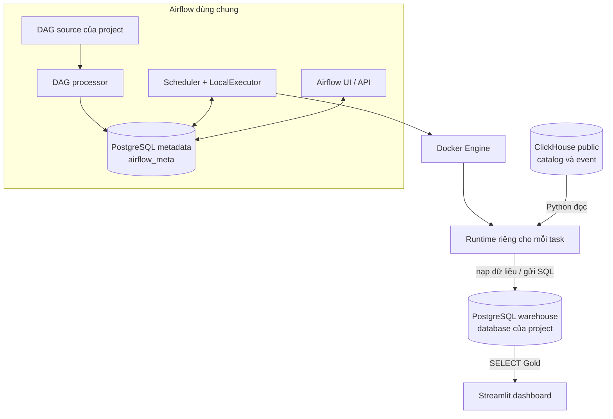

Airflow quyết định **khi nào chạy**; runtime quyết định **chạy chương trình gì**; PostgreSQL thực hiện **lưu trữ và tính SQL**. Vì vậy chạy dbt CLI trên host vẫn cần warehouse hoạt động nhưng không bắt buộc bật Airflow. Docker tắt thì warehouse local không nhận kết nối; CI không chạy ETL thay scheduler.

### 1.2. Shared platform và phạm vi của project

Airflow là một deployment dùng chung. Warehouse cũng có thể phục vụ nhiều project, mỗi project có database và login riêng. **Metadata Airflow là PostgreSQL instance khác**, không chứa dữ liệu phân tích.

LapLapTech dùng database `laplaptech_pipeline_dev`, DAG `laplaptech_pipeline`, image runtime riêng và config/artifact volumes riêng. Dependencies xử lý dữ liệu không được gom vào Python environment chung của Airflow. Tên warehouse/network có chữ LapLapTech được giữ để tương thích; không suy ra instance chỉ được chứa một project.

Database/user riêng giúp giới hạn quyền, nhưng các database cùng instance vẫn chia CPU/RAM/I/O và cùng dừng khi warehouse dừng. Superuser có quyền toàn cluster. Kiến trúc này dành cho các project local tin cậy, không phải cách ly tenant production. [Kiến trúc platform dùng chung](shared_platform.md) giải thích contract; workspace platform hiện hành là nguồn quy ước khi thay shared services.

### 1.3. Thành phần Airflow và vòng đời một task

| Thành phần | Thực hiện gì? | Không giữ gì? |
|---|---|---|
| `airflow-init` | Migrate metadata/tạo admin ban đầu, rồi thoát; exit 0 là bình thường | Không phải worker chạy ETL thường trực |
| `airflow-api-server` | Phục vụ UI/API và execution API | Không phải kho raw/Gold |
| `airflow-dag-processor` | Parse source DAG được mount read-only, cập nhật định nghĩa | Không extract ClickHouse lúc parse DAG |
| `airflow-scheduler` + LocalExecutor | Xếp lịch và chạy process operator | Không chứa dependencies nghiệp vụ của mọi project |
| `metadata` | Lưu user, DAG/run/task state, pool và metadata điều phối | Không lưu các bảng phân tích của project |
| `BudgetDockerOperator` | Đọc policy chung rồi yêu cầu Docker Engine tạo runtime | Không chuyển DataFrame qua XCom |

Không có Redis, Celery worker hoặc Flower trong cấu hình LocalExecutor này. LocalExecutor chạy operator process trong môi trường scheduler; operator gọi Docker Engine qua socket để tạo **container workload riêng**, không phải Docker-in-Docker daemon bên trong scheduler.

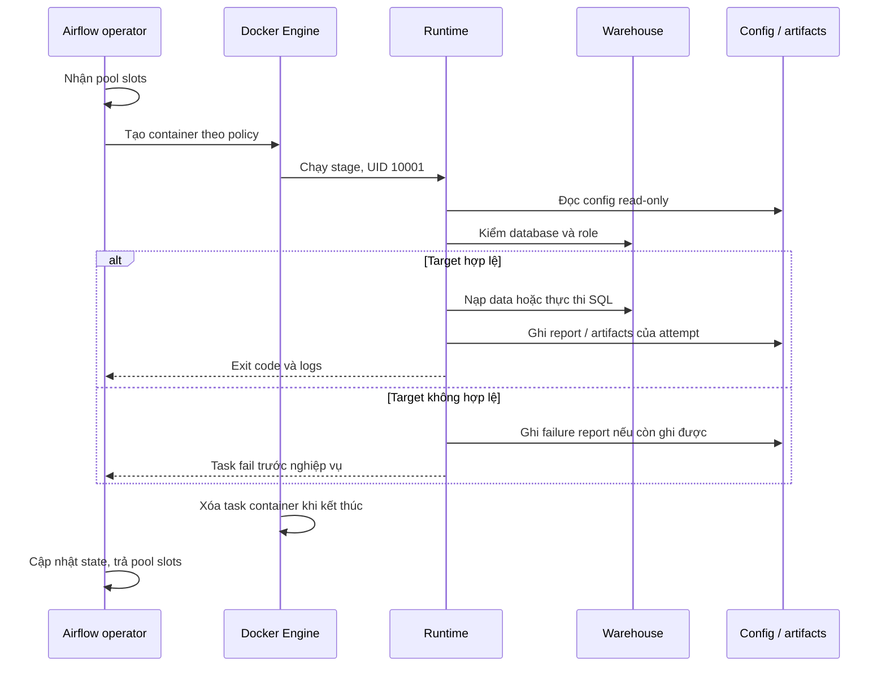

Config và artifacts trong sơ đồ là hai volume riêng: runtime chỉ đọc config và được ghi artifacts. Riêng stage ingest còn đọc ClickHouse trước khi nạp PostgreSQL. Source: [DAG](../../infra/laplaptech/dags/laplaptech_pipeline.py) và [stage entrypoint](../../scripts/run_airflow_stage.py). `preflight` là chế độ entrypoint kiểm target, **không phải task thứ năm** của DAG. Kill đột ngột/OOM có thể ngăn chương trình ghi report cuối; cần đọc thêm Airflow/Docker logs.

### 1.4. DAG: lịch, dependency, retry và Assets

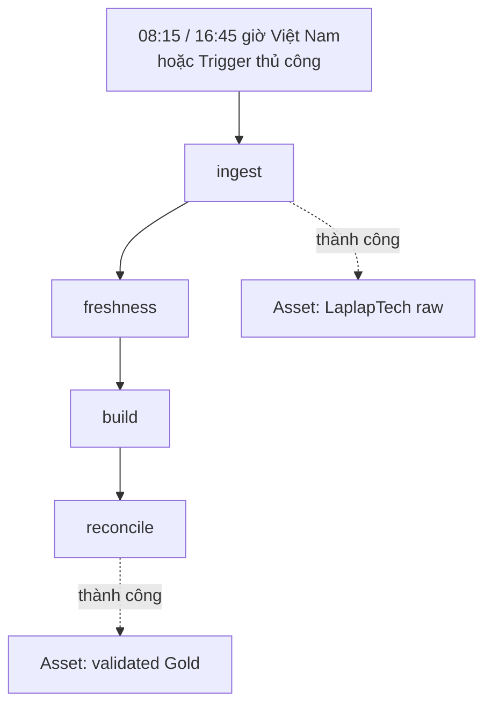

| Task | Thao tác chính | Timeout | Retry sau lỗi | RAM / CPU theo policy hiện hành |
|---|---|---|---|---|
| `ingest` | Python: 5 snapshot + event incremental | 45 phút | 1 lần, cách 2 phút | 2048 MiB / 2 CPU |
| `freshness` | `dbt source freshness` | 5 phút | 0 | 512 MiB / 1 CPU |
| `build` | `dbt build`, có thể thêm `--full-refresh` | 30 phút | 1 lần, cách 2 phút | 1024 MiB / 1 CPU |
| `reconcile` | SQL đọc/đối soát inventory và totals | 10 phút | 0 | 512 MiB / 1 CPU |

Giá trị trên là snapshot cấu hình ngày đối chiếu; `resources.json` của platform mới quyết định limits thực tế. DAG dùng `Asia/Ho_Chi_Minh`, `catchup=False`, tối đa một active run và một active task; timeout cả run là hai giờ. Laptop nghỉ không làm scheduler tự tạo đầy đủ mọi lượt đã bỏ qua. DAG mới tạo ở trạng thái paused.

Param `full_refresh=true` chỉ thay lệnh của task build; ingest vẫn chạy theo chế độ thông thường. DAG chưa có param `start/end` cho historical backfill. Retry một task không rollback các stage/model đã commit trước đó.

Hai Assets là metadata về kết quả task. Raw Asset phát khi cả task ingest thành công; Gold Asset phát sau reconcile thành công. Các khai báo này không chứa dataset, không thay transaction database và không tự khóa dashboard. Lịch DAG hiện vẫn theo cron; chưa có consumer DAG được kích hoạt theo Asset. `platform_smoke_test` là diagnostic tùy chọn ngoài thư mục DAG mặc định, không nằm trong luồng dữ liệu nghiệp vụ.

### 1.5. Docker: image, source, volume, network và cấu hình

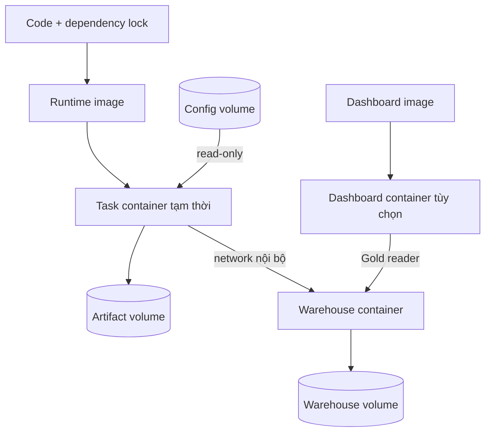

| Loại | Cụ thể | Khi sửa/dừng thì sao? |
|---|---|---|
| Runtime image | `laplaptech-runtime:local-v1`, [Dockerfile](../../infra/laplaptech/runtime.Dockerfile) | Ingestion/dbt/entrypoint được COPY; sửa code phải rebuild image |
| Dashboard image | `laplaptech-dashboard:local-v1`, [Dockerfile](../../infra/laplaptech/dashboard.Dockerfile) | Kế thừa runtime, thêm app; sửa app phải rebuild dashboard |
| DAG bind mount | Source `infra/laplaptech/dags` mount read-only vào Airflow | Sửa DAG cần đợi parse lại; không cần COPY bản trùng ID |
| Config volume | `laplaptech-lab-config`, file `/run/laplaptech/pipeline.env` | Runtime chỉ đọc; sửa root `.env` không tự đồng bộ volume |
| Artifacts volume | `laplaptech-lab-artifacts`, mount `/artifacts` | Giữ report/dbt artifacts sau khi task container bị xóa |
| Warehouse volume | `laplaptech-lab-warehouse` | Giữ database qua stop/recreate; không phải backup độc lập |
| Metadata/log volumes | `airflow-platform_airflow-metadata`, `airflow-platform_airflow-logs` | Giữ state Airflow/logs qua stop/recreate |

Control plane dùng Compose network mặc định; metadata không publish cổng host. Runtime, warehouse và dashboard liên lạc qua `laplaptech-lab`.

| Client | Endpoint mặc định |
|---|---|
| DataGrip/dbt trên host | `127.0.0.1:55434/laplaptech_pipeline_dev` |
| Runtime/dashboard trong Docker | `warehouse-laplaptech:5432/laplaptech_pipeline_dev` |
| Trình duyệt Airflow / dashboard | `127.0.0.1:8080` / `127.0.0.1:8501` |

`localhost` trong container là chính container đó, không phải Windows và cũng không phải container warehouse. Dữ liệu lớn được trao đổi qua PostgreSQL/volumes, không qua XCom. Dashboard bật riêng bằng profile; task runtime chỉ tồn tại khi có task.

Bootstrap [Start-LocalStack.ps1](../../scripts/Start-LocalStack.ps1) phân biệt platform mới/rỗng (`-InitializePlatform`) và platform hiện có. Chế độ hiện có giữ shared Compose/policy/keys, kiểm run đang hoạt động rồi cập nhật runtime/config của LapLapTech. Khi thao tác shared services phải giữ registrations, data và pause states của các project khác. Lệnh cụ thể ở [Docker guide](../guides/docker.md).

### 1.6. Quyền truy cập và quản lý tài nguyên

| Login/phạm vi | Quyền và trách nhiệm |
|---|---|
| ClickHouse source login | Python dùng credential trong config để đọc nguồn public có xác thực |
| `laplaptech_pipeline` | Non-superuser; sở hữu objects trong bốn schema của database dự án để ingest/dbt |
| `laplaptech_dashboard` | Non-superuser; CONNECT database, USAGE schema Gold và SELECT Gold; không đọc raw/Bronze/Silver, không ghi/DDL |
| `laplaptech` | Admin provisioning/bảo trì; không dùng làm runtime/dashboard login |
| Airflow UI login | Đăng nhập điều phối; không phải login PostgreSQL warehouse |

[Provisioning](../../scripts/provision_access.py) thiết lập default privileges của role pipeline để Gold tạo lại vẫn cho reader SELECT. Runtime kiểm database/user/quyền trước mọi stage. Dashboard kiểm login reader khi mở engine trên database vận hành. Dashboard không nhận source ClickHouse credential; config task không cần admin password. Mật khẩu thật/key nằm ngoài Git, không ghi vào sơ đồ/report.

Pool `platform_memory` có 4 slot × 512 MiB, Airflow parallelism 2; một ingest chiếm 4 slot, build chiếm 2 slot. Pool là cơ chế nhận việc theo ngân sách, không đo RAM realtime. Docker áp cgroup RAM/CPU/PID; WSL/Docker Desktop còn có trần tổng. **SQL của dbt tiêu thụ tài nguyên warehouse**, nên trần RAM runtime không bao toàn bộ RAM của truy vấn PostgreSQL. CLI trên host không tự chịu pool/cgroup của task.

Docker stdout logs có rotation 10 MB × 3; Airflow logs, dbt artifacts và backups chưa có retention tự động. RAM cap không giới hạn dung lượng ổ đĩa. Chi tiết ngân sách ở [resource guide](../guides/resources.md); không tăng limit chỉ vì một project mới muốn chạy cùng lúc.

## 2. Ingestion: dữ liệu vào `raw` như thế nào?

Source: [clickhouse_to_postgres.py](../../ingestion/clickhouse_to_postgres.py). Thứ tự thực thi là năm snapshot rồi đến event. Kết nối được đóng trong `finally`; các lệnh nguồn giới hạn bảng theo cấu hình cố định.

### 2.1. Snapshot năm bảng catalog/benchmark

Các bảng `brand`, `cpu_model`, `gpu_model`, `laptop_model`, `laptop_benchmark_result` được đọc toàn bộ mỗi lượt. Chúng là trạng thái hiện tại của nguồn, không phải lịch sử SCD.

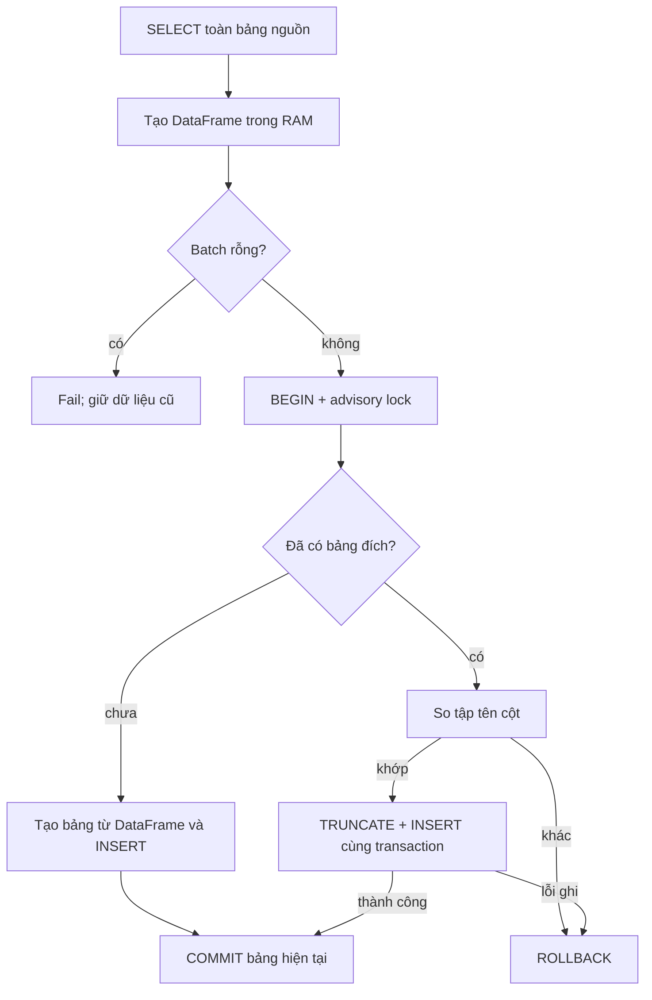

TRUNCATE và insert cùng transaction giúp lỗi insert giữ dữ liệu cũ, đồng thời không DROP bảng làm mất view phụ thuộc. Lần đầu bảng chưa có thì `to_sql` tạo bảng từ DataFrame; chưa có bộ DDL/type contract đầy đủ. Khi bảng đã có, loader kiểm **tập tên cột**, chưa kiểm mọi thay đổi type/nullability/ý nghĩa.

Mỗi bảng commit riêng. Nguồn cũng được query từng bảng, không có snapshot nhất quán xuyên toàn bộ nguồn. Nếu snapshot brand đã commit rồi CPU lỗi, brand mới vẫn còn; cả sáu bảng không tự rollback chung. Batch rỗng hiện luôn bị từ chối, kể cả khi nguồn thực sự muốn xóa sạch một catalog; cần điều tra thay vì bỏ guard.

### 2.2. Chọn khoảng event: watermark thường và backfill

Watermark raw lấy trực tiếp bằng `MAX(event_received_on_server_timestamp)` trong PostgreSQL, không có bảng checkpoint riêng. Timestamp là epoch giây server nguồn nhận event; hiện nó đồng thời được dùng làm mốc extract và tiêu chí chọn version.

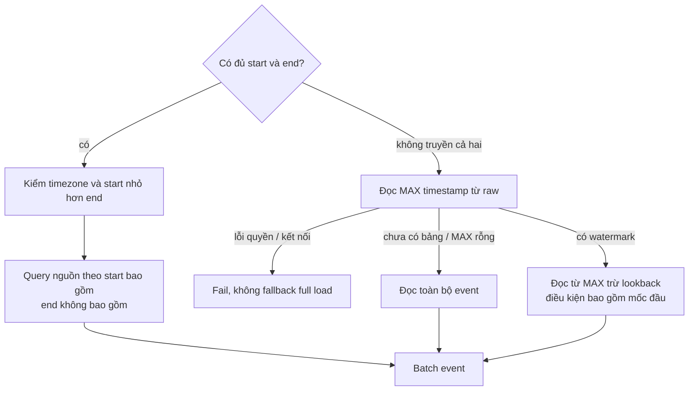

Lookback raw là `INGESTION_LOOKBACK_SECONDS`, mặc định 7200. Ví dụ MAX raw = 12:00 thì đọc từ 10:00 trở đi. Đọc chồng là chủ đích để nhận event/version nằm trong cửa sổ, rồi dedup ở bước ghi. Timestamp lớn nhất không chứng minh các khoảng phía trước đã đầy đủ.

CLI đã hỗ trợ `--start/--end` với ISO-8601 có timezone và khoảng `[start,end)`, không đọc MAX hiện tại cho event khi chọn chế độ đó. Truyền thiếu một đầu mốc bị từ chối. **Năm dimension vẫn refresh snapshot hiện tại trong cùng lượt backfill**. Xem [hướng dẫn backfill](../guides/ingestion.md#4-backfill-event-theo-khoảng-thời-gian).

### 2.3. Chuẩn hóa, dedup và cập nhật version

Trước ghi, `prepare_event_batch` kiểm ID không NULL/rỗng, watermark chuyển được sang số hữu hạn, tên cột không trùng. JSON dạng Python dict/list được serialize ổn định theo key để so payload. Bước này chưa bảo đảm mọi chuỗi JSON đầu vào hợp lệ hoặc đúng shape; cast JSON trong dbt vẫn có thể lỗi.

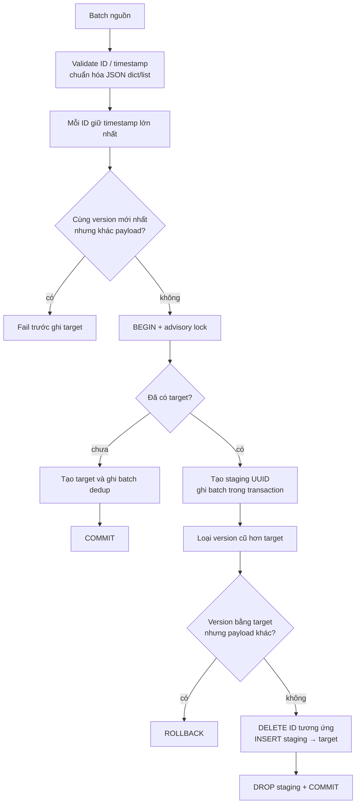

Nhánh target chưa có ghi batch đã dedup trực tiếp; nhánh target đã có dùng staging. Insert được chia batch tối đa 1000 dòng, giảm thêm theo số cột để giới hạn parameters. Đây là **batch insert**, extraction vẫn giữ kết quả query và DataFrame trong RAM.

| So với raw đang có | Kết quả |
|---|---|
| ID mới | Insert |
| Cùng ID, timestamp lớn hơn | Thay bản raw cũ bằng bản mới |
| Cùng ID, timestamp nhỏ hơn | Không ghi đè bản mới hơn |
| Cùng ID/timestamp/payload | Replay cho kết quả logic không đổi; có thể vẫn DELETE/INSERT vật lý |
| Cùng ID/timestamp, payload khác | Fail để điều tra version nguồn |

Advisory transaction lock phối hợp các writer dùng cùng quy tắc trên **một bảng**, không khóa toàn luồng ingestion → build → reconcile. Code bên ngoài bỏ qua lock vẫn có thể ghi. Raw không lưu mọi version, không capture source delete kiểu CDC, không có cam kết exactly-once từ đầu nguồn đến dashboard. Test uniqueness giúp phát hiện duplicate; `unique_key` trong dbt cũng không thay cho constraint database.

### 2.4. Hai watermark và giới hạn dữ liệu đến muộn

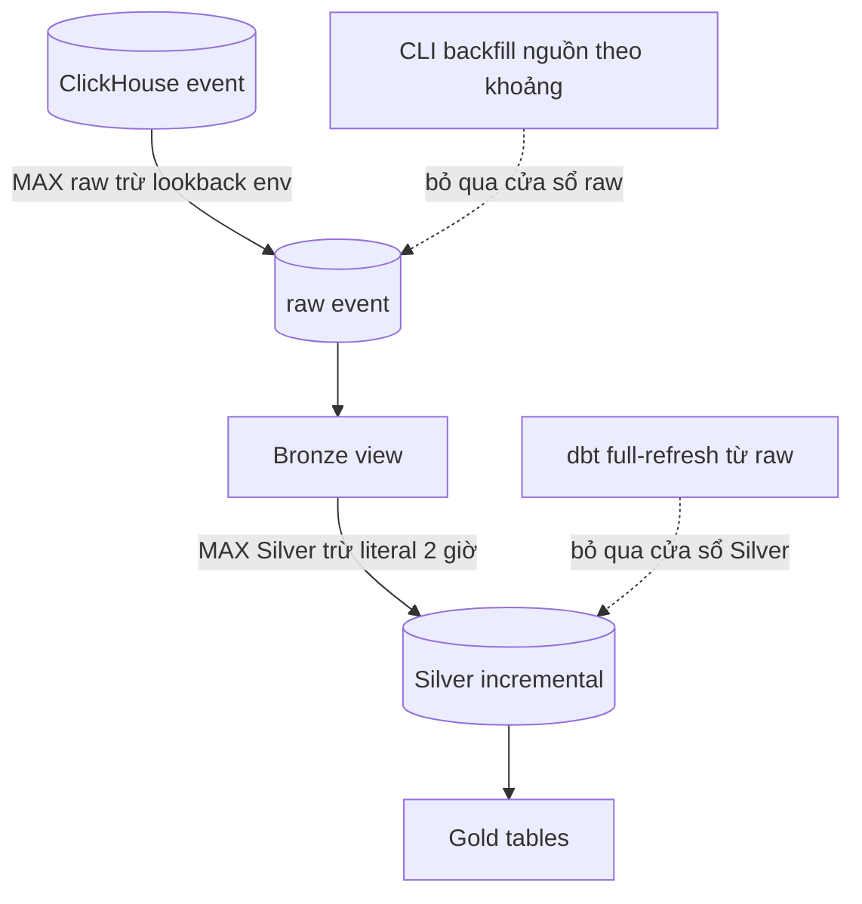

Đổi lookback ingestion hiện **không tự đổi** literal `INTERVAL '2 hour'` trong Silver. Event được backfill vào raw nhưng nằm ngoài cửa sổ Silver có thể chưa đi tới Gold nếu chỉ build incremental. Ngược lại, full-refresh dbt không thể phục hồi event chưa có trong raw.

Một bản Silver từng hợp lệ nhưng raw được sửa thành thiếu name/session còn có thể sót trong incremental target: row mới bị lọc trước bước cập nhật. Full-refresh hiện là đường xây lại theo raw; quy trình recovery thống nhất và fixtures cho tình huống này còn ở [roadmap mục 2](../plans/roadmap.md#2-lookback-thống-nhất-và-recovery-backfill).

## 3. dbt: từ raw tới dashboard

### 3.1. Các tầng và nơi SQL thực thi

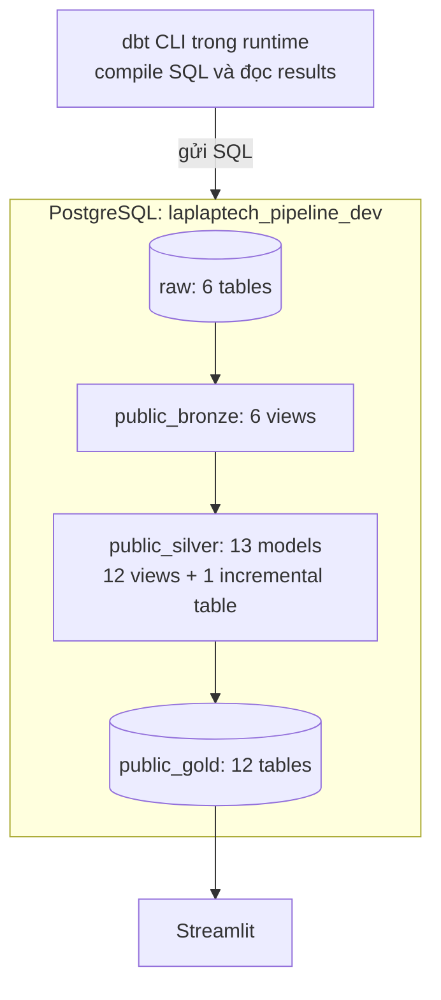

Mũi tên tầng là tổng quan; lineage chính xác theo `ref()`/`source()`, mỗi Gold dùng những nhánh Silver khác nhau. [dbt_project.yml](../../dbt/dbt_project.yml) cấu hình Bronze/Silver mặc định view và Gold table; Silver event tự override thành incremental. Profile có schema gốc `public`, nên schema tùy chỉnh thành `public_bronze`, `public_silver`, `public_gold`.

View lưu định nghĩa query, không lưu một snapshot dữ liệu riêng. Silver view có thể phản ánh raw mới ngay sau ingestion, dù Gold table còn là kết quả lượt build trước. Gold table được xây lại giúp dashboard đọc kết quả đã tính sẵn, đổi lại cần thời gian build và dung lượng lưu trữ.

### 3.2. Silver: từ JSON tới grain phục vụ phân tích

| Model/nhóm model | Làm gì? | Grain/kết quả |
|---|---|---|
| `silver_brand`, `silver_cpu_model`, `silver_gpu_model` | Chuẩn hóa tên và cast ID | Một brand/CPU/GPU |
| `silver_laptop_model` | Join ba dimension vào catalog, chuẩn hóa tên/spec/flags | Một laptop |
| `silver_laptop_benchmark_result` | Chọn ID benchmark lớn nhất mỗi laptop, cast điểm và đổi phút sang giờ | Một benchmark đại diện/laptop; ID không chứng minh thời gian mới nhất |
| `silver_user_event_tracking` | Parse JSON, chuẩn hóa page, cast timestamp/device ID, lọc name/session NULL, dedup | Một event ID; incremental `unique_key=id` |
| `silver_session_day` | Gom event theo session + ngày server nhận, tạo counts/flags | Một session-day |
| `silver_session_funnel` | Ánh xạ flags thành từng bước reach | Một session-day, không yêu cầu thứ tự |
| `silver_comparison_event_device` | Chọn comparison taxonomy, tách device đơn/mảng, loại ID lặp | Một event + laptop ID ứng viên hợp lệ về định dạng |
| `silver_comparison_session_device` | Gom comparison interactions | Một session-day + laptop |
| `silver_comparison_sort_event` | Chọn event comparison có `sort_by` | Một dòng event sort được chọn |
| `silver_device_traffic_event` | Chọn pageview, lấy OS/device/browser, gán Unknown khi NULL | Một dòng pageview |
| `silver_session_activity` | Gom toàn bộ event theo session, lấy thuộc tính đầu tiên không rỗng | Một session toàn kỳ |

Silver event kiểm device ID là số nguyên trong khoảng cho phép; ID hợp lệ về định dạng chưa chứng minh laptop đó tồn tại. Join catalog và relationship tests mới kiểm những quan hệ cụ thể. Taxonomy comparison chuẩn hóa nhiều page/action về `CompareDevice`; model tách mảng dùng DISTINCT theo event/laptop để tránh nhân đôi cùng ID trong một event.

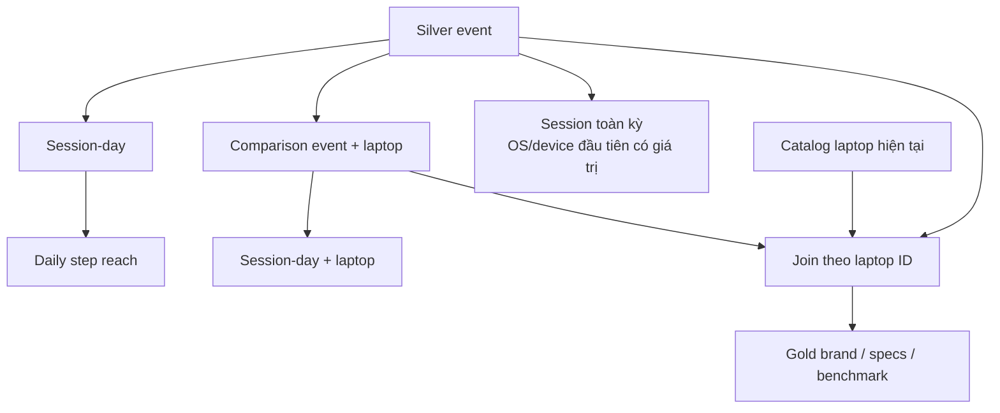

Catalog được snapshot lại nên join hiện là **theo thông tin hiện tại**, chưa phải as-of theo thời điểm event. Rebuild có thể diễn giải hành vi cũ bằng catalog mới. Giữ lịch sử catalog/SCD Type 2 là thiết kế tương lai, không được suy ra từ tên Bronze/Silver.

### 3.3. Gold: câu hỏi, grain và giới hạn metric

| Gold model | Grain | Trả lời gì và cần hiểu đúng điều gì? |
|---|---|---|
| `gold_daily_site_kpis` | Ngày Việt Nam | Event/pageview và daily sessions; cộng sessions nhiều ngày thành session-days |
| `gold_behavior_funnel_daily` | Ngày Việt Nam | Số session-day đạt từng bước độc lập; chưa phải ordered conversion |
| `gold_brand_interest` | Brand | Detail views, comparison và distinct sessions toàn kỳ; tỷ lệ đo giao hai tập session |
| `gold_brand_comparison` | Cặp brand không có hướng | Đồng xuất hiện trong session-day; có thể gồm same-brand, không chứng minh cùng một action |
| `gold_cpu_trend` | Tháng + CPU + brand | Detail views theo CPU trong catalog hiện tại; không phải số CPU bán được |
| `gold_gpu_trend` | Tháng + GPU + brand | Detail views theo GPU trong catalog hiện tại |
| `gold_spec_popularity` | CPU + GPU + màn hình + dung lượng pin | Interest theo tổ hợp spec; không có grain RAM nếu nguồn/model chưa đưa vào |
| `gold_performance_ranking` | Laptop active | Xếp hạng điểm/pin; laptop thiếu benchmark vẫn có thể xuất hiện với NULL |
| `gold_performance_efficiency` | Laptop active, visible và có benchmark phù hợp | Điểm/Wh, điểm/kg, phút/Wh, sụt hiệu năng khi dùng pin; thiếu mẫu số trả NULL |
| `gold_battery_vs_interest` | Laptop active | Ghép điểm/pin với lượt quan tâm; cung cấp dữ liệu khám phá, chưa tự chứng minh quan hệ nhân quả |
| `gold_search_analytics` | Keyword đã lower/trim | Search events và distinct sessions; không chứng minh zero-result hay product gap |
| `gold_user_os` | OS + device type | Phân bố session toàn kỳ theo thuộc tính được chọn đầu tiên; không phải unique people |

Grain cần được giữ khi join/tổng hợp. Cùng một session qua nửa đêm tạo hai session-day nhưng vẫn có thể chỉ là một session toàn kỳ. Không cộng các distinct counts từ nhiều nhóm/ngày rồi gọi đó là distinct toàn bộ.

### 3.4. Timestamp, timezone và định nghĩa nghiệp vụ

| Trường/mốc | Dùng cho gì? |
|---|---|
| `event_local_timestamp` → `event_timestamp` | Thời gian event từ phía client, giữ để điều tra |
| `event_received_on_server_timestamp` → `server_timestamp` | Thời gian server nguồn nhận; dùng watermark, freshness và ngày/tháng nghiệp vụ |
| Report `started_at` / `finished_at` | Thời gian chạy stage; không phải timestamp phát sinh của mỗi event |
| `business_timezone=Asia/Ho_Chi_Minh` | Macro tính ngày/tháng thống nhất, không dựa vào timezone mặc định của máy |

[business_time.sql](../../dbt/macros/business_time.sql) chuyển timestamp sang timezone nghiệp vụ rồi lấy ngày/tháng. Ví dụ 17:30 UTC đã là 00:30 ngày kế tiếp tại Việt Nam. [safe_divide.sql](../../dbt/macros/safe_divide.sql) trả NULL khi thiếu/0 mẫu số; NULL không được tự hiểu thành kết quả bằng 0.

### 3.5. Freshness, dbt tests và reconcile kiểm gì?

`dbt source freshness` kiểm **raw đã nạp**, không query trực tiếp ClickHouse: MAX timestamp event quá 24 giờ thì warn, quá 48 giờ thì error và chặn build. Hiện chỉ source event có cấu hình freshness này; nó không đo đầy đủ năm snapshot hay độ trễ từng event.

`dbt build` materialize models và chạy tests theo dependency. Test upstream thất bại có thể làm downstream bị skip; các model đã commit trước lỗi không tự rollback chung. Sau full build đã pass không cần chạy thêm run/test chỉ để lặp đúng công việc đó.

| Lớp kiểm tra | Bằng chứng/điều kiện hiện tại | Không tự chứng minh |
|---|---|---|
| Generic dbt tests | Unique, not-null, relationships, accepted values | Mọi metric đều đúng nghiệp vụ |
| Raw → Silver SQL test | ID, timestamp, name/session, payload khớp các row raw đủ điều kiện | Nguồn ClickHouse đã được lấy đầy đủ |
| Daily/Gold SQL tests | Tổng events, tỷ lệ, grain, taxonomy và định nghĩa được khai báo | Mọi câu hỏi phân tích đều đã được kiểm |
| Stage `reconcile` | Inventory 6/6/13/12; duplicate raw ID; count raw hợp lệ ↔ Silver; raw ↔ Bronze event; totals và sessions/ngày ↔ Gold daily | So lại mọi cột của cả 12 Gold tables |

Source: [model_tests.yml](../../dbt/models/model_tests.yml), [SQL tests](../../dbt/tests/assert_raw_to_silver.sql) và [reconcile entrypoint](../../scripts/run_airflow_stage.py). Inventory hiện có 31 models, 47 data tests, 6 sources, 1 exposure; số này là baseline code, không phải kết quả execution mới.

### 3.6. Dashboard, exposure và giới hạn phục vụ dữ liệu

[exposures.yml](../../dbt/models/exposures.yml) khai báo dashboard phụ thuộc 12 Gold models để thể hiện lineage/owner trong dbt docs. Exposure không tự chạy app, không cấp quyền SQL và không thay data tests.

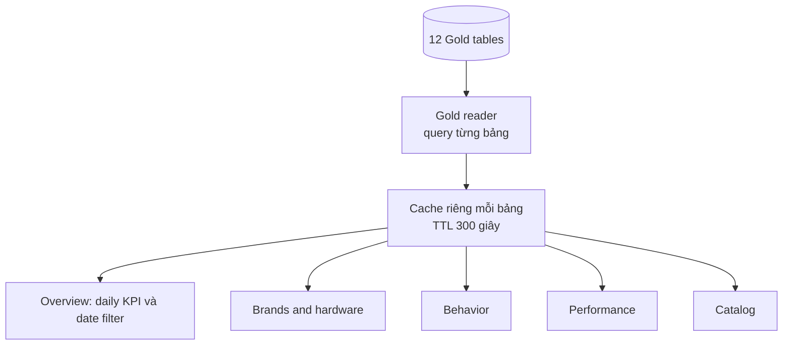

[data.py](../../streamlit_app/data.py) chỉ nhận tên model trong allowlist, dùng SQLAlchemy pool nhỏ và SELECT Gold. [app.py](../../streamlit_app/app.py) đọc đủ 12 bảng, hiển thị năm tab. Date filter ở Overview không tự biến các Gold all-time thành metric của cùng khoảng ngày; các tab khác có ngữ cảnh riêng. App có thời điểm event mới nhất, nhắc lịch batch/cache và nút refresh cache.

**Gold chưa có cơ chế publish nguyên khối.** dbt xây từng bảng, dashboard có thể query trong lúc build; nếu model sau lỗi thì một số Gold đã mới, số khác còn cũ. Reconcile/Gold Asset không làm các bảng đó quay lại phiên bản trước. Cache từng bảng còn có thể giữ các phiên bản khác nhau qua nhiều request. Thiết kế candidate → validate → publish và cache theo version nằm ở [roadmap mục 3](../plans/roadmap.md#3-publish-gold-nhất-quán-và-cache-theo-phiên-bản).

### 3.7. CI, fixture và artifacts: kiểm chứng khác vận hành

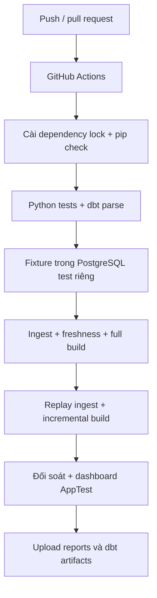

[validate.yml](../../.github/workflows/validate.yml) không cần source credential: fixture thay client nguồn, còn loader/PostgreSQL/dbt SQL là thật. DB test là `laplaptech_pipeline_test`; [runner](../../scripts/run_dev_pipeline.py) chặn fixture/reset vào database vận hành. CI không xác nhận Docker Desktop, socket, shared mounts và dataset thật đang hoạt động; cần [system verifier](../../scripts/verify_local_stack.py) cho phạm vi đó. `dbt parse` chỉ kiểm cấu trúc/compile metadata, chưa thực thi SQL trên dữ liệu.

Runtime artifacts nằm dưới `/artifacts/<run-hash>/<stage>/attempt-<n>-<uuid>/`: mỗi attempt có report trạng thái/thời gian/cgroup limits; dbt stages thêm target/logs, manifest/run results hoặc freshness results tùy lệnh. Container tự xóa nhưng volume giữ bằng chứng. Airflow logs phục vụ đọc lỗi task; dbt docs/lineage giúp xem dependency. Artifact lịch sử cần đọc đúng run/attempt, không coi file cũ là xác nhận lượt mới.

## 4. Khi lỗi thì dữ liệu ở trạng thái nào?

### 4.1. Failure path và ranh giới transaction

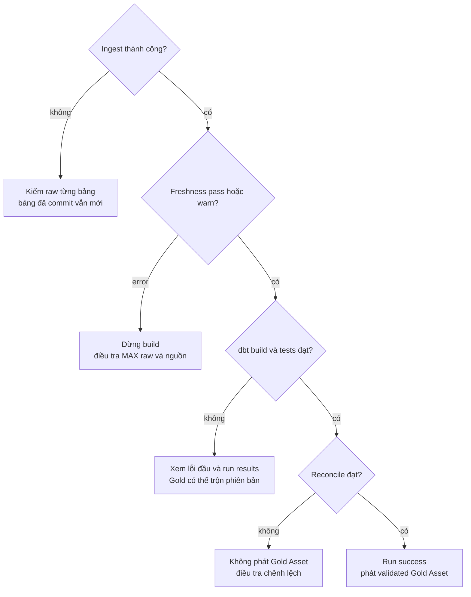

| Ranh giới | Được bảo vệ | Phần còn ngoài ranh giới |
|---|---|---|
| Snapshot transaction | TRUNCATE/INSERT một bảng rollback cùng nhau | Các bảng snapshot khác đã commit |
| Event transaction | Staging + so version + DELETE/INSERT rollback cùng nhau | Thay đổi nguồn, snapshot khác, dbt downstream |
| dbt model | Materialization theo model/adapter | Toàn bộ graph và mọi cache dashboard |
| DAG `max_active_runs=1` | Không chồng hai run của chính DAG | CLI writer, DAG khác hoặc consumer đọc giữa build |
| Advisory lock ingestion | Writer tuân thủ cùng lock trên bảng | Toàn bộ chu kỳ raw → Gold và writer không lấy lock |

### 4.2. Chọn đúng cách khắc phục

| Tình huống | Điều tra/xử lý trước |
|---|---|
| `Connection refused` tới 55434 | Kiểm Docker Engine, warehouse readiness và mapping cổng; chưa phải lỗi SQL model |
| Sai login/database | Kiểm endpoint, database/user thực tế và config volume; không xóa volume để chữa password |
| Watermark query lỗi | Sửa quyền/type/kết nối; không fallback full extract |
| Event ngoài lookback | Backfill raw khoảng đúng, rebuild phạm vi phụ thuộc, đối soát ID/version và Gold |
| Catalog cũng refresh trong recovery | Cần kiểm toàn graph; chỉ build nhánh event không cập nhật mọi Gold phụ thuộc catalog |
| Source đổi cột/type hoặc JSON lỗi | Đánh giá contract/migration; hiện chưa có quarantine tự động |
| Cùng ID/timestamp nhưng payload khác | Xác minh version nguồn; không tự chọn ngẫu nhiên |
| Build/test lỗi giữa chừng | Đọc lỗi đầu; retry không đảo ngược các Gold đã commit |
| OOM/exit 137 hoặc timeout | Đối chiếu logs, cgroup và kích thước nguồn; chunk insert không giải quyết toàn bộ extraction RAM |
| Ổ đĩa tăng dần | Đo logs/artifacts/images/volumes; retention chưa tự động, không prune volumes tùy tiện |

Trước recovery phải kiểm writer của cả DAG lẫn CLI, pause/drain đúng phạm vi, giữ baseline và backup. `stop` giữ volumes; volume còn tồn tại không thay thế bài thử restore. Recovery end-to-end chuẩn hóa, Gold publication, data contracts, extraction streaming, lịch sử catalog và Cosmos đều có checkpoint riêng trong [roadmap](../plans/roadmap.md).

## 5. Đi đâu tiếp?

| Muốn làm gì? | Tài liệu/source |
|---|---|
| Setup, bật/tắt, kết nối, rebuild, backup | [Docker](../guides/docker.md) |
| Hiểu DAG, logs, retry và Assets | [Airflow](../guides/airflow.md) |
| Điều tra raw, watermark và replay | [Ingestion](../guides/ingestion.md) |
| Chạy run/test/build/freshness, xem docs/lineage | [dbt](../guides/dbt.md) |
| Chạy fixture/CI hoặc kiểm stack thật | [Testing](../guides/testing.md) |
| Hiểu Compose/images/mounts | [Hạ tầng](../../infra/README.md) |
| Dùng chung Airflow/PostgreSQL và kiểm budget | [Shared platform](shared_platform.md), [resources](../guides/resources.md) |
| Chọn bài cải thiện tiếp theo | [Roadmap 7 hạng mục](../plans/roadmap.md), [Cosmos chi tiết](../plans/cosmos.md) |
