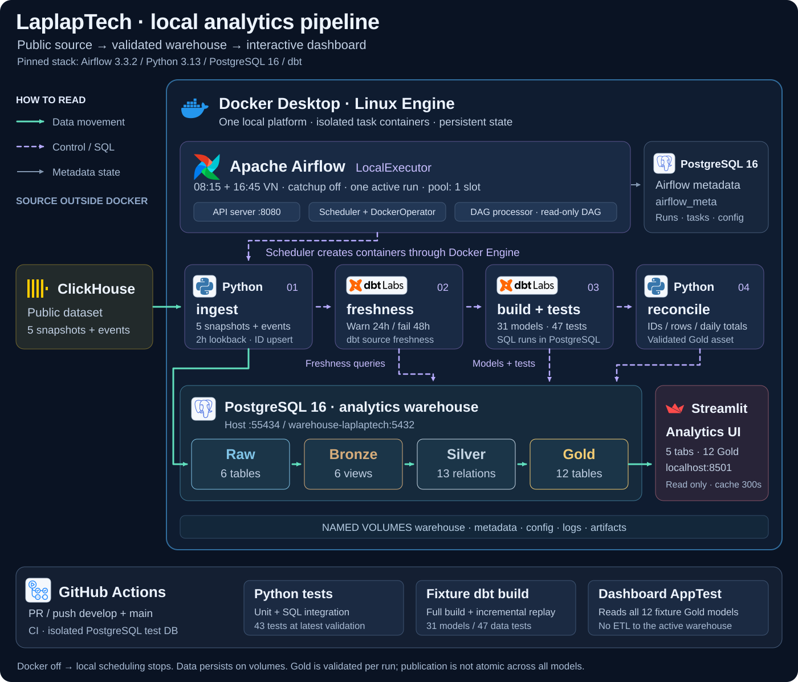
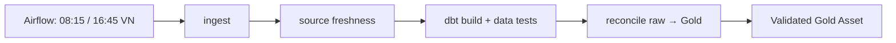

# Kiến trúc và data flow

Tài liệu này là nguồn giải thích kiến trúc, grain, metric và giới hạn của project. Lệnh thao tác nằm trong [Docker](../guides/docker.md), [Airflow](../guides/airflow.md), [dbt](../guides/dbt.md), [ingestion](../guides/ingestion.md) và [testing](../guides/testing.md). Bắt đầu từ [README chính](../../README.md).

## 1. Mục tiêu và luồng tổng thể

LaplapTech là project học Data Engineering với batch hai lần/ngày: đọc dữ liệu danh mục/benchmark và clickstream JSON từ ClickHouse public, nạp PostgreSQL, biến đổi bằng dbt rồi phục vụ Streamlit. Không có yêu cầu realtime được triển khai. Thiết kế tập trung vào transaction, replay, data quality và khả năng giải thích kết quả.

Đây là ELT: Python nạp raw, còn SQL do PostgreSQL thực thi. Airflow quyết định lịch/thứ tự/retry; dbt quyết định dependency giữa các model. Docker đóng gói môi trường thực thi và giữ dữ liệu qua named volumes. GitHub Actions chỉ chạy CI fixture, không thay scheduler local.

## 2. Các thành phần và ranh giới

| Thành phần | Nơi chạy/lưu | Trách nhiệm |
|---|---|---|
| ClickHouse public | Nguồn bên ngoài | 5 bảng snapshot và 1 bảng event |
| Airflow API/UI | Docker, host `localhost:8080` | UI, API và execution API |
| Scheduler + LocalExecutor | Docker | Lập lịch, chạy task process và yêu cầu Docker Engine tạo runtime container |
| DAG processor | Docker | Import source DAG được mount read-only từ repo |
| Python/dbt runtime | Container riêng cho mỗi stage | Ingest, freshness, build và reconcile; UID 10001, RAM theo stage 512–2048 MiB và CPU quota |
| Warehouse PostgreSQL 16 | `warehouse-laplaptech:5432`; host `127.0.0.1:55434` | DB `laplaptech_pipeline_dev`, raw/Bronze/Silver/Gold |
| Metadata PostgreSQL 16 | `metadata:5432/airflow_meta`, không publish host | DAG/run/task state, user và cấu hình Airflow |
| Streamlit | Docker, host `localhost:8501` | Đọc đủ 12 Gold model, cache query 300 giây |
| GitHub Actions | Runner và PostgreSQL test riêng | Kiểm thử code/fixture/dbt/dashboard |

Control plane và warehouse có database/volume riêng. Config task là read-only volume; artifacts và Airflow logs ở volume riêng. Dataset không truyền qua XCom. Root `.env` dành host, `.env` platform dành Airflow, config volume dành container; thay file trên host không tự cập nhật volume.

Một platform có thể chạy nhiều project với DAG ID, runtime, config, network riêng và dùng chung pool ngân sách RAM. UI/metadata dùng chung không phải tenant isolation. Người clone repo trên Docker Engine khác không thấy DAG hay volume cá nhân của chủ repo. Scheduler có Docker socket nên platform này dành cho máy local tin cậy.

## 3. Điều phối và failure path

DAG [`laplaptech_pipeline.py`](../../infra/laplaptech/dags/laplaptech_pipeline.py) dùng timezone `Asia/Ho_Chi_Minh`, `catchup=False`, một active run/task và pool RAM chung `platform_memory` bốn slot có trọng số theo task. Khi unpause lần đầu, Airflow có thể tạo lượt mới nhất đã đến hạn. Docker/laptop tắt thì lịch và dashboard dừng; catchup không thay bounded backfill.

| Stage | Điều kiện đi tiếp và xử lý lỗi |
|---|---|
| `ingest` | Commit raw thành công; lỗi chặn downstream, retry 1 lần sau 2 phút |
| `freshness` | MAX server-received timestamp của event: warn 24 giờ/error 48 giờ; error chặn build, không retry |
| `build` | Materialize model và chạy data tests theo dbt DAG; lỗi có thể skip downstream, retry 1 lần |
| `reconcile` | Đối chiếu inventory, ID/count và daily metrics; lệch làm fail run, không retry |

Raw Asset phát sau ingest success; validated Gold Asset chỉ phát sau reconcile success. Assets là metadata dữ liệu sẵn sàng, không lưu dataset và hiện không thay lịch cron. `full_refresh=true` chỉ thêm `--full-refresh` cho dbt build; scheduled run mặc định incremental Silver.

Stage container tự xóa sau chạy, nhưng task log và report/dbt artifacts theo run/task/attempt còn trên volumes. Runtime [`run_airflow_stage.py`](../../scripts/run_airflow_stage.py) kiểm tra target config và database/user identity trước mỗi stage. Nếu container chưa tạo được, chưa có runtime report; đọc Airflow log để phân biệt.

Bootstrap pause mọi DAG đang unpaused trên platform trước khi kiểm tra active runs toàn platform và giữ pause suốt cập nhật image/config. Thành công khôi phục trạng thái pause cũ; lỗi cập nhật dở dang giữ paused để xử lý. Pool chỉ kiểm soát task dùng pool, không ngăn người tự chạy writer ngoài Airflow.

## 4. Ingestion: atomicity, version và replay

### Năm bảng snapshot

`brand`, `cpu_model`, `gpu_model`, `laptop_model`, `laptop_benchmark_result` được extract toàn bảng. Mỗi bảng dùng cùng transaction/Connection cho advisory lock → kiểm tra tập tên cột → TRUNCATE nếu đã tồn tại → insert → COMMIT. Batch rỗng, schema đổi hoặc insert lỗi làm fail/rollback bảng đó; view phụ thuộc được giữ.

Atomicity chỉ bao trùm từng bảng. Bảng đã commit trước một lỗi sau đó vẫn giữ dữ liệu mới; cả ingestion và dbt không phải một transaction chung. Bronze `SELECT *` là ánh xạ nguồn, chưa phải data contract; kiểm tra tên cột chưa thay thế kiểm tra type/schema evolution đầy đủ.

### Event incremental

Watermark là `event_received_on_server_timestamp` dạng epoch giây. Lượt thường lấy `timestamp >= MAX(raw timestamp) - 7200`; chưa có bảng/watermark mới extract toàn bộ. Lỗi đọc watermark phải fail, không tự chuyển thành full extraction.

1. Kiểm tra ID/epoch và JSON object; chọn timestamp lớn nhất của mỗi ID trong batch.
2. Cùng ID/timestamp mới nhất nhưng payload khác thì fail để điều tra.
3. Trong transaction: advisory lock → tạo/nạp staging UUID → loại version cũ hơn raw → kiểm tra conflict cùng version → DELETE/INSERT theo danh sách cột → DROP staging → COMMIT.
4. Lỗi giữa transaction rollback raw và staging của bảng event. Replay cùng dữ liệu không làm tăng ID đã có; version cũ không thay version mới.

Raw giữ version được chọn, không lưu bất biến mọi version. Delete ở nguồn chưa được đồng bộ bằng CDC. Advisory lock chỉ bảo vệ writer dùng cùng quy tắc; dbt `unique_key`/generic tests không tự tạo unique constraint vật lý trong raw.

Extraction hiện giữ toàn bộ DataFrame trong RAM; chunk insert tối đa 1.000 dòng chỉ giảm kích thước câu INSERT, không phải streaming extraction. Đo RAM/time theo volume trước khi chọn phân trang/streaming hoặc tăng memory.

## 5. Warehouse và lineage

| Schema | Materialization | Vai trò |
|---|---|---|
| `raw` | 6 tables | Snapshot danh mục và event upsert |
| `public_bronze` | 6 views | Ánh xạ nguồn 1:1 |
| `public_silver` | 12 views + 1 incremental table | JSON/timestamp, catalog enrichment, session/day và comparison bridges |
| `public_gold` | 12 tables | Aggregate/join phục vụ dashboard |

Tên `gold_*` là convention project. Đổi tên model tạo relation mới, không tự rename/drop relation `mart_*` cũ. Gold rebuild theo model mỗi lần build; chưa phải incremental Gold. Sửa taxonomy cho dữ liệu lịch sử có thể cần full-refresh Silver vì incremental không đọc lại mọi row ngoài lookback.

Silver event lọc event_name/session_id NULL, dedup ID và có watermark/lookback 2 giờ riêng từ MAX **Silver**, không phải MAX raw. `silver_session_day` là nguồn chung của daily KPI và funnel; comparison event-device bridge dùng chung cho attribution brand/product. `silver_comparison_sort_event` và `silver_device_traffic_event` chưa có Gold downstream trực tiếp.

Nguồn có `DeviceComparisonHome`/`DeviceComparison`; Silver giữ `source_page_name` và chuẩn hóa trang comparison. Selection/add/chart-sort events được nhận diện; `device_ids` được mở rộng, khử ID lặp trong event và bỏ ID vượt phạm vi integer. OS đọc `os`, fallback `os_name`; thuộc tính session chọn first non-empty theo server timestamp/ID, thiếu thì `Unknown`.

| Gold model | Grain và phạm vi phân tích |
|---|---|
| `gold_daily_site_kpis` | Ngày Việt Nam; events, pageviews, active sessions, co-reach numerators và latest event |
| `gold_behavior_funnel_daily` | Cùng session-day với KPI; đếm reach từng bước độc lập |
| `gold_brand_interest` | Brand trong catalog; detail views, distinct sessions và comparison co-reach |
| `gold_brand_comparison` | Cặp brand ID không có hướng; comparison co-occurrence trong session-day |
| `gold_cpu_trend` / `gold_gpu_trend` | Tháng Việt Nam, component, brand; detail views, giữ cả nhóm ít view |
| `gold_search_analytics` | Keyword lower/trim; search count và distinct sessions |
| `gold_spec_popularity` | CPU/GPU/screen/battery; detail views, chưa có RAM/storage |
| `gold_performance_ranking` | Laptop active và benchmark đại diện, một dòng/laptop |
| `gold_performance_efficiency` | Laptop active/visible có benchmark; hiệu năng trên kg/Wh |
| `gold_battery_vs_interest` | Laptop active; pin/benchmark, detail views và comparison interactions |
| `gold_user_os` | OS/device type theo session, gồm `Unknown` |

Benchmark đại diện là ID lớn nhất mỗi laptop vì chưa dùng được timestamp/version đáng tin cậy để chọn. Đây không phải khẳng định “benchmark mới nhất theo thời gian”. Raw/Bronze giữ mọi benchmark; Silver chọn một bản để tránh fanout. Danh mục hiện tại vẫn được join vào event lịch sử; chưa có SCD/snapshot lịch sử danh mục.

## 6. Contract thời gian, metric và serving

- `event_timestamp` là thời điểm client ghi nhận; `server_timestamp` là thời điểm server nhận. Ngày/tháng nghiệp vụ dùng `Asia/Ho_Chi_Minh` qua [`business_time.sql`](../../dbt/macros/business_time.sql); timestamp gốc vẫn giữ timezone.
- Daily sessions là distinct session trong từng ngày. Session qua nửa đêm có thể thuộc hai ngày; SUM daily sessions là **session-days**, không phải unique sessions toàn kỳ.
- `detail_rate_pct` = session có cả pageview và detail / session có pageview; `comparison_rate_pct` = session có cả detail và comparison / session có detail, trong cùng ngày. Cộng tử/mẫu rồi chia, không lấy trung bình phần trăm theo ngày.
- Funnel/reach không yêu cầu thứ tự hành vi nên chưa phải sequential conversion. Daily KPI, all-time brand và OS có grain khác nhau; không ép tổng sessions bằng nhau.
- Brand pairs đo đồng xuất hiện trong comparison interactions của session-day, không chứng minh cùng một action so sánh đồng thời. Search volume chưa chứng minh zero-result hoặc product gap.

Streamlit có 5 tab sử dụng đủ 12 Gold model, khớp exposure. Data access có allowlist, đọc Gold và cache 300 giây. Today dùng ngày Việt Nam thật; query lỗi hiển thị error thay vì KPI 0; benchmark thiếu là N/A/NULL; literal search không coi punctuation là regex. Latest received event không phải thời điểm job hoàn tất.

Gold chưa có publish/swap đồng loạt. Nếu một model/test fail sau khi vài Gold table đã build, dashboard có thể đọc các phiên bản khác nhau. Reconcile thành công và validated Asset không thay thế transaction publish toàn bộ warehouse.

## 7. Backfill và kiểm chứng

CLI ingestion có `--start`/`--end`, khoảng `[start,end)` theo server timestamp. Dimension vẫn là snapshot hiện tại. Event được thêm/sửa muộn nhưng mang timestamp quá cũ có thể ngoài lookback raw hoặc Silver; cần backfill/rebuild và đối soát. `dbt --full-refresh` chỉ đọc raw hiện có, không tự truy vấn lại ClickHouse. DAG hiện chưa truyền bounded interval cho historical replay. Lệnh xem [ingestion](../guides/ingestion.md) và [dbt](../guides/dbt.md).

CI compile Python, chạy unit/guard/PostgreSQL integration, dbt parse bằng cấu hình giả, fixture full build/replay rồi AppTest trên Gold fixture. Không cần credential nguồn thật. Fixture/reset chỉ được dùng `laplaptech_pipeline_test`; ad-hoc runner luôn chặn warehouse active và URL query override đích. Kiểm tra type/resource bằng parse không chứng minh dữ liệu đúng; freshness mới cũng không chứng minh mọi ID/version đầy đủ.

Ngày **20/10/2026**, [system report](../validation/system_check_2026-10-20.json) ghi 784.914 event, raw/Silver/Gold daily totals khớp, 31 model và 47 data tests đạt trong run Airflow mới. [Regression report](../validation/regression_check_2026-10-20.json) ghi fixture full/replay và **43/43 Python tests pass**. Đây là snapshot theo thời điểm report, không phải số row/test cố định cho mọi lượt chạy.

Runtime dùng 85 package pin trong [`requirements.lock.txt`](../../requirements.lock.txt); `.in` ghi intent, `.txt` trỏ lock. Script lock chỉ ghi closure từ môi trường đã resolve/test, không tự resolve version mới; lock chưa có artifact hashes. Base image tags chưa pin digest. Các report lịch sử giữ nguyên ngày/phạm vi tại [testing guide](../guides/testing.md#8-báo-cáo-kiểm-chứng-theo-ngày); không suy ra đã diễn tập restore từ archive đọc được.

## 8. Hướng nghiên cứu còn lại

| Ưu tiên theo nhu cầu | Kết quả cần chứng minh |
|---|---|
| Backup/restore | Restore warehouse và metadata vào volume/DB riêng, đối chiếu counts và run history |
| Schema/constraints/quarantine | DB rỗng và batch rỗng có contract rõ; duplicate/NULL/type/JSON drift bị xử lý hoặc cách ly có lý do |
| Bounded backfill + audit | Khoảng `[start,end)` đi đến ingestion/Silver; replay sửa được event ngoài lookback; ghi rows/watermark và phân biệt no-new-data với job chưa chạy |
| Consistent Gold publication | Build lỗi không làm dashboard đọc hỗn hợp snapshot |
| Scale extraction hoặc SCD/CDC | Chọn khi đo được bottleneck RAM hoặc cần lịch sử danh mục/update/delete; không chỉ tăng lookback |
| Release và vận hành dài hạn | Pin digest, clean-machine smoke, retention logs/artifacts, CI Docker/DAG import; nếu cần lịch liên tục thì dùng host thường trực |

Đây là backlog nghiên cứu, không phải khả năng đã có chỉ vì Docker services hoặc DAG đang xanh. Luồng local không phụ thuộc Neon; việc xóa project cloud là thao tác riêng và không được xác nhận bởi report local.
