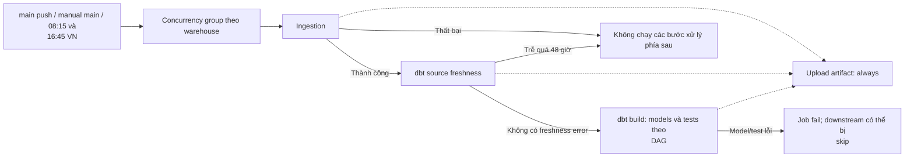
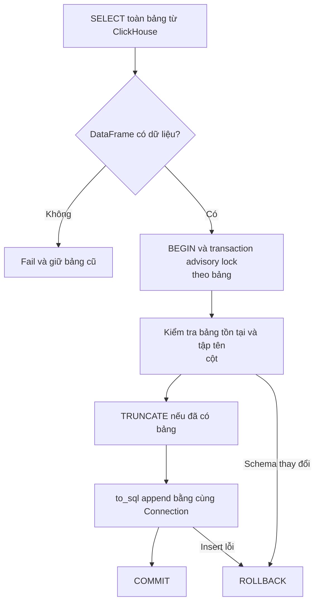
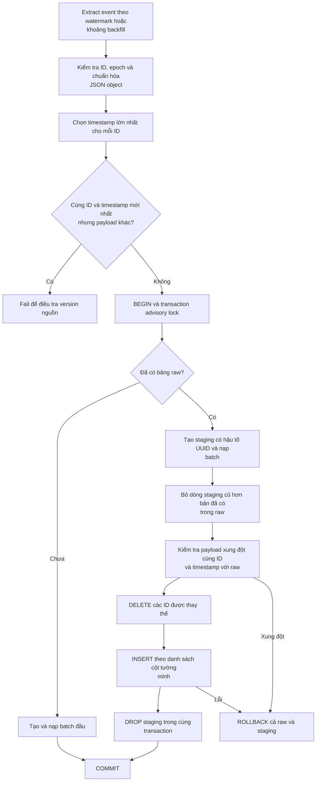
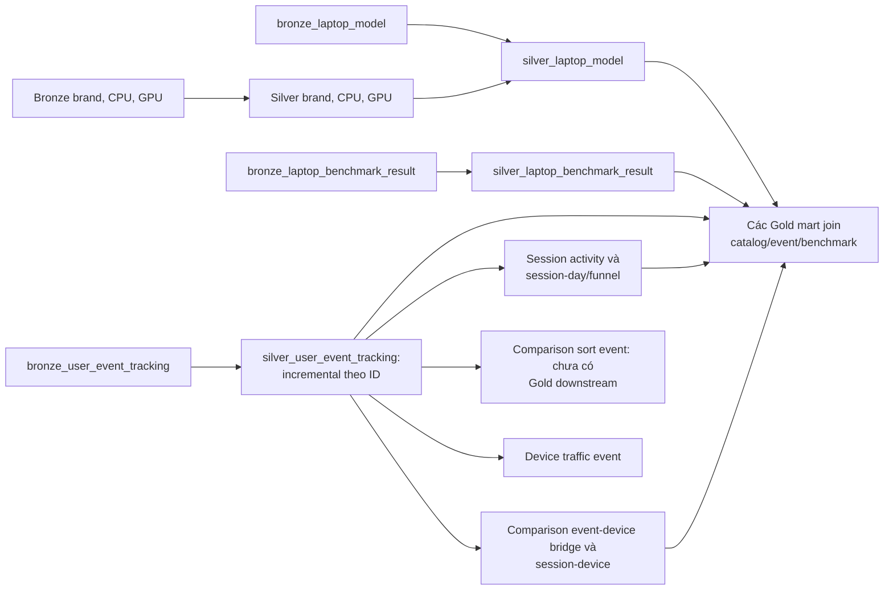
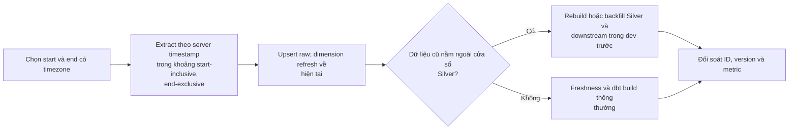
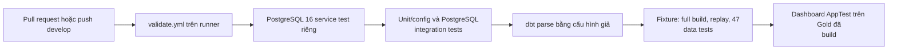
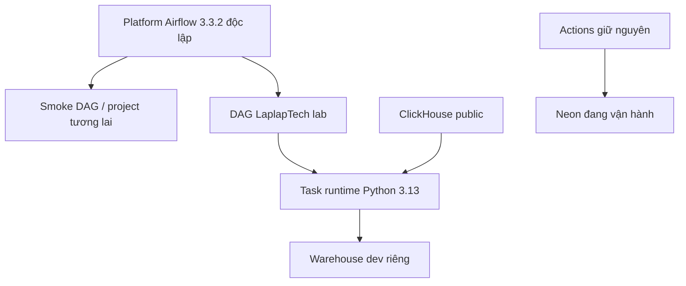
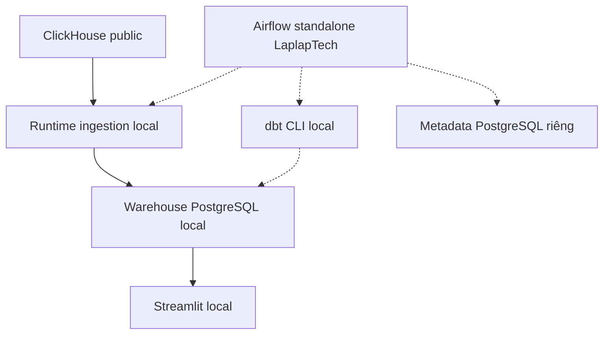

# Data flow hiện tại của LaplapTech

Cập nhật ngày 19/10/2026, đối chiếu source trong repository. Chủ project xác nhận warehouse đang chạy trên Neon. Báo cáo end-to-end đã lưu được thu bằng nguồn ClickHouse thật trên PostgreSQL dev local. Xem [Gold upgrade](../guides/gold_upgrade.md) và [report](../validation/dev_run_2026-10-19.json). Airflow có [kế hoạch tích hợp dùng chung](../guides/airflow_setup.md) cho lab dev riêng; Neon và sync Actions giữ nguyên. [Docker full cho cộng đồng](../guides/docker_distribution_plan.md) là chặng cuối, chưa triển khai.

## 1. Các thành phần chạy ở đâu?

| Thành phần | Nơi chạy/lưu | Trách nhiệm |
|---|---|---|
| ClickHouse | Nguồn bên ngoài | 5 bảng danh mục/benchmark và 1 bảng event |
| Python ingestion | GitHub Actions runner hoặc máy local | Extract vào DataFrame, nạp PostgreSQL raw |
| dbt CLI | Cùng runner/máy local | Lập DAG, gửi SQL và chạy data tests |
| SQL transformation | PostgreSQL Neon | Thực thi view, incremental và tạo Gold tables |
| Warehouse | Neon | `raw`, `public_bronze`, `public_silver`, `public_gold` |
| Streamlit | Nơi người dùng khởi chạy app | Truy vấn Gold, cache kết quả 300 giây |
| PostgreSQL test | Docker local hoặc CI service | Dữ liệu fixture và schema tạm để chạy integration tests |

Workflow hiện tại không deploy hoặc restart Streamlit. Neon lưu dữ liệu; GitHub Actions cung cấp nơi chạy job. Hai vai trò này độc lập.

## 2. Luồng dữ liệu tổng thể

Mũi tên liền là dữ liệu/quan hệ phụ thuộc; mũi tên đứt là điều khiển hoặc metadata.

`dbt exposure` khai báo dependency vào cả 12 Gold model cho app; đây là metadata, không di chuyển dữ liệu. Sơ đồ tổng quan dùng chung [SVG](../../assets/data-flow.svg) với README.

Bronze là pass-through view, chưa phải data contract được enforce. Raw giữ snapshot danh mục và phiên bản event được chọn theo ID; raw không lưu bất biến mọi phiên bản nguồn.

## 3. Control flow của job cập nhật

- Lịch cấu hình UTC: `15 1 * * *` và `45 9 * * *`, tương ứng 08:15 và 16:45 Việt Nam. Đây là lịch cấu hình, không phải cam kết job luôn bắt đầu đúng phút.
- `concurrency.group` cố định và `cancel-in-progress: false` tránh hai run trong cùng group chạy đồng thời. Không coi cơ chế này là hàng đợi giữ mọi trigger.
- Freshness dùng MAX server timestamp của event: warn sau 24 giờ, error sau 48 giờ. Warn không chặn build theo cấu hình hiện tại.
- `dbt build` đã chạy data tests; không chạy `dbt test` toàn bộ lần nữa ngay sau đó.
- Upload giữ `manifest.json`, `run_results.json`, `sources.json` nếu đã sinh, retention 14 ngày. Ingestion lỗi sớm có thể chưa có artifact dbt.
- Chưa có automatic retry cho toàn job, bảng audit theo run hoặc notification riêng ngoài cấu hình thông báo GitHub của người dùng.

## 4. Ingestion: transaction và phiên bản dữ liệu

### 4.1 Full refresh cho 5 bảng

Áp dụng cho `brand`, `cpu_model`, `gpu_model`, `laptop_model`, `laptop_benchmark_result`.

TRUNCATE giữ định nghĩa view. Atomicity đến từ việc TRUNCATE và insert dùng cùng transaction; chỉ TRUNCATE rồi append ở hai transaction khác nhau không bảo đảm rollback dữ liệu.

`to_sql` dùng chunk tối đa 1.000 dòng và giới hạn theo số cột. Extraction vẫn giữ toàn bộ kết quả trong RAM; chunk insert không đồng nghĩa streaming extraction.

### 4.2 Event incremental

Watermark: `event_received_on_server_timestamp`, dạng epoch giây. Lượt thông thường lấy `timestamp >= MAX(raw timestamp) - INGESTION_LOOKBACK_SECONDS`, mặc định 7.200 giây. Chưa có bảng hoặc chưa có watermark thì extract toàn bảng. Lỗi đọc watermark phải fail, không biến thành full extraction.

Xung đột cùng timestamp bị fail thay vì chọn bản ngẫu nhiên. Muốn hỗ trợ sửa payload có cùng server timestamp cần version/updated_at và quy tắc chọn bản rõ ràng.

Transaction lock bảo vệ các writer sử dụng cùng khóa trong code. Chưa có migration tự động thêm unique index vào raw; generic tests phát hiện duplicate không thay thế constraint vật lý. Từng bảng commit riêng; cả ingestion + dbt không phải một transaction toàn cục.

## 5. dbt lineage và grain

### 5.1 Các nhánh Silver

Silver event parse JSON, đổi epoch sang timestamp có timezone, lọc event_name/session_id NULL và dedup theo ID. Incremental đọc lại cửa sổ 2 giờ từ MAX timestamp của **Silver**. Đây là watermark riêng, không phải MAX raw. `unique_key='id'` của dbt không tự tạo unique constraint.

`silver_comparison_sort_event` và `silver_device_traffic_event` hiện không có Gold downstream. `gold_daily_site_kpis` và funnel cùng lấy từ `silver_session_day`. Bridge `silver_comparison_event_device` mở rộng device_ids và chuẩn hóa attribution cho brand/product.

### 5.2 12 Gold mart

| Model | Upstream Silver | Grain và ý nghĩa hiện tại |
|---|---|---|
| `gold_daily_site_kpis` | session_day | Một ngày Việt Nam, đo active session-days và event thực tế |
| `gold_behavior_funnel_daily` | session_funnel | Ngày Việt Nam của session-day; đếm các bước đã xuất hiện, không yêu cầu thứ tự |
| `gold_brand_interest` | user_event_tracking, laptop_model, comparison_event_device, brand | Một brand trong catalog; detail views, distinct sessions và comparison interaction co-reach |
| `gold_brand_comparison` | comparison_session_device, laptop_model, brand | Cặp brand ID đã canonicalize; đồng xuất hiện trong comparison interactions của session-day |
| `gold_cpu_trend` | user_event_tracking, laptop_model | Tháng, CPU, brand; chỉ detail pageview, giữ cả nhóm ít view |
| `gold_gpu_trend` | user_event_tracking, laptop_model | Tháng, GPU, brand; chỉ detail pageview, giữ cả nhóm ít view |
| `gold_search_analytics` | user_event_tracking | Keyword đã lower/trim, tổng search và distinct sessions |
| `gold_spec_popularity` | user_event_tracking, laptop_model | CPU, GPU, kích thước màn hình, dung lượng pin; chưa có RAM/storage |
| `gold_performance_ranking` | laptop_model, laptop_benchmark_result | Laptop active join benchmark; chọn benchmark ID lớn nhất, một dòng/laptop |
| `gold_performance_efficiency` | laptop_model, laptop_benchmark_result | Laptop active/visible join benchmark có điểm CPU; hiệu năng trên kg/Wh |
| `gold_battery_vs_interest` | user_event_tracking, comparison_event_device, laptop_model, laptop_benchmark_result | Laptop active join benchmark đại diện, detail views và comparison interactions |
| `gold_user_os` | session_activity | OS và device type, đếm session |

Gold materialize thành table, rebuild theo DAG mỗi lần build; chưa phải incremental Gold. Silver chọn một benchmark ID lớn nhất mỗi laptop để tránh fanout; raw/Bronze giữ toàn bộ benchmark. Brand rate dùng giao của detail/comparison session, cặp brand được chuẩn hóa không có hướng.

### 5.3 Quy ước thời gian và metric

- `event_timestamp`: thời điểm client ghi nhận; `server_timestamp`: thời điểm server nhận.
- Daily KPI mới nhóm `server_timestamp AT TIME ZONE 'Asia/Ho_Chi_Minh'` theo ngày.
- `total_sessions` là distinct session **trong từng ngày**; SUM nhiều ngày là session-days.
- `detail_rate_pct`: session có cả pageview và detail / session có pageview trong ngày.
- `comparison_rate_pct`: session có cả detail và comparison / session có detail trong ngày.
- Hai tỷ lệ đo cùng đạt bước, không chứng minh thứ tự chuyển đổi.
- Session funnel dùng cùng session-day với KPI; ngày/tháng trên các nhánh event dùng business_date/business_month theo giờ Việt Nam. Session activity giữ timestamp bắt đầu và thêm ngày bắt đầu riêng.

## 6. Serving và exposure

App truy vấn đủ 12 Gold model qua data access layer có allowlist; query chỉ đọc schema Gold.

App mới và exposure dùng đủ 12 Gold model, gồm cả behavior funnel, brand comparison, spec popularity và OS. Cache query 300 giây có thể giữ kết quả trước lượt build vừa xong. Chưa có publish/swap đồng loạt toàn bộ Gold, nên khi build lỗi giữa chừng app có thể thấy các mart từ những run khác nhau.

Dashboard đã sửa Today theo ngày thật, dùng nhãn session-days khi cộng nhiều ngày, giữ N/A và search literal. Latest received event không được trình bày như thời điểm job hoàn tất.

## 7. Backfill và phục hồi

CLI `--start`/`--end` đã có trong ingestion. Full-refresh dbt chỉ đọc raw đang có, không truy vấn lại ClickHouse. Lookback hữu hạn có thể bỏ sót bản xuất hiện ở nguồn với timestamp quá cũ; hai cửa sổ 2 giờ không phải bảo đảm không mất dữ liệu.

Lệnh chạy, lưu ý Neon và database test: [ingestion operations](../guides/ingestion_operations.md).

## 8. CI và bằng chứng kiểm thử

Validate còn compile Python trước khi chạy tests. Không cần credential Neon/ClickHouse. Mỗi integration test tạo schema UUID và dọn đúng schema đó trong database local test.

Kết quả đã ghi nhận ngày 19/10/2026: 28/28 Python test pass; 31 model build thành công và 47 data test pass trên fixture lẫn nguồn thật 784.455 event trong dev local. Có 6 source và 1 exposure; 47 tests gồm 41 generic và 6 singular. Freshness là lệnh riêng; exposure không tính là test. Báo cáo này ghi nhận lần kiểm chứng dev; chủ project xác nhận hiện đã chạy trên Neon. Bộ 85 dependency khóa đã cài sạch trên Windows và Linux.

## 9. Luồng roadmap — cập nhật 20/10/2026

### B — Airflow Docker chung cho lab cá nhân, làm trước

Đã có bộ cấu hình Compose, env generator và DAG kiểm tra nền tảng cho platform Airflow 3.3.2/LocalExecutor độc lập; chủ project gửi kết quả init/service health/smoke DAG success ngày 20/10/2026. Các kết nối pipeline trong sơ đồ này chưa triển khai; có [bài thực hành kèm code mẫu](../guides/airflow_laplaptech_walkthrough.md) cho bước tích hợp. Stack NASDAQ100 cũ đã gỡ. Lab dừng khi Docker tắt; cloud tiếp tục chạy theo Actions. Không có bước tắt workflow sync hoặc chuyển lịch chính trong roadmap hiện tại.

Nối data interval vào bounded ingestion và xử lý Silver ngoài lookback là công việc sau manual/replay, không chỉ bật catchup. Chi tiết: [Triển khai Airflow](../guides/airflow_setup.md).

### C — Engineering sau Airflow

Bootstrap schema, raw constraints/index, chính sách JSON lỗi/quarantine, run/stage audit, backfill/recovery và lưu artifacts có tiêu chí nghiệm thu riêng trong [backlog](remaining_work.md). Các thay đổi được test trên lab trước; không suy diễn việc có DAG xanh là mọi invariant đã được enforce.

### D — Docker full cho cộng đồng, làm cuối

Đây là bản standalone cho người clone: không mount DAG project khác, không dùng database/credential Neon của chủ repo. Mỗi người có volumes, cấu hình và kết quả riêng; nguồn thật dùng chung ClickHouse public. Bộ Compose full và quickstart được làm sau các nâng cấp engineering cốt lõi. Nó bổ sung cách chạy dự án, không thay cách host hoặc lịch Actions hiện tại. [Docker distribution plan](../guides/docker_distribution_plan.md).

Sơ đồ SVG ở phần tổng quan vẫn mô tả luồng cloud đang chạy; các kết nối pipeline trong sơ đồ mục này là kế hoạch. Xem [upgrade plan](upgrade_plan.md) để theo dõi B → C → D và trạng thái triển khai.
