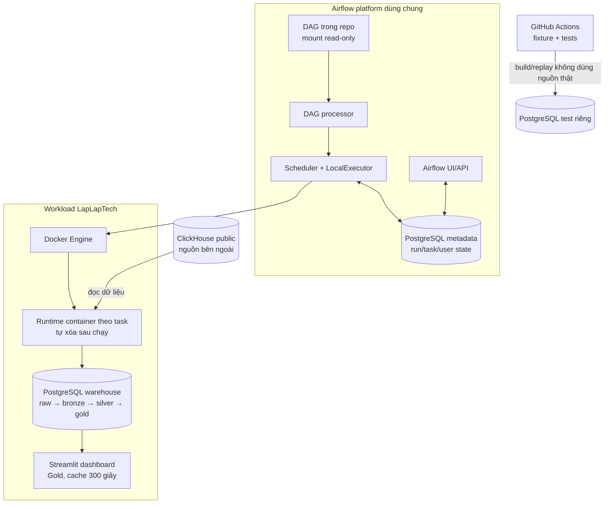
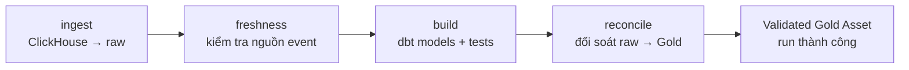
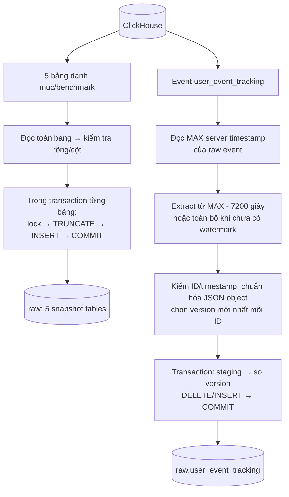
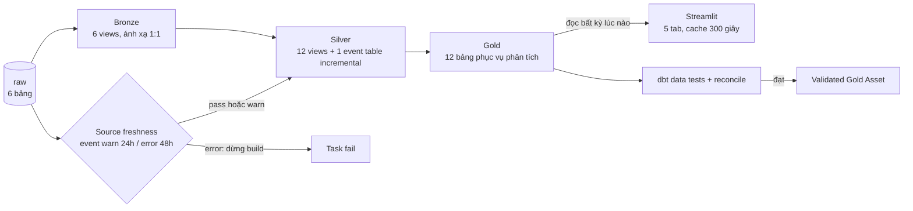

# Data flow và kiến trúc LapLapTech

Đọc trang này theo thứ tự: **toàn hệ thống → ingestion → dbt → lỗi và giới hạn**. Đây là mô tả code hiện tại, không phải kiến trúc dự kiến. Cách Airflow/PostgreSQL phục vụ nhiều project nằm ở [kiến trúc platform dùng chung](shared_platform.md). Lệnh chạy ở [Docker](../guides/docker.md); lệnh điều tra ở [ingestion](../guides/ingestion.md) và [dbt](../guides/dbt.md).

## 1. Toàn hệ thống: ai làm việc gì?

Airflow điều phối bốn task `ingest → freshness → build → reconcile`. Mỗi task chạy trong **runtime container riêng**, tự xóa khi xong; Airflow UI, scheduler và metadata PostgreSQL là hạ tầng điều phối dùng chung. Warehouse PostgreSQL giữ dữ liệu phân tích trong volume riêng; metadata Airflow không nằm trong warehouse. DAG được mount read-only từ repo, scheduler yêu cầu Docker Engine tạo task container; config của task là volume read-only, logs/artifacts là volume riêng. Runtime và dashboard gặp warehouse qua Docker network `laplaptech-lab`. GitHub Actions chạy kiểm thử với fixture, **không cập nhật warehouse local** và không thay lịch Airflow khi Docker tắt.

DAG dùng `Asia/Ho_Chi_Minh`, `catchup=False`, tối đa một active run và một active task của project. Airflow pool `platform_memory` giới hạn tổng task trên platform; Docker áp trần RAM/CPU từng container. Một task lỗi chặn task sau. Retry task **không hoàn tác** các bảng đã commit trong lượt trước.

## 2. Ingestion: dữ liệu vào `raw` như thế nào?

Source code: [`clickhouse_to_postgres.py`](../../ingestion/clickhouse_to_postgres.py). Có hai cách nạp khác nhau:

**Snapshot:** `brand`, `cpu_model`, `gpu_model`, `laptop_model`, `laptop_benchmark_result` được nạp lại toàn bộ mỗi lượt. Mỗi bảng có một transaction và advisory lock. Batch rỗng hoặc tập tên cột thay đổi thì fail, giữ bản cũ của **bảng đó**. Nếu bảng 1 đã commit rồi bảng 2 lỗi, bảng 1 không tự rollback: pipeline không có transaction chung cho cả sáu bảng.

**Event incremental:** watermark là `event_received_on_server_timestamp` (epoch giây server nhận event), lấy `MAX` từ **raw hiện có**. Ví dụ MAX = 12:00 thì lượt thường đọc ClickHouse từ **10:00 trở đi** vì lookback 7200 giây; điều kiện là `>=`, nên bản đã thấy có thể được đọc lại. Chưa có bảng/watermark thì đọc toàn bộ. Nếu đọc MAX lỗi, task fail; không âm thầm chuyển sang full load.

Với từng ID trong batch, loader giữ timestamp lớn nhất. Cùng ID/timestamp nhưng payload khác nhau thì fail để điều tra. Trong transaction, bản mới hơn thay bản raw cũ; bản cũ hơn không ghi đè; bản bằng timestamp và cùng payload được nạp lại mà không làm tăng số ID. Advisory lock giảm nguy cơ hai writer cùng sửa một bảng. Raw giữ **version được chọn**, không lưu lịch sử mọi version và không phản ánh source delete kiểu CDC.

**Giới hạn lookback:** một event mới xuất hiện ở nguồn nhưng mang server timestamp cũ hơn `MAX(raw) - 2 giờ` sẽ bị lượt thường bỏ qua. Chạy [backfill theo khoảng thời gian](../guides/ingestion.md#4-backfill-event-theo-khoảng-thời-gian) `[start,end)` để lấy lại khoảng đó, rồi full-refresh nhánh Silver event nếu nó cũng nằm ngoài cửa sổ Silver. `dbt --full-refresh` chỉ xử lý **raw đã có**, không tự hỏi lại ClickHouse. Extract hiện giữ cả DataFrame trong RAM; insert chia batch tối đa 1.000 dòng không biến extract thành streaming.

## 3. dbt: từ raw tới dashboard

`dbt source freshness` dùng MAX server timestamp của `raw.user_event_tracking`: quá 24 giờ là cảnh báo, quá 48 giờ là lỗi và chặn build. Freshness chỉ nói mốc mới nhất còn gần hiện tại; nó không chứng minh đủ mọi ID/version. `dbt build` theo dependency của model, vừa materialize vừa chạy data tests; không cần thêm `dbt run` và `dbt test` sau một full build đã pass.

**Bronze** là view gần nguồn, chưa phải hợp đồng type/schema đầy đủ. **Silver** parse JSON, ép kiểu/timestamp, chuẩn hóa trang comparison, join catalog và tạo các grain session/day. `silver_user_event_tracking` là incremental table, `unique_key=id`: nó đọc từ `MAX(server_timestamp của Silver) - 2 giờ` rồi dedup ID. Đây là **watermark thứ hai, độc lập với raw**. Nếu sửa logic parse dữ liệu cũ, cần full-refresh model Silver và downstream từ raw. Những event thiếu `event_name` hoặc `session_id` bị lọc ở Silver, vì vậy raw và Silver có thể khác số dòng mà vẫn đúng.

**Gold** gồm 12 bảng tổng hợp cho KPI, funnel, brand, linh kiện, benchmark, pin, tìm kiếm và hệ điều hành. Các bảng được build theo model, chưa có cơ chế publish/swap toàn bộ Gold trong một transaction. `reconcile` sau build kiểm inventory 6 raw/6 Bronze/13 Silver/12 Gold, duplicate raw ID, raw ↔ Bronze, số event Silver ↔ Gold daily và tổng ngày/session theo giờ Việt Nam. Asset “validated Gold” chỉ phát khi bước này thành công; nó không khiến một Gold build dở trở thành atomic. Dashboard có thể query Gold **trong lúc build đang chạy** vì hiện chưa khóa việc phục vụ đến sau reconcile; vì vậy cần theo dõi trạng thái DAG trước khi tin vào kết quả mới.

| Ví dụ kết quả | Grain đúng | Cần nhớ |
|---|---|---|
| `gold_daily_site_kpis` | Một ngày Việt Nam | SUM sessions qua nhiều ngày là **session-days**, không phải unique users/sessions toàn kỳ |
| `gold_behavior_funnel_daily` | Ngày + reach theo session | Các bước không bắt buộc xảy ra đúng thứ tự, chưa phải conversion tuần tự |
| `gold_brand_comparison` | Cặp brand trong session-day | Đồng xuất hiện không chứng minh hai brand cùng một hành động so sánh |
| `gold_performance_ranking` | Một dòng/laptop | Benchmark chọn ID lớn nhất, chưa chứng minh là bản mới nhất theo thời gian |

Ngày/tháng nghiệp vụ dùng `Asia/Ho_Chi_Minh` từ [`business_time.sql`](../../dbt/macros/business_time.sql). `event_timestamp` là thời gian client ghi nhận; `server_timestamp` là thời gian server nhận và là cơ sở watermark/freshness. Dashboard chỉ đọc Gold, không đọc ClickHouse/raw và không có credential nguồn.

## 4. Khi lỗi thì dữ liệu ở trạng thái nào?

```mermaid
flowchart TD
    I{ingest thành công?} -->|không| I0[Kiểm log và bảng raw đã commit trước lỗi]
    I -->|có| F{freshness đạt?}
    F -->|error > 48h| F0[Kiểm timestamp nguồn và raw; dừng build]
    F -->|có| B{dbt build + tests đạt?}
    B -->|không| B0[Đọc run_results; Gold có thể khác phiên bản]
    B -->|có| R{reconcile đạt?}
    R -->|không| R0[Đối chiếu raw, Silver, Gold theo ngày]
    R -->|có| OK[Run success; dashboard đọc Gold]
```

| Tình huống | Xử lý trước |
|---|---|
| Event đến quá muộn, ngoài lookback | Backfill raw đúng khoảng; full-refresh Silver/downstream nếu cần; chạy đối soát |
| Source thêm/xóa/đổi kiểu cột | Kiểm schema contract trước khi cho snapshot ghi; hiện mới chặn đổi **tập tên cột** |
| dbt lỗi giữa build | Xem model/test đầu tiên lỗi; dashboard có thể thấy Gold khác phiên bản, chưa có publish atomic |
| Lặp ID, sai tổng ngày | Xem `reconcile` và dbt tests; không chỉ clear task cho xanh |
| RAM ingest cao | Đo `docker stats` và kích thước nguồn; nghiên cứu phân trang/streaming, không chỉ tăng trần RAM |
| Cần chạy khi laptop tắt | Cần host thường trực; GitHub Actions hiện chỉ làm CI |

Bản cải tiến có thứ tự và điều kiện nghiệm thu nằm ở [roadmap](../plans/roadmap.md). Kế hoạch hiển thị từng dbt model trong Airflow nằm riêng ở [Cosmos](../plans/cosmos.md); **chưa được triển khai**.

## 5. Đi đâu tiếp?

- Chỉ muốn chạy: [Docker](../guides/docker.md) → [Airflow](../guides/airflow.md).
- Muốn sửa dữ liệu: [ingestion](../guides/ingestion.md) → [dbt](../guides/dbt.md).
- Muốn kiểm chứng không dùng nguồn thật: [testing](../guides/testing.md).
- Muốn thêm project vào platform: [resource policy](../guides/resources.md).
