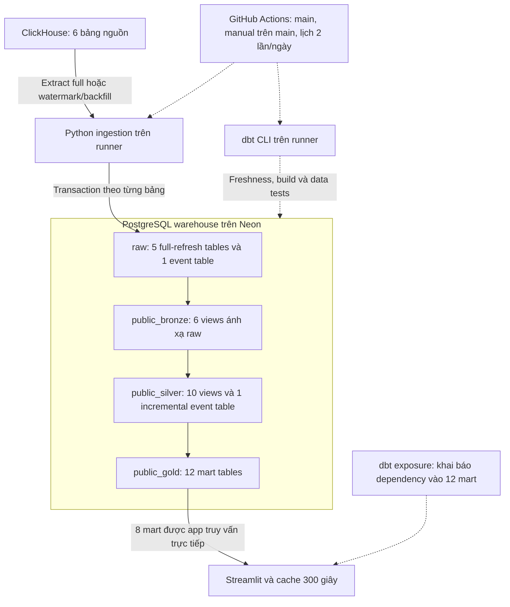
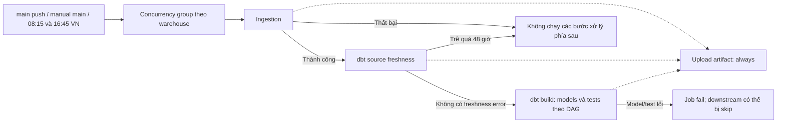
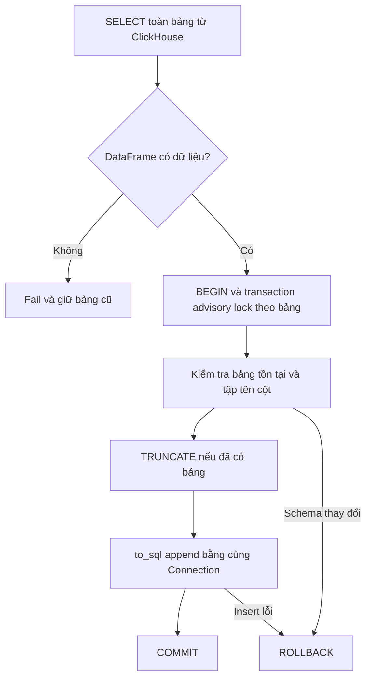
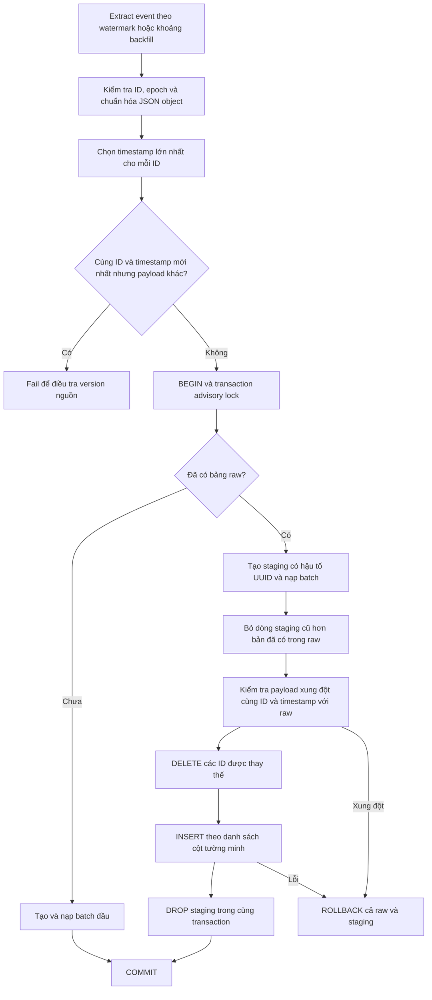
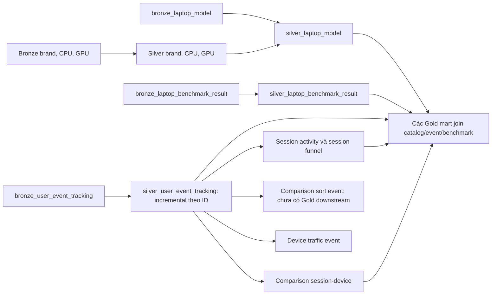
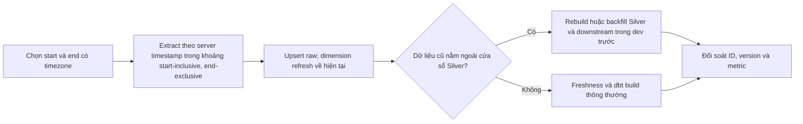
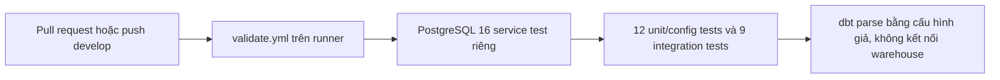
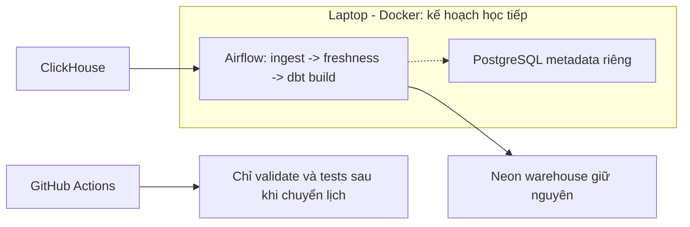

# Data flow hiện tại của LaplapTech

Cập nhật ngày 19/10/2026, đối chiếu source trong repository. Đây là kiến trúc đã có code; chưa xác nhận các thay đổi mới đã chạy end-to-end trên Neon. Airflow nằm ở phần kế hoạch, chưa thay GitHub Actions.

## 1. Các thành phần chạy ở đâu?

| Thành phần | Nơi chạy/lưu | Trách nhiệm |
|---|---|---|
| ClickHouse | Nguồn bên ngoài | 5 bảng danh mục/benchmark và 1 bảng event |
| Python ingestion | GitHub Actions runner hoặc máy local | Extract vào DataFrame, nạp PostgreSQL raw |
| dbt CLI | Cùng runner/máy local | Lập DAG, gửi SQL và chạy data tests |
| SQL transformation | PostgreSQL Neon | Thực thi view, incremental và tạo Gold tables |
| Warehouse | Neon | `raw`, `public_bronze`, `public_silver`, `public_gold` |
| Streamlit | Nơi người dùng khởi chạy app | Truy vấn Gold, cache kết quả 300 giây |
| PostgreSQL test | Docker local hoặc CI service | Dữ liệu fixture và schema tạm để chạy integration tests |

Workflow hiện tại không deploy hoặc restart Streamlit. Neon lưu dữ liệu; GitHub Actions cung cấp nơi chạy job. Hai vai trò này độc lập.

## 2. Luồng dữ liệu tổng thể

Mũi tên liền là dữ liệu/quan hệ phụ thuộc; mũi tên đứt là điều khiển hoặc metadata.

Bronze là pass-through view, chưa phải data contract được enforce. Raw giữ snapshot danh mục và phiên bản event được chọn theo ID; raw không lưu bất biến mọi phiên bản nguồn.

## 3. Control flow của job cập nhật

- Lịch cấu hình UTC: `15 1 * * *` và `45 9 * * *`, tương ứng 08:15 và 16:45 Việt Nam. Đây là lịch cấu hình, không phải cam kết job luôn bắt đầu đúng phút.
- `concurrency.group` cố định và `cancel-in-progress: false` tránh hai run trong cùng group chạy đồng thời. Không coi cơ chế này là hàng đợi giữ mọi trigger.
- Freshness dùng MAX server timestamp của event: warn sau 24 giờ, error sau 48 giờ. Warn không chặn build theo cấu hình hiện tại.
- `dbt build` đã chạy data tests; không chạy `dbt test` toàn bộ lần nữa ngay sau đó.
- Upload giữ `manifest.json`, `run_results.json`, `sources.json` nếu đã sinh, retention 14 ngày. Ingestion lỗi sớm có thể chưa có artifact dbt.
- Chưa có automatic retry cho toàn job, bảng audit theo run hoặc notification riêng ngoài cấu hình thông báo GitHub của người dùng.

## 4. Ingestion: transaction và phiên bản dữ liệu

### 4.1 Full refresh cho 5 bảng

Áp dụng cho `brand`, `cpu_model`, `gpu_model`, `laptop_model`, `laptop_benchmark_result`.

TRUNCATE giữ định nghĩa view. Atomicity đến từ việc TRUNCATE và insert dùng cùng transaction; chỉ TRUNCATE rồi append ở hai transaction khác nhau không bảo đảm rollback dữ liệu.

`to_sql` dùng chunk tối đa 1.000 dòng và giới hạn theo số cột. Extraction vẫn giữ toàn bộ kết quả trong RAM; chunk insert không đồng nghĩa streaming extraction.

### 4.2 Event incremental

Watermark: `event_received_on_server_timestamp`, dạng epoch giây. Lượt thông thường lấy `timestamp >= MAX(raw timestamp) - INGESTION_LOOKBACK_SECONDS`, mặc định 7.200 giây. Chưa có bảng hoặc chưa có watermark thì extract toàn bảng. Lỗi đọc watermark phải fail, không biến thành full extraction.

Xung đột cùng timestamp bị fail thay vì chọn bản ngẫu nhiên. Muốn hỗ trợ sửa payload có cùng server timestamp cần version/updated_at và quy tắc chọn bản rõ ràng.

Transaction lock bảo vệ các writer sử dụng cùng khóa trong code. Chưa có migration tự động thêm unique index vào raw; generic tests phát hiện duplicate không thay thế constraint vật lý. Từng bảng commit riêng; cả ingestion + dbt không phải một transaction toàn cục.

## 5. dbt lineage và grain

### 5.1 Các nhánh Silver

Silver event parse JSON, đổi epoch sang timestamp có timezone, lọc event_name/session_id NULL và dedup theo ID. Incremental đọc lại cửa sổ 2 giờ từ MAX timestamp của **Silver**. Đây là watermark riêng, không phải MAX raw. `unique_key='id'` của dbt không tự tạo unique constraint.

`silver_comparison_sort_event` và `silver_device_traffic_event` hiện không có Gold model downstream; chúng vẫn là view chuẩn bị cho phân tích mở rộng. `mart_daily_site_kpis` đọc trực tiếp Silver event, không còn lấy COUNT từ `silver_session_funnel`.

### 5.2 12 Gold mart

| Model | Upstream Silver | Grain và ý nghĩa hiện tại |
|---|---|---|
| `mart_daily_site_kpis` | user_event_tracking | Một ngày Việt Nam, đo active session-days và event thực tế |
| `mart_behavior_funnel_daily` | session_funnel | Ngày bắt đầu session; đếm các bước đã xuất hiện, không yêu cầu thứ tự |
| `mart_brand_interest` | user_event_tracking, laptop_model, comparison_session_device | Một brand có detail view; số view và session quan tâm |
| `mart_brand_comparison` | comparison_session_device, laptop_model | Cặp brand theo hướng laptop_a/laptop_b; suy từ đồng xuất hiện trong session |
| `mart_cpu_trend` | user_event_tracking, laptop_model | Tháng, CPU, brand; chỉ detail pageview, nhóm ít nhất 5 view |
| `mart_gpu_trend` | user_event_tracking, laptop_model | Tháng, GPU, brand; chỉ detail pageview, nhóm ít nhất 5 view |
| `mart_search_analytics` | user_event_tracking | Keyword đã lower/trim, tổng search và distinct sessions |
| `mart_spec_popularity` | user_event_tracking, laptop_model | CPU, GPU, kích thước màn hình, dung lượng pin; chưa có RAM/storage |
| `mart_performance_ranking` | laptop_model, laptop_benchmark_result | Laptop active join benchmark; cần kiểm chứng một benchmark/laptop |
| `mart_performance_efficiency` | laptop_model, laptop_benchmark_result | Laptop active/visible join benchmark có điểm CPU; hiệu năng trên kg/Wh |
| `mart_battery_vs_interest` | user_event_tracking, laptop_model, laptop_benchmark_result | Laptop active join benchmark và tổng interest |
| `mart_user_os` | session_activity | OS và device type, đếm session |

Gold materialize thành table, rebuild theo DAG mỗi lần build; chưa phải incremental Gold. Join benchmark có thể tạo nhiều dòng/laptop nếu upstream có nhiều benchmark cho cùng laptop. Các tỷ lệ brand interest và cặp brand vẫn cần chuẩn hóa định nghĩa; xem [việc còn lại](remaining_work.md).

### 5.3 Quy ước thời gian và metric

- `event_timestamp`: thời điểm client ghi nhận; `server_timestamp`: thời điểm server nhận.
- Daily KPI mới nhóm `server_timestamp AT TIME ZONE 'Asia/Ho_Chi_Minh'` theo ngày.
- `total_sessions` là distinct session **trong từng ngày**; SUM nhiều ngày là session-days.
- `detail_rate_pct`: session có cả pageview và detail / session có pageview trong ngày.
- `comparison_rate_pct`: session có cả detail và comparison / session có detail trong ngày.
- Hai tỷ lệ đo cùng đạt bước, không chứng minh thứ tự chuyển đổi.
- Session funnel cũ gán về ngày bắt đầu session; CPU/GPU và một số view vẫn phụ thuộc timezone PostgreSQL khi cast ngày/tháng. Chưa đồng bộ toàn bộ về giờ Việt Nam.

## 6. Serving và exposure

App truy vấn trực tiếp 8 mart: daily KPI, brand interest, CPU trend, GPU trend, performance ranking, performance efficiency, battery vs interest và search analytics.

Exposure khai báo dependency vào cả 12 mart; đó là lineage metadata, không chứng minh UI hiện sử dụng đủ 12 mart. Cache query 300 giây có thể giữ kết quả trước lượt build vừa xong. Chưa có publish/swap đồng loạt toàn bộ Gold, nên khi build lỗi giữa chừng app có thể thấy các mart từ những run khác nhau.

Dashboard chưa sửa nhãn Today/All-Time và benchmark fallback. Dữ liệu đúng ở mart chưa bảo đảm người xem đọc đúng ý nghĩa trên UI.

## 7. Backfill và phục hồi

CLI `--start`/`--end` đã có trong ingestion. Full-refresh dbt chỉ đọc raw đang có, không truy vấn lại ClickHouse. Lookback hữu hạn có thể bỏ sót bản xuất hiện ở nguồn với timestamp quá cũ; hai cửa sổ 2 giờ không phải bảo đảm không mất dữ liệu.

Lệnh chạy, lưu ý Neon và database test: [ingestion operations](../guides/ingestion_operations.md).

## 8. CI và bằng chứng kiểm thử

Validate còn compile Python trước khi chạy tests. Không cần credential Neon/ClickHouse. Mỗi integration test tạo schema UUID và dọn đúng schema đó trong database local test.

Kết quả đã ghi nhận ngày 19/10/2026: 21/21 Python test pass; `dbt parse` nhận 29 model, 34 data test, 6 source và 1 exposure. Trong 34 data test có 32 generic và 2 singular. Freshness là lệnh riêng; exposure không tính là test. Chưa ghi nhận 34 data test pass trên Neon sau đợt sửa.

## 9. Airflow Docker: hướng học tiếp, chưa triển khai

Neon có thể tiếp tục giữ warehouse; chưa cần VPS nếu chấp nhận job chỉ chạy khi laptop/Docker hoạt động. Chỉ một orchestrator có lịch ghi cùng warehouse tại một thời điểm. Trước khi bật Airflow catchup phải nối data interval vào tham số backfill; script có tham số chưa đồng nghĩa DAG đã hỗ trợ backfill.

Xem [upgrade plan](upgrade_plan.md) và [backlog ưu tiên](remaining_work.md) để phân biệt code đã có với việc dự kiến.
