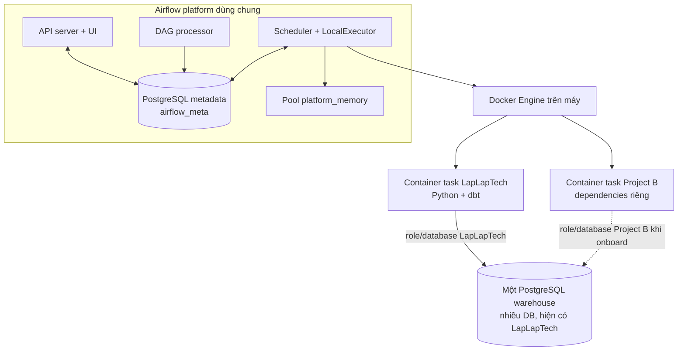
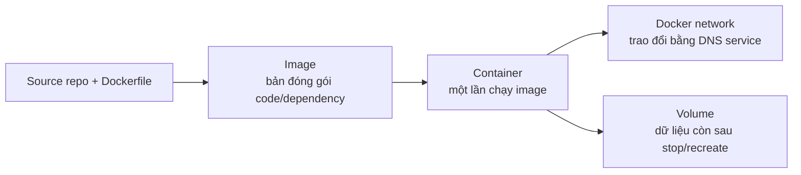
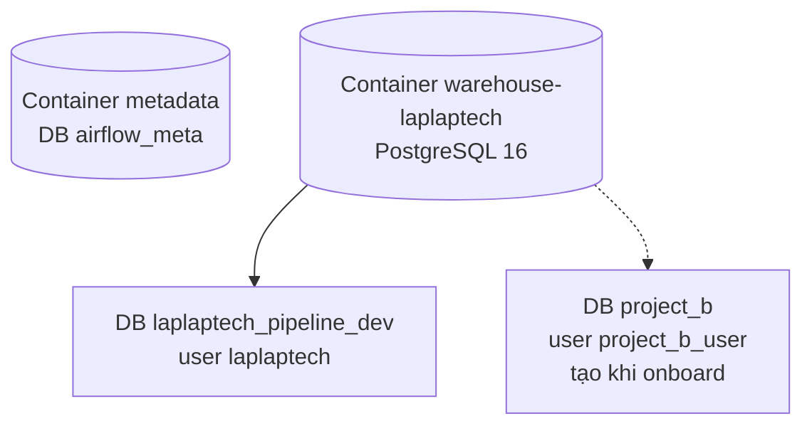

# Kiến trúc Airflow platform dùng chung

Trang này giải thích **hạ tầng điều phối dùng chung**, không phải logic dữ liệu riêng của LapLapTech. Đọc [data flow LapLapTech](data_flow.md) để hiểu ingestion → dbt → dashboard; xem [Docker guide](../guides/docker.md) để chạy và [resource guide](../guides/resources.md) khi thêm project. Mọi số liệu/cấu hình dưới đây đối chiếu với hai Compose file trong repo; workspace `D:/Dev/Project/airflow-platform` là bản vận hành trên máy và có thể chứa cấu hình riêng.

## 1. Tư duy thiết kế: một control plane, workload riêng



**Control plane** là nơi Airflow đọc DAG, lên lịch, ghi trạng thái và hiển thị UI. **Workload** là code Python/dbt/ML thật của từng project: mỗi project tự đóng image, có DAG ID, môi trường, database/user, config/artifact và resource policy riêng. Scheduler gọi Docker Engine tạo container cho từng task; container task tự xóa sau khi kết thúc. Chia sẻ Airflow không có nghĩa cài mọi thư viện project vào image Airflow.

Node warehouse mô tả **một PostgreSQL instance với database riêng cho từng project**, không phải một container cho mỗi project. Hiện Compose chỉ tạo database LapLapTech; database/user của Project B chỉ tồn tại sau khi onboard. Đây là local platform tin cậy, **không phải cách ly tenant mạnh**: Airflow UI/metadata và Docker Engine là failure domain chung.

## 2. Các thành phần Airflow: cái nào có ở đây?

| Thành phần | Vai trò | Stack hiện tại |
|---|---|---|
| `metadata` PostgreSQL | Lưu DAG runs, task states, users/config Airflow | **Có**; DB `airflow_meta`, volume riêng, không chứa raw/Gold |
| `airflow-init` | Migrate metadata DB, tạo admin ban đầu rồi thoát | **Có**; `Exited (0)` là bình thường |
| `airflow-api-server` | Airflow 3 UI và API, cổng host `127.0.0.1:8080` | **Có**; thay vị trí webserver trong nhiều sơ đồ Airflow cũ |
| `airflow-scheduler` | Quyết định run/task nào sẵn sàng; LocalExecutor chạy task Airflow cục bộ | **Có**; được mount Docker socket để DockerOperator tạo runtime container |
| `airflow-dag-processor` | Parse file DAG được mount read-only | **Có** |
| Redis/broker | Hàng đợi phân tán cho CeleryExecutor | **Không dùng** với LocalExecutor |
| `airflow-worker` riêng | Celery worker nhận task từ broker | **Không có**; Docker task container của project **không phải** Celery worker |
| Flower | UI theo dõi Celery workers | **Không có** vì không dùng Celery |
| `airflow-webserver` | Tên service trong nhiều bản/sơ đồ cũ | **Không có**; stack Airflow 3 này dùng `airflow-api-server` |

`LocalExecutor` là cách Airflow thực thi operator process trong môi trường scheduler. `BudgetDockerOperator` sau đó yêu cầu Docker Engine tạo **một container riêng cho workload**. Hai lớp này cùng tồn tại; không cần Celery để chạy task bằng Docker. Quy tắc pool `platform_memory`, `parallelism=2`, `max_active_tasks_per_dag=1` chỉ giới hạn task do Airflow quản lý; Docker memory/CPU limits mới là trần container. Các lệnh `docker run` thủ công ngoài Airflow không bị pool chặn.

## 3. Docker: image, container, network, volume



- **Image** là bản đóng gói bất biến theo lần build. `airflow-platform:...` chứa Airflow/provider dùng chung; `laplaptech-runtime:...` chứa ingestion/dbt riêng; `laplaptech-dashboard:...` chứa Streamlit. Sửa Python/dbt trong runtime cần rebuild image; sửa DAG được bind mount read-only, chờ DAG processor parse.
- **Container** là tiến trình chạy từ image. Airflow/metadata/warehouse là service thường trực khi stack bật. `airflow-init` là one-shot. Container ingest/build/freshness/reconcile chỉ xuất hiện khi task chạy và có `auto_remove='force'`. Container bị xóa **không** xóa volume.
- **Network**: Airflow control plane và metadata dùng Compose network mặc định. Runtime, dashboard, warehouse kết nối qua `laplaptech-lab`; từ container, warehouse là `warehouse-laplaptech:5432`, không phải `localhost`. Đưa project khác vào network chung cho phép kết nối mạng, còn quyền dữ liệu phụ thuộc user/database; network chung tự nó không phải hàng rào bảo mật.
- **Volume**: `airflow-metadata` giữ state Airflow; `airflow-logs` giữ task logs; `laplaptech-lab-warehouse` giữ PostgreSQL data; `laplaptech-lab-config` giữ env runtime read-only; `laplaptech-lab-artifacts` giữ report/dbt artifacts. Bind mount DAG lấy source từ repo, khác với named volume dữ liệu. `stop`/`up` giữ volumes; `down -v` có thể xóa dữ liệu nên không dùng để tắt thường ngày.

Compose [base](../../infra/airflow-platform/compose.yaml) khai báo control plane; [overlay LapLapTech](../../infra/airflow-platform/compose.laplaptech.yaml) thêm image/provider, mount DAG/socket, warehouse và dashboard. Hai file được ghép trong **một Compose project** `airflow-platform`. Workspace platform sibling chứa `.env`, keys và policy vận hành; repo chứa template/source để người khác clone. Không commit `.env` thật, database dumps, config volume hay mật khẩu Airflow.

## 4. PostgreSQL nào thật sự dùng chung?



**Đang chạy:** một container PostgreSQL `metadata` dành riêng Airflow, một container `warehouse-laplaptech` dành dữ liệu LapLapTech. **Quy ước mở rộng:** tái sử dụng *warehouse instance* cho project tin cậy khác, tạo **database và role riêng**; không tạo thêm metadata DB/Airflow instance cho mỗi project. Project có MySQL/MinIO/ClickHouse đặc thù thì tự quản service riêng và chỉ bật khi cần.

Điểm cần biết trước khi gọi đây là “isolation”: `POSTGRES_USER=laplaptech` trong Compose khởi tạo role quản trị của warehouse. Project mới phải dùng role **không phải superuser** và database riêng; không phát tán credential LapLapTech cho project khác. Nếu muốn quyền tách biệt chặt giữa các project, cần chuyển quyền sở hữu/credential quản trị hiện tại sang role admin riêng và kiểm thử GRANT/REVOKE. Cho đến lúc đó, đây là cách **chia sẻ tài nguyên và quy ước truy cập**, chưa phải biên an ninh production. Các DB vẫn chia CPU/RAM/I/O và cùng ngừng khi warehouse container tắt.

## 5. Onboard một project mới: cái gì chung, cái gì riêng?

| Dùng chung | Project phải có riêng |
|---|---|
| Airflow API/scheduler/DAG processor/metadata | Repo, DAG ID và schedule; prefix Connection/Variable/Asset ID |
| Docker Engine và Airflow pool `platform_memory` | Runtime image/requirements, task limits, secrets/config, artifact path |
| Warehouse PostgreSQL server (nếu phù hợp) | Database, non-superuser role, schema và backup/restore phạm vi project |
| Platform workspace và quy tắc audit | Network/service đặc thù, on/off, healthchecks và tài liệu chạy của project |

Thứ tự triển khai: (1) xây/test project độc lập; (2) tạo DB/role riêng và kiểm quyền không đọc DB khác; (3) đóng runtime image và mount config/artifacts riêng; (4) thêm DAG vào Airflow, đăng ký task trong `resources.json`, dùng `BudgetDockerOperator`; (5) để DAG **paused** khi service nguồn/project chưa bật; (6) thử một run, xem logs, RAM và đối soát; (7) cập nhật README/AGENTS của **project đó**. [Resource guide](../guides/resources.md#5-thêm-project-tiếp-theo) có lệnh và mẫu cấu hình chi tiết. Đừng copy `network_mode='laplaptech-lab'` hoặc credential LapLapTech nguyên xi vào DAG mới; chọn network theo topology của project.

## 6. Bảo trì khi project nằm yên lâu

Không cần nâng version liên tục chỉ để tăng số phiên bản. Một project **đã tắt** vẫn cần biết cách tái tạo: source/lock/image tag, `.env.example`, backup, hướng dẫn start và một fixture smoke test. Khi quay lại sau nhiều tháng, kiểm tra image/dependency/CVE theo đợt, build lại trên môi trường sạch, chạy test/fixture, thử restore backup và chỉ nâng version **từng lớp** (Airflow/provider, Python/dbt, PostgreSQL) khi có lý do. Backup/restore và tương thích major version quan trọng hơn cập nhật liên tục mà không test.

Airflow/warehouse dùng chung tạo ảnh hưởng chéo: trước khi nâng platform, ghi lại DAG đang bật, đợi task của **mọi project** xong, backup metadata và từng DB, kiểm tra Compose + DAG import, rồi thử một run đại diện. Một project đã nghỉ nên pause DAG của nó và dừng service riêng; không phải xóa source hay volume. Nếu muốn lịch chạy khi laptop tắt, local Docker không đáp ứng; cần host thường trực.

## 7. Ổ đĩa: RAM limit không phải disk limit

| Nơi phát sinh | Chính sách hiện tại | Rủi ro |
|---|---|---|
| Docker stdout/stderr log (`json-file`) | `max-size=10m`, `max-file=3` cho Compose services và task DockerOperator | Tối đa xấp xỉ 30 MB/container cho loại log này; nhiều container/image vẫn cộng dồn |
| Airflow task logs | Named volume `airflow-logs` | **Chưa có retention tự động** trong cấu hình repo; tăng theo số run/task |
| dbt reports/logs | Volume `laplaptech-lab-artifacts`, đường dẫn theo run/stage/attempt | **Chưa có retention tự động**; mỗi run tạo artifact mới |
| PostgreSQL data | Metadata và warehouse volumes | Tăng theo dữ liệu, indexes, WAL/metadata history; dừng container không thu nhỏ volume |
| Images, build cache, backup files | Docker Desktop storage và thư mục `backups/` ở workspace | Rebuild/nâng version và backup lặp lại có thể làm đầy ổ |
| `/tmp` trong task container | Container filesystem, task auto-remove khi kết thúc | Dữ liệu tạm thường mất theo container; task lỗi/đang chạy vẫn chiếm dung lượng |

**Kiểm tra trước khi dọn** (PowerShell, không làm thay đổi dữ liệu):

```powershell
docker system df -v
docker volume ls
docker ps -a --size
Get-ChildItem 'D:\Dev\Project\airflow-platform\backups' -Directory -ErrorAction SilentlyContinue |
    Sort-Object LastWriteTime -Descending | Select-Object -First 10 Name,LastWriteTime
```

`docker system df` không cho biết đầy đủ dung lượng *bên trong* từng named volume; cần đo volume cụ thể khi thấy Docker Desktop phình lên. Chưa có script dọn logs/artifacts theo tuổi trong repo, nên **có nguy cơ đầy ổ nếu chạy lâu**. Đề xuất: đặt hạn giữ logs/artifacts theo số ngày hoặc số run, giữ backup đã kiểm restore, theo dõi dung lượng mỗi tháng và dọn theo **đúng volume/project** sau khi pause DAG, không dùng `docker system prune --volumes` như bước dọn định kỳ. Chính sách retention cần được triển khai và test riêng; hiện tài liệu chỉ nêu cách quan sát, chưa tự xóa dữ liệu.

## 8. Nên đưa gì lên GitHub?

Commit source/template: Compose, Dockerfiles, DAG, `resources.json` mẫu, `.env.example`, kiến trúc, runbook và test. Giữ ngoài Git: `.env` thật, platform workspace vận hành chứa keys, Docker volumes, dumps, task logs/artifacts và file backup. Người clone dùng source trong repo để tạo platform **riêng trên máy họ**; họ không thấy DAG/DB/credential ở Docker Engine của bạn. Cập nhật tài liệu và code platform cùng commit/PR để người đọc không gặp mô tả lệch cấu hình.
