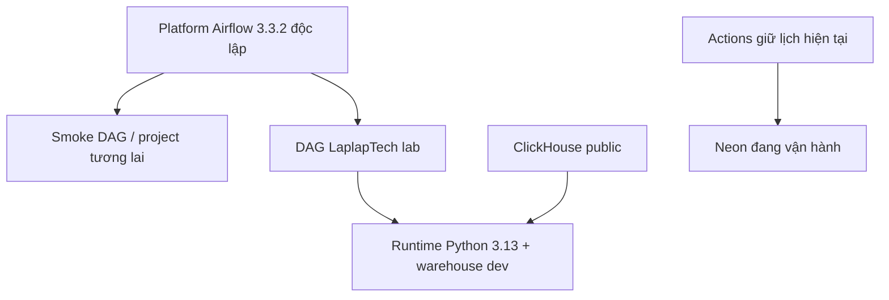

# LaplapTech — Quyết định kiến trúc và kế hoạch học tiếp

Cập nhật 20/10/2026. Project phục vụ học và nghiên cứu. Ingestion đã được củng cố và kiểm thử local; chưa tuyên bố production-grade hoặc đã xác nhận toàn bộ dữ liệu sau sửa trên Neon.

Bản nâng cấp mới nhất: [Gold, metric, lock và dashboard](../guides/gold_upgrade.md), [bằng chứng dev](../validation/dev_run_2026-10-19.json).

Tài liệu chính: [data flow hiện tại](data_flow.md), [việc còn lại](remaining_work.md), [hướng dẫn vận hành](../guides/ingestion_operations.md).

Chủ project xác nhận hiện đã chạy trên Neon. Các kết quả định lượng dưới đây là bằng chứng dev đã lưu; kế hoạch học tiếp có mẫu triển khai trong [Triển khai Airflow](../guides/airflow_setup.md).

## 1. Trạng thái triển khai

| Hạng mục | Đã có code | Bằng chứng/phạm vi |
|---|---|---|
| Full refresh atomic | Có | TRUNCATE + insert cùng Connection/transaction; test rollback và view pass |
| Event dedup/version | Có | Giữ timestamp mới nhất, fail khi payload cùng version xung đột, bỏ batch cũ hơn raw |
| Event staging/upsert | Có | Tên UUID, create/load/delete/insert/drop trong cùng transaction |
| Chống concurrent writer | Có | Transaction advisory lock theo bảng; test hai writer local pass |
| Lookback | Có | Raw mặc định 7.200 giây cấu hình env; Silver hiện cố định 2 giờ |
| Backfill CLI | Có | `--start`/`--end` có timezone, khoảng đầu bao gồm/cuối không bao gồm |
| Neon connection | Có | SSL config, URL.create, database provisioning mặc định tắt |
| dbt | Có | 31 model, 47 data test pass trên dev, 6 source, 1 exposure |
| Freshness | Có | Workflow gọi riêng trước build; warn 24 giờ/error 48 giờ |
| Validate CI | Có | PostgreSQL test riêng, Python tests, compile và dbt parse không cần Neon secrets |
| Python tests | Đã chạy local | 28/28 pass, gồm 9 PostgreSQL integration và 2 dashboard AppTest |
| Daily KPI session-day | Có | Session-day dùng chung; đã đối soát fixture và nguồn thật trên dev |
| Airflow Docker | Nền tảng ban đầu đã chạy | Chủ project gửi init/service health/smoke DAG success ngày 20/10/2026; có bài code theo DAG LaplapTech, chưa triển khai tích hợp pipeline |
| End-to-end dữ liệu thật sau sửa | Đã lưu bằng chứng dev local | ClickHouse 784.455 event → local PostgreSQL; full build + replay pass; chủ project xác nhận chạy Neon |

## 2. Kiến trúc hiện tại và ranh giới

Đây là sơ đồ tổng hợp; các nhánh transformation thực tế theo `ref()` nằm trong [data flow](data_flow.md). Bronze chỉ ánh xạ raw, không tự enforce contract. SQL transformation chạy trong PostgreSQL; runner chỉ điều khiển và gửi SQL.

Atomicity ở mức một bảng ingestion. Không có transaction chung cho 6 bảng hoặc publish đồng loạt 12 mart. Khi job lỗi giữa chừng, một số bảng/mart có thể đã commit. Freshness mới không chứng minh dữ liệu đầy đủ.

## 3. Quyết định và lý do

### ADR 01 — Giữ PostgreSQL Neon làm warehouse

Neon là nơi lưu/truy vấn dữ liệu, không phải nơi chạy scheduler. Việc học Airflow trên Docker local không yêu cầu chuyển warehouse xuống local hoặc thuê VPS.

Database managed được cấp sẵn; pipeline không tự tạo database trừ khi bật `POSTGRES_CREATE_DATABASE=true`. Các bài kiểm thử dùng PostgreSQL local/CI riêng.

### ADR 02 — Full refresh cho danh mục/benchmark

Giữ snapshot hiện tại của 5 bảng nhỏ và giữ view phụ thuộc bằng TRUNCATE. Đặt TRUNCATE và insert cùng transaction để khi insert lỗi khôi phục dữ liệu cũ.

Nguồn dimension rỗng và tập tên cột thay đổi làm job fail. Đây là chính sách bảo vệ hiện tại; nếu muốn chấp nhận bảng rỗng/schema evolution phải thiết kế riêng. Type contract đầy đủ và snapshot lịch sử chưa có.

### ADR 03 — Incremental event có version và lookback

Dùng server-received epoch giây, không suy từ thời điểm client. Raw chọn version có timestamp lớn nhất theo ID. Cùng ID/timestamp nhưng payload khác thì fail; chưa có version field để phân xử các chỉnh sửa đó.

Raw và Silver dùng hai MAX riêng. Raw mặc định lùi 2 giờ; Silver cũng lùi 2 giờ. Điều này giảm rủi ro bỏ sót trong cửa sổ, không bảo đảm bắt mọi late record/correction ở nguồn.

### ADR 04 — Staging trong transaction và lock theo bảng

Tránh staging dùng chung tên giữa các job. Tạo/load/apply/drop staging trong transaction để lỗi không commit bảng tạm dở dang. DELETE + INSERT dùng danh sách cột tường minh; batch cũ không ghi đè version mới hơn.

Transaction advisory lock bảo vệ writer dùng cùng khóa. Workflow group bảo vệ các run GitHub cùng warehouse. Chưa khóa cả vòng ingestion + dbt khỏi mọi writer local/Airflow; chỉ vận hành một orchestrator ghi dữ liệu chính.

### ADR 05 — Backfill là luồng riêng cần đối soát

CLI ingestion theo khoảng `[start, end)` đã triển khai. Không đọc MAX raw cho bounded extraction. Dimension vẫn refresh snapshot hiện tại, không phải danh mục tại thời điểm quá khứ.

Nếu raw backfill cũ hơn watermark Silver trừ 2 giờ, incremental Silver có thể chưa đọc được. Cần rebuild/backfill Silver và downstream rồi đối soát. Full-refresh dbt không lấy lại ClickHouse.

### ADR 06 — Chốt grain của daily KPI

KPI theo ngày Việt Nam dựa trên server timestamp, đếm event từ event table và session hoạt động trong từng ngày. SUM daily session là session-days, không phải unique session toàn thời gian.

Rates là cùng đạt bước trong ngày. Funnel đã dùng cùng session-day; các nhánh ngày/tháng dùng timezone nghiệp vụ. Dashboard đã sửa nhãn theo grain và dữ liệu thiếu; vẫn không coi reach là sequential conversion.

### ADR 07 — Tách CI khỏi lịch ghi warehouse

PR/develop chạy compile, tests trên PostgreSQL fixture và parse bằng cấu hình giả. Main/manual main/lịch chạy ingestion → freshness → build. Giữ hai lịch 08:15 và 16:45 Việt Nam đang cấu hình.

Data tests nằm trong build; source freshness chạy riêng. Artifact giữ 14 ngày nếu đã sinh; chưa có bảng audit/run heartbeat và notification riêng.

### ADR 08 — Airflow dùng chung cho lab, giữ nguyên lịch cloud

Stack Docker/Airflow NASDAQ100 cũ đã được chủ project gỡ. Dựng workspace `airflow-platform` độc lập bằng Airflow 3.3.2/LocalExecutor, nghiệm thu DAG kiểm tra nền tảng trước rồi tích hợp LaplapTech. LaplapTech dùng runtime Python 3.13 riêng và PostgreSQL dev riêng, vì dependency pipeline không được cài đè vào environment Airflow. Bộ cấu hình Airflow, kiến thức và trình tự triển khai nằm trong [Triển khai Airflow](../guides/airflow_setup.md).

Neon và sync GitHub Actions tiếp tục vận hành như hiện tại; validate CI cũng giữ nguyên. Lab có thể manual hoặc có lịch thử trên đích riêng sau khi kiểm chứng. Docker/laptop tắt chỉ làm lab dừng; không có cutover hoặc tự động failover giữa hai scheduler.

### ADR 09 — Phát hành Docker full ở chặng cuối

Sau khi DAG dùng chung và engineering cốt lõi được nghiệm thu, tạo bộ Compose standalone cho cộng đồng: Airflow chỉ chứa DAG LaplapTech, metadata DB, warehouse local, runtime ingestion/dbt và Streamlit. Nguồn thật là ClickHouse public; người clone không dùng Neon hoặc Secrets GitHub của chủ repo.

Bản public dùng chung code/metric với bản cloud, tách cấu hình và nơi lưu kết quả. Docker là runtime; file env vẫn cung cấp cấu hình. Các mount/override nhiều project thuộc workspace platform cá nhân. [Kế hoạch Docker distribution](../guides/docker_distribution_plan.md).

## 4. Lịch sử thay đổi và phạm vi xác nhận

Các mục Sprint 1–3 dưới đây tóm tắt ghi chép trước đợt sửa hiện tại, không dùng làm bằng chứng production hiện nay.

| Giai đoạn | Ghi chép lịch sử | Trạng thái sau sửa |
|---|---|---|
| Sprint 1 | Thêm 26 generic tests, source freshness, exposure và dbt docs | Hiện có 47 data test pass trên dev; freshness được gọi trong workflow |
| Sprint 2 | TRUNCATE thay DROP, lookback raw 1 giờ, Silver dedup/incremental, macros | Full refresh nay atomic; raw mặc định 2 giờ; dedup trước load theo version |
| Sprint 3 | Silver lookback 2 giờ và staging upsert raw | Staging nay có UUID và chung transaction; kiểm tra version cũ/xung đột |
| Ghi chép cũ | Có ghi nhận dọn 188 duplicate và raw còn 0 duplicate trên Neon | Không thực hiện lại hoặc xác minh thao tác dọn này trong đợt sửa hiện tại |
| 19/10/2026, trước Gold upgrade | Củng cố ingestion, workflow, KPI và tests local | 21 Python tests pass; 29 model/34 data test parse thành công |
| 19/10/2026, Gold upgrade | Taxonomy, timezone/metric, dependency lock và dashboard | 31 model/47 data test, 28 Python test pass; nguồn thật trên dev và fixture |

Artifact trước đợt sửa từng ghi nhận 29 model success, 26 data test pass và 1 exposure no-op. Không được cộng các loại tài nguyên đó thành “56 tests”. Các con số giảm thời gian 95% hoặc khoảng 13 giây trong ghi chép cũ cần benchmark lại trên môi trường/dataset hiện tại.

## 5. Roadmap đã chốt: B → C → D

Các giai đoạn dưới đây là kế hoạch, không phải tính năng đã triển khai. Neon + sync Actions + validate CI được giữ xuyên suốt; không có sprint tắt lịch cloud.

### Giai đoạn A — Nền tảng đã hoàn thành

- [x] Dashboard 12 Gold model, Today/session-days/N/A/literal search, biểu đồ có phạm vi rõ.
- [x] Timezone/metric và session-day thống nhất; taxonomy, bridge comparison và benchmark policy được kiểm chứng.
- [x] Lock 85 dependency, cài sạch Windows/Linux và 28 Python tests pass.
- [x] Fixture và nguồn thật trên dev: 31 model/47 data tests, full build/replay và đối soát có báo cáo.

### Giai đoạn B — Airflow Docker dùng chung, làm trước

Đầu ra B0: platform Airflow 3.3.2 độc lập chạy DAG kiểm tra nền tảng; bộ cấu hình Airflow đã có, chờ nghiệm thu Docker runtime. Đầu ra B1: DAG LaplapTech trên platform đó, runtime/config/warehouse lab/artifacts riêng. Tập trung dependency isolation, task boundaries, retry, timeout, concurrency và recovery. Chưa cần bảng audit riêng để bắt đầu.

Nghiệm thu: init và DAG kiểm tra nền tảng đạt trước; tiếp theo manual run LaplapTech, build/test, fixture replay và failure/recovery có bằng chứng. Chi tiết: [Triển khai Airflow](../guides/airflow_setup.md).

### Giai đoạn C — Engineering và chất lượng vận hành

1. **Bootstrap và data integrity:** first-run schema, raw constraint/index và policy JSON lỗi/quarantine; có test dữ liệu rỗng/trùng/lỗi.
2. **Audit và recovery:** run/stage/attempt ID, watermark, row-count semantics, logs/artifacts, backfill thật qua raw/Silver/Gold, backup/restore lab.
3. **Nâng cao khi có nhu cầu:** publish Gold nhất quán, streaming extraction/checkpoint, catalog history hoặc benchmark version có timestamp; không biến mọi ý tưởng nghiên cứu thành blocker release.

Nghiệm thu: lỗi/retry/Clear không tạo trạng thái success giả, không bỏ row lỗi âm thầm, late-data/backfill được đối soát và dữ liệu phục hồi được. Triển khai và kiểm chứng ở lab trước khi đưa thay đổi logic lên cloud. Checklist chi tiết trong [remaining work](remaining_work.md).

### Giai đoạn D — Docker full cho người clone, làm cuối

Tái sử dụng runtime/DAG/CLI đã ổn định để tạo Compose standalone đầy đủ: Airflow riêng, metadata PostgreSQL, warehouse PostgreSQL local, ingestion/dbt, dashboard và bootstrap. Đích mặc định là local; nguồn mặc định là ClickHouse public với tài khoản dataset công bố.

Nghiệm thu trên clone sạch: startup/initial load → build/tests → dashboard; replay/restart giữ dữ liệu, logs/artifacts có thể xem lại, không có DAG project khác hoặc credential Neon trong image/config public. Có hướng dẫn và số đo tài nguyên thực tế. [Docker distribution plan](../guides/docker_distribution_plan.md) mô tả các file và contract quickstart cần tạo sau này.

Docker full là cách phân phối bổ sung; Neon và Actions của chủ project tiếp tục giữ nguyên. Với nhiều project trên máy cá nhân có thể dùng Airflow chung; người clone vẫn có một bản standalone độc lập.

## 6. Cách chạy

Không lặp lại commands ở nhiều tài liệu. Dùng [README](../../README.md) để setup và [ingestion operations](../guides/ingestion_operations.md) để chạy/backfill/test.

Các lệnh ingestion/build có ghi dữ liệu: luôn kiểm tra môi trường đích. Không coi database/schema có tên “dev” trong profile là đã cô lập dữ liệu nếu ingestion và dbt vẫn trỏ cùng Neon database.
