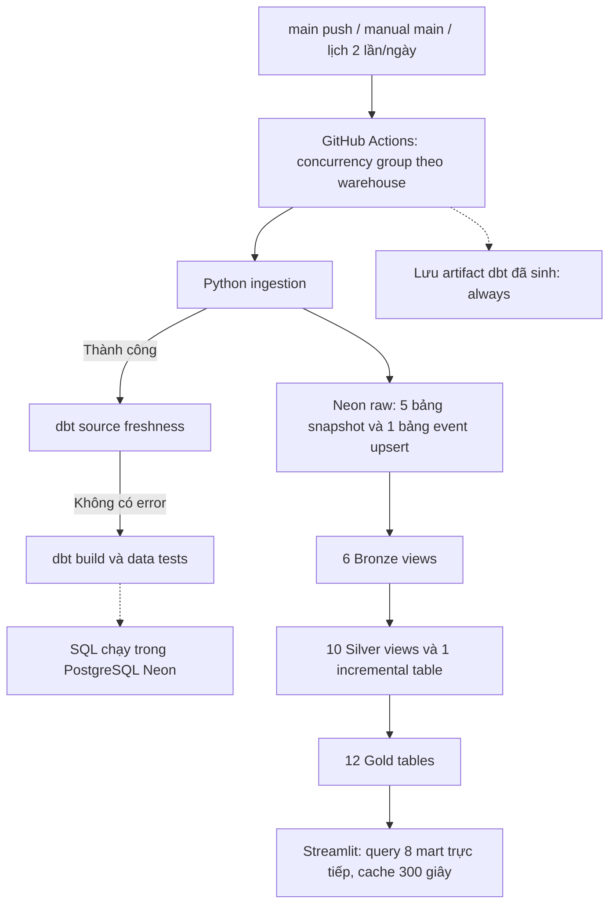
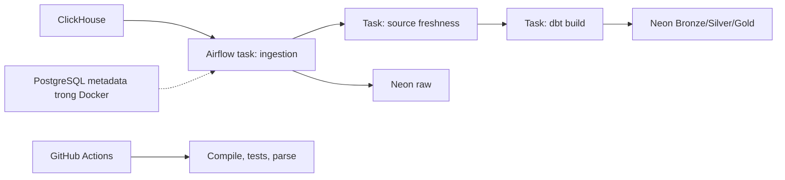

# LaplapTech — Quyết định kiến trúc và kế hoạch học tiếp

Cập nhật 19/10/2026. Project phục vụ học và nghiên cứu. Ingestion đã được củng cố và kiểm thử local; chưa tuyên bố production-grade hoặc đã xác nhận toàn bộ dữ liệu sau sửa trên Neon.

Tài liệu chính: [data flow hiện tại](data_flow.md), [việc còn lại](remaining_work.md), [hướng dẫn vận hành](../guides/ingestion_operations.md).

## 1. Trạng thái triển khai

| Hạng mục | Đã có code | Bằng chứng/phạm vi |
|---|---|---|
| Full refresh atomic | Có | TRUNCATE + insert cùng Connection/transaction; test rollback và view pass |
| Event dedup/version | Có | Giữ timestamp mới nhất, fail khi payload cùng version xung đột, bỏ batch cũ hơn raw |
| Event staging/upsert | Có | Tên UUID, create/load/delete/insert/drop trong cùng transaction |
| Chống concurrent writer | Có | Transaction advisory lock theo bảng; test hai writer local pass |
| Lookback | Có | Raw mặc định 7.200 giây cấu hình env; Silver hiện cố định 2 giờ |
| Backfill CLI | Có | `--start`/`--end` có timezone, khoảng đầu bao gồm/cuối không bao gồm |
| Neon connection | Có | SSL config, URL.create, database provisioning mặc định tắt |
| dbt | Có | 29 model, 34 data test đã parse, 6 source, 1 exposure |
| Freshness | Có | Workflow gọi riêng trước build; warn 24 giờ/error 48 giờ |
| Validate CI | Có | PostgreSQL test riêng, Python tests, compile và dbt parse không cần Neon secrets |
| Python tests | Đã chạy local | 21/21 pass: 12 unit/config và 9 PostgreSQL integration |
| Daily KPI session-day | Có | Event count thực tế, co-reach rates, ngày Việt Nam; SQL fixture pass |
| Airflow Docker | Chưa | Hướng học tiếp, chưa có runtime/DAG được triển khai |
| End-to-end dữ liệu thật sau sửa | Chưa xác nhận | Chưa chạy ingestion/build mới trên ClickHouse/Neon trong đợt sửa |

## 2. Kiến trúc hiện tại và ranh giới

Đây là sơ đồ tổng hợp; các nhánh transformation thực tế theo `ref()` nằm trong [data flow](data_flow.md). Bronze chỉ ánh xạ raw, không tự enforce contract. SQL transformation chạy trong PostgreSQL; runner chỉ điều khiển và gửi SQL.

Atomicity ở mức một bảng ingestion. Không có transaction chung cho 6 bảng hoặc publish đồng loạt 12 mart. Khi job lỗi giữa chừng, một số bảng/mart có thể đã commit. Freshness mới không chứng minh dữ liệu đầy đủ.

## 3. Quyết định và lý do

### ADR 01 — Giữ PostgreSQL Neon làm warehouse

Neon là nơi lưu/truy vấn dữ liệu, không phải nơi chạy scheduler. Việc học Airflow trên Docker local không yêu cầu chuyển warehouse xuống local hoặc thuê VPS.

Database managed được cấp sẵn; pipeline không tự tạo database trừ khi bật `POSTGRES_CREATE_DATABASE=true`. Các bài kiểm thử dùng PostgreSQL local/CI riêng.

### ADR 02 — Full refresh cho danh mục/benchmark

Giữ snapshot hiện tại của 5 bảng nhỏ và giữ view phụ thuộc bằng TRUNCATE. Đặt TRUNCATE và insert cùng transaction để khi insert lỗi khôi phục dữ liệu cũ.

Nguồn dimension rỗng và tập tên cột thay đổi làm job fail. Đây là chính sách bảo vệ hiện tại; nếu muốn chấp nhận bảng rỗng/schema evolution phải thiết kế riêng. Type contract đầy đủ và snapshot lịch sử chưa có.

### ADR 03 — Incremental event có version và lookback

Dùng server-received epoch giây, không suy từ thời điểm client. Raw chọn version có timestamp lớn nhất theo ID. Cùng ID/timestamp nhưng payload khác thì fail; chưa có version field để phân xử các chỉnh sửa đó.

Raw và Silver dùng hai MAX riêng. Raw mặc định lùi 2 giờ; Silver cũng lùi 2 giờ. Điều này giảm rủi ro bỏ sót trong cửa sổ, không bảo đảm bắt mọi late record/correction ở nguồn.

### ADR 04 — Staging trong transaction và lock theo bảng

Tránh staging dùng chung tên giữa các job. Tạo/load/apply/drop staging trong transaction để lỗi không commit bảng tạm dở dang. DELETE + INSERT dùng danh sách cột tường minh; batch cũ không ghi đè version mới hơn.

Transaction advisory lock bảo vệ writer dùng cùng khóa. Workflow group bảo vệ các run GitHub cùng warehouse. Chưa khóa cả vòng ingestion + dbt khỏi mọi writer local/Airflow; chỉ vận hành một orchestrator ghi dữ liệu chính.

### ADR 05 — Backfill là luồng riêng cần đối soát

CLI ingestion theo khoảng `[start, end)` đã triển khai. Không đọc MAX raw cho bounded extraction. Dimension vẫn refresh snapshot hiện tại, không phải danh mục tại thời điểm quá khứ.

Nếu raw backfill cũ hơn watermark Silver trừ 2 giờ, incremental Silver có thể chưa đọc được. Cần rebuild/backfill Silver và downstream rồi đối soát. Full-refresh dbt không lấy lại ClickHouse.

### ADR 06 — Chốt grain của daily KPI

KPI theo ngày Việt Nam dựa trên server timestamp, đếm event từ event table và session hoạt động trong từng ngày. SUM daily session là session-days, không phải unique session toàn thời gian.

Rates là cùng đạt bước trong ngày. Funnel session cũ vẫn đo step reach theo session-start date, không phải sequential conversion; dashboard và các mart khác còn cần đồng bộ timezone/nhãn.

### ADR 07 — Tách CI khỏi lịch ghi warehouse

PR/develop chạy compile, tests trên PostgreSQL fixture và parse bằng cấu hình giả. Main/manual main/lịch chạy ingestion → freshness → build. Giữ hai lịch 08:15 và 16:45 Việt Nam đang cấu hình.

Data tests nằm trong build; source freshness chạy riêng. Artifact giữ 14 ngày nếu đã sinh; chưa có bảng audit/run heartbeat và notification riêng.

### ADR 08 — Chọn Airflow Docker làm hướng thực hành tiếp

Với mục tiêu học, Airflow local có giá trị khi thực hành retry, rerun từng task, timeout, concurrency và data interval. Chưa chuyển lịch đang chạy trong lúc runtime/DAG chưa hoàn thiện.

Khi chuyển, giữ Actions cho CI; chỉ bật một lịch có quyền ghi warehouse chính. Laptop/Docker tắt thì job local không chạy. VPS là lựa chọn khi cần chạy thường trực, không phải điều kiện để học.

## 4. Lịch sử thay đổi và phạm vi xác nhận

Các mục Sprint 1–3 dưới đây tóm tắt ghi chép trước đợt sửa hiện tại, không dùng làm bằng chứng production hiện nay.

| Giai đoạn | Ghi chép lịch sử | Trạng thái sau sửa |
|---|---|---|
| Sprint 1 | Thêm 26 generic tests, source freshness, exposure và dbt docs | Hiện có 34 data test đã parse; freshness được gọi trong workflow |
| Sprint 2 | TRUNCATE thay DROP, lookback raw 1 giờ, Silver dedup/incremental, macros | Full refresh nay atomic; raw mặc định 2 giờ; dedup trước load theo version |
| Sprint 3 | Silver lookback 2 giờ và staging upsert raw | Staging nay có UUID và chung transaction; kiểm tra version cũ/xung đột |
| Ghi chép cũ | Có ghi nhận dọn 188 duplicate và raw còn 0 duplicate trên Neon | Không thực hiện lại hoặc xác minh thao tác dọn này trong đợt sửa hiện tại |
| 19/10/2026 | Củng cố ingestion, workflow, KPI và tests local | 21 Python tests pass; 29 model/34 data test parse thành công |

Artifact trước đợt sửa từng ghi nhận 29 model success, 26 data test pass và 1 exposure no-op. Không được cộng các loại tài nguyên đó thành “56 tests”. Các con số giảm thời gian 95% hoặc khoảng 13 giây trong ghi chép cũ cần benchmark lại trên môi trường/dataset hiện tại.

## 5. Kế hoạch tiếp theo

### Giai đoạn A — Đọc đúng và kiểm chứng dữ liệu

- [ ] Sửa dashboard Today, All-Time session-days, N/A, literal search và chart scope.
- [ ] Đồng bộ timezone/grain giữa các model cần cùng calendar.
- [ ] Khóa dependencies phù hợp nền tảng và chạy một lượt end-to-end dev có bằng chứng.
- [ ] Bổ sung đối soát raw-Silver ID/version và theo dõi row bị loại.

### Giai đoạn B — Airflow Docker local

- [ ] Tạo runtime/container và metadata DB riêng; đưa repo/dependencies vào worker.
- [ ] Chạy manual trên dev; test failure/retry, logs và timeout.
- [ ] Nối data interval vào CLI backfill; xử lý Silver ngoài lookback trước catchup.
- [ ] Chuyển lịch có kế hoạch, dừng writer Actions trước khi bật Airflow.
- [ ] Lưu run artifacts và theo dõi trạng thái; không coi có UI Airflow là đã có observability đầy đủ.

### Giai đoạn C — Các invariant và model nâng cao

- [ ] Migration raw NOT NULL/unique ID, index watermark sau khi đối chiếu dữ liệu cũ.
- [ ] JSON/ID validation hoặc quarantine, schema bootstrap cho first run không event.
- [ ] Audit table theo run và watermark.
- [ ] Chốt brand conversion, cặp brand, semantics so sánh và benchmark grain.
- [ ] Nếu cần, thiết kế publish/version cho tập Gold nhất quán.

Chưa có nhu cầu đã triển khai cho CDC, streaming, SCD Type 2, manual price seeds hoặc thay BI tool. Các mục này giữ làm hướng nghiên cứu khi có câu hỏi/dữ liệu phù hợp.

Chi tiết thứ tự và tiêu chí hoàn thành: [remaining work](remaining_work.md).

## 6. Cách chạy

Không lặp lại commands ở nhiều tài liệu. Dùng [README](../../README.md) để setup và [ingestion operations](../guides/ingestion_operations.md) để chạy/backfill/test.

Các lệnh ingestion/build có ghi dữ liệu: luôn kiểm tra môi trường đích. Không coi database/schema có tên “dev” trong profile là đã cô lập dữ liệu nếu ingestion và dbt vẫn trỏ cùng Neon database.
