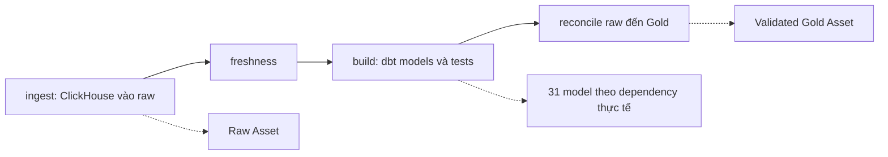

# Chạy và hiểu DAG Airflow

**Dùng khi:** muốn trigger DAG, đọc trạng thái task hoặc sửa lịch/retry. Nếu chỉ cần bật/tắt Docker, xem [Docker guide](docker.md). [Sơ đồ 4 task](../architecture/data_flow.md#1-toàn-hệ-thống-ai-làm-việc-gì) giúp đọc trước phần chi tiết.

## 1. Điều kiện và vai trò

Stack đã được dựng theo [hướng dẫn Docker](docker.md), Docker Desktop chạy Linux containers và năm service nền healthy; dashboard bật riêng khi cần. Bài này dùng baseline **Airflow 3.3.2 / Python 3.13 / LocalExecutor**, Docker provider **4.6.1** được pin trong source.

| Thành phần | Việc thực hiện |
|---|---|
| API server | UI tại [localhost:8080](http://localhost:8080), API và execution API cho task |
| DAG processor | Import source DAG và lưu định nghĩa vào metadata |
| Scheduler + LocalExecutor | Lập lịch, chạy Airflow task process và gọi Docker Engine |
| Metadata PostgreSQL | Giữ user, DAG/run/task state, Connections/Variables; tách khỏi warehouse |
| BudgetDockerOperator (dựa trên DockerOperator) | Tạo runtime container, thu stdout/stderr và chờ exit code |
| Runtime Python/dbt | Đọc ClickHouse, nạp raw, kiểm tra và biến đổi dữ liệu trong warehouse |

Airflow quản lý thứ tự và trạng thái task; dependency SQL giữa 31 model vẫn do dbt quản lý. Xem [dbt](dbt.md) để chạy/chọn model và [data flow](../architecture/data_flow.md) để hiểu grain/metric.

Kế hoạch nâng cấp để hiển thị/chạy từng model trên Airflow có tại [Cosmos step by step](../plans/cosmos.md). Đây là tài liệu thực hành chưa triển khai; flow hiện hành vẫn dùng một task `build`.

## 2. Source, workspace và cấu hình

Source chuẩn là [`infra/laplaptech/dags/laplaptech_pipeline.py`](../../infra/laplaptech/dags/laplaptech_pipeline.py). Compose mount thư mục DAG này read-only vào `/opt/airflow/dags/laplaptech` của API, scheduler và DAG processor qua `LAPLAPTECH_PROJECT_DIR`.

| Nơi làm việc | Nội dung |
|---|---|
| Root repo `laplaptech_pipeline` | Sửa DAG, ingestion/dbt, Dockerfiles, tests và tài liệu |
| Workspace sibling `airflow-platform` | Compose vận hành, `.env` Airflow keys, diagnostic tùy chọn ngoài DAG mount và backups |

Không copy thêm một file Python cùng DAG ID vào workspace platform. Sửa DAG chỉ cần lưu source rồi đợi processor parse; sửa code ingestion/dbt cần rebuild runtime image.

Các lệnh dưới đây chạy tại **workspace platform**. Từ root repo có thể chuyển vào workspace mặc định:

```powershell
$platformDir = Join-Path (Split-Path -Path (Get-Location).Path -Parent) 'airflow-platform'
Set-Location -LiteralPath $platformDir
```

Nếu setup đã chọn workspace khác, dùng đúng đường dẫn đó. Luôn truyền đủ `compose.yaml` và `compose.laplaptech.yaml`.

## 3. Parse và chạy pipeline

Kiểm tra services, version và DAG import:

```powershell
docker compose --env-file .env -f compose.yaml -f compose.laplaptech.yaml ps
docker compose --env-file .env -f compose.yaml -f compose.laplaptech.yaml exec -T airflow-scheduler airflow version
docker compose --env-file .env -f compose.yaml -f compose.laplaptech.yaml exec -T airflow-dag-processor airflow dags list-import-errors
docker compose --env-file .env -f compose.yaml -f compose.laplaptech.yaml exec -T airflow-scheduler airflow dags list
```

**Checkpoint:** version 3.3.2, không có import error và thấy `laplaptech_pipeline`. UI mở được chưa chứng minh task đã chạy. Đăng nhập bằng `AIRFLOW_ADMIN_USERNAME`/`AIRFLOW_ADMIN_PASSWORD` trong `.env` **platform**, không dùng placeholder `.env.example`.

Trong UI: mở DAG → unpause → Trigger. Lần rebuild Silver từ raw, chọn parameter `full_refresh=true`; các lượt thường để `false`.

CLI tương đương cho một lượt thường, tại workspace platform:

```powershell
$runId = 'manual-' + (Get-Date -Format 'yyyyMMddTHHmmss')
docker compose --env-file .env -f compose.yaml -f compose.laplaptech.yaml exec -T airflow-scheduler airflow dags unpause laplaptech_pipeline
docker compose --env-file .env -f compose.yaml -f compose.laplaptech.yaml exec -T airflow-scheduler airflow dags trigger --run-id $runId laplaptech_pipeline
```

Mỗi run ID phải khác nhau. Unpause lần đầu có thể tạo lượt lịch mới nhất đã đến hạn; các run vẫn chạy tuần tự. Trigger manual không tự thay param mặc định của các lượt scheduled.

## 4. Đọc DAG theo ý nghĩa vận hành

```text
ingest → freshness → build → reconcile
```

| Task | Công việc | Timeout / retry |
|---|---|---|
| `ingest` | 5 snapshot atomic theo bảng + event dedup/upsert | 45 phút; retry 1 lần sau 2 phút |
| `freshness` | `dbt source freshness` | 5 phút; không retry; warn 24 giờ/error 48 giờ |
| `build` | `dbt build`, gồm model và data tests | 30 phút; retry 1 lần sau 2 phút |
| `reconcile` | Inventory, duplicate ID, raw/Bronze/Silver và daily totals | 10 phút; không retry |

Lịch là **08:15 và 16:45**, timezone `Asia/Ho_Chi_Minh`, với hai cron `15 8 * * *` và `45 16 * * *`. `catchup=False` không tạo mọi lượt bị lỡ và không thay bounded backfill. Khi Docker tắt, scheduler dừng; GitHub CI không chạy ETL thay nó.

`max_active_runs=1`, `max_active_tasks=1` giới hạn writer của DAG; pool RAM dùng chung `platform_memory=4` nhận task theo trọng số RAM; toàn run có timeout 2 giờ. Các cơ chế này không chặn người tự chạy CLI ngoài Airflow trên cùng warehouse.

Factory `pipeline_stage` dùng `BudgetDockerOperator`, image `laplaptech-runtime:local-v1`, UID 10001. RAM/CPU/slot theo stage lấy từ policy dùng chung: ingest 2048 MiB/2 CPU/4 slot, freshness và reconcile 512 MiB/1 CPU/1 slot, build 1024 MiB/1 CPU/2 slot. Xem [quản lý tài nguyên](resources.md) để thêm project hoặc thay ngân sách. Config volume chỉ đọc; artifact volume cho phép ghi. `mount_tmp_dir=False` tránh cố mount đường dẫn tạm của scheduler vào sibling container. Dataset không truyền qua XCom.

`full_refresh=true` chỉ thêm `--full-refresh` vào **dbt build**; nó rebuild incremental Silver từ raw hiện có, không kéo lại toàn bộ version lịch sử ClickHouse. Ingestion vẫn theo snapshot/lookback của loader.

Nếu ingest/freshness fail, build bị chặn; build fail thì reconcile không chạy. Retry/Clear không rollback những bảng đã commit. Gold chưa publish chung một transaction nên build fail giữa chừng có thể để lại các mart khác phiên bản.

## 5. Assets, logs và artifacts

| Asset | Được cập nhật khi |
|---|---|
| `LaplapTech raw` | Task ingest success |
| `LaplapTech validated Gold` | Task reconcile success |

Assets ghi metadata dữ liệu sẵn sàng, không chứa dataset. DAG hiện vẫn dùng lịch cron; chưa có consumer DAG nào được lập lịch bằng hai Assets này.

Trong UI, mở đúng **run → task → Logs**; xem try number để phân biệt attempt. Docker task container tự xóa khi kết thúc, nhưng Airflow logs và runtime artifacts vẫn nằm trên named volumes.

Mỗi stage lưu `/artifacts/<sha256(run_id)[:20]>/<stage>/attempt-<try>-<uuid>/report.json`. Build có `target/manifest.json` và `target/run_results.json`; freshness có `target/sources.json`. Nếu Docker chưa tạo được container thì chưa có stage report; nếu dbt chưa chạy thì chưa có dbt artifacts.

Kiểm tra log control plane tại workspace platform:

```powershell
docker compose --env-file .env -f compose.yaml -f compose.laplaptech.yaml logs --tail 80 airflow-scheduler airflow-dag-processor airflow-api-server
docker compose --env-file .env -f compose.yaml -f compose.laplaptech.yaml exec -T airflow-scheduler airflow pools list
```

**Checkpoint:** bốn task success, artifact của đúng run ghi đủ 31 model/47 data tests đạt và reconcile khớp. Cách nghiệm thu lại bằng verifier và report theo ngày nằm trong [testing guide](testing.md).

## 6. Sửa DAG hoặc runtime an toàn

Sửa DAG tại source trong repo rồi kiểm tra lại import errors. Tránh gọi mạng/truy vấn DB ở top-level file DAG vì processor import lặp lại.

Khi thay runtime/config, cách khuyến nghị là chạy lại bootstrap từ **root repo**:

```powershell
.\scripts\Start-LocalStack.ps1
```

Bootstrap tạm pause mọi DAG đang unpaused trên platform trước active-run check toàn platform, giữ pause suốt build/nạp config, rồi khôi phục trạng thái cũ khi thành công. Nếu còn active run, nó dừng trước cập nhật. Nếu lỗi sau khi bắt đầu cập nhật, DAG giữ paused để sửa lỗi trước khi unpause. Xem [Docker](docker.md) cho rebuild, partial-stack recovery và giữ keys/volumes.

Nếu thao tác thủ công, pause DAG, đợi hết queued/running runs, rồi mới thay runtime/config; chỉ unpause sau khi kiểm chứng. Không đồng thời chạy ingestion ngoài Airflow; [ingestion](ingestion.md) mô tả recovery/backfill có kiểm soát.

## 7. Smoke test tùy chọn và xử lý lỗi

`platform_smoke_test` kiểm control plane bằng `prepare_payload → validate_payload`, truyền dict nhỏ qua XCom, không truy cập warehouse. Nó không cần cho lượt pipeline thường ngày và **không còn nằm trong DAG mount mặc định**. Mẫu được giữ tại `diagnostics/platform_smoke_test.py` của platform, hoặc [template standalone](../../infra/airflow-platform/diagnostics/platform_smoke_test.py). Đưa file ra ngoài DAG folder để Airflow deactive; history được giữ, không purge metadata.

Khi cần kiểm riêng sau một lần nâng cấp, tại **workspace platform**, xác nhận file đích chưa tồn tại rồi opt-in:

```powershell
if (Test-Path -LiteralPath 'dags/platform_smoke_test.py') { throw 'Diagnostic is already deployed; inspect it first.' }
Copy-Item -LiteralPath 'diagnostics/platform_smoke_test.py' -Destination 'dags/platform_smoke_test.py'
```

Đợi parse, trigger manual và kiểm hai task success. Khi xong, pause smoke, đợi không còn active run rồi xóa đúng bản copy `dags/platform_smoke_test.py`; bản diagnostic vẫn ở ngoài mount. Không dùng nút xóa history nếu chỉ muốn gỡ DAG khỏi deployment. Không suy ra smoke kiểm được quyền warehouse, Docker task hoặc dữ liệu raw → Gold; dùng verifier cho các phần đó.

| Triệu chứng | Nơi kiểm tra |
|---|---|
| DAG không xuất hiện/import error | Source mount, `LAPLAPTECH_PROJECT_DIR`, log processor và imports |
| Task queued lâu | Scheduler health, pool, run trước và trạng thái paused |
| Freshness error | `sources.json` và timestamp nguồn; không bỏ kiểm tra để làm run xanh |
| Exit 137 | Đối chiếu OOM/log và RAM từng stage trong [resource policy](resources.md); SIGKILL không luôn là OOM |
| Build/reconcile lỗi | `run_results.json`, stage report, DB target và [dbt guide](dbt.md) |

Nâng Airflow cần pin core/provider/Python tương thích, pause/đợi active runs, backup metadata cùng `.env`, thử migration và restore trên môi trường riêng trước. Không chỉ đổi tag trên metadata đã migrate. Tham khảo [upgrade guide baseline 3.3.2](https://airflow.apache.org/docs/apache-airflow/3.3.2/installation/upgrading.html).

## 8. Có cần thêm DAG, task theo tầng hoặc Assets?

Giữ một DAG vận hành hằng ngày cho luồng hiện tại:



| Ý tưởng | Quyết định hiện tại | Điều kiện để mở rộng |
|---|---|---|
| DAG ingestion riêng | Chưa cần; task ingest đã có trong pipeline | Nguồn có lịch/consumer độc lập và đã giải quyết writer coordination |
| Thêm task build raw | Raw được Python nạp, không phải một tầng dbt cần build lại | Chỉ thêm khi có xử lý raw riêng với hợp đồng/kiểm chứng rõ |
| Chia build Bronze/Silver/Gold | Chưa tách ba lệnh chỉ để đẹp graph | Cần thiết kế lại test selection: tests đối soát nhiều tầng phải chạy khi đủ model; `dbt build` hiện tự xếp theo dependency |
| Một task cho từng model | [Cosmos plan](../plans/cosmos.md), để sau recovery/publish Gold | Giữ model graph, tests đa cha, resource pool, artifacts và retry đúng phạm vi |
| DAG backfill/recovery manual | Hướng nâng cấp hữu ích sau fixture của [roadmap](../plans/roadmap.md) | Validate start/end và dùng chung writer lock với DAG thường/CLI; max_active_runs của hai DAG riêng không tự chặn nhau |
| Thêm Assets | Giữ hai Assets hiện có | Thêm khi có consumer độc lập cần biết dataset nào đã sẵn sàng; không tạo Asset cho mọi bảng chỉ để tăng số lượng |

Assets hiện là metadata cập nhật khi producer success, không tự thay lịch cron, khóa database hoặc khiến Gold publish atomic. Chưa có DAG nào schedule theo chúng. Sau này có thể cho một DAG báo cáo/ML độc lập consume **validated Gold**, kèm aggregate metadata như run_id, watermark và row count khi có nhu cầu; không đưa credentials/dataset thật vào Asset metadata.

Ưu tiên tiếp theo là lookback/backfill → publish Gold nhất quán. Sau đó mới cân nhắc alert khi fail nếu có kênh thông báo được cấu hình, hoặc Cosmos khi cần retry theo model. Retry, timeout, concurrency, pool, stage artifacts và hai Assets đã có trong DAG hiện hành.

Nguồn: [dbt build và dependency order](https://docs.getdbt.com/reference/commands/build), [Airflow Assets](https://airflow.apache.org/docs/apache-airflow/3.3.2/authoring-and-scheduling/assets.html), [deactivation và history](https://airflow.apache.org/docs/apache-airflow/3.3.2/concepts/dags.html#dag-pausing-deactivation-and-deletion).
