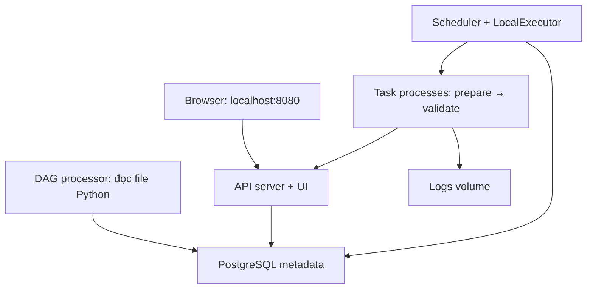

# Khởi tạo Airflow Docker dùng chung — hướng dẫn thực hành

Cập nhật 20/10/2026. Stack Docker/Airflow cũ ở NASDAQ100 đã được chủ project gỡ. Hướng mới: dựng workspace **`airflow-platform` độc lập**, dùng chung cho LaplapTech và các dự án sau này. Không cần khôi phục repo NASDAQ100.

**Đầu ra bài này:** mở UI Airflow, đăng nhập, thấy DAG `platform_smoke_test`, chạy hai task thành công và xem log. Neon + lịch GitHub Actions hiện tại tiếp tục hoạt động riêng. Bài này chưa chạy ingestion/dbt và chưa tạo warehouse cho LaplapTech.

Bộ cấu hình hạ tầng nằm tại [`infra/airflow-platform`](../../infra/airflow-platform). Bạn đã gửi kết quả ngày 20/10/2026: init exit 0, các service healthy, smoke DAG và cả hai task success. Logs/XCom chi tiết, retry/Clear và restart cần kiểm tra riêng; chưa suy ra pipeline LaplapTech đã chạy. Phần tích hợp tiếp theo có [code mẫu và giải thích từng bước](airflow_laplaptech_walkthrough.md).

## 1. Chọn kiến trúc và phiên bản

- Airflow **3.3.2**, Python **3.13**, image `apache/airflow:3.3.2-python3.13` cho tất cả service Airflow.
- **LocalExecutor:** task chạy thành process trong container scheduler. Khởi đầu không cần Redis/Celery worker. Nhiều project chia sẻ cùng nền tảng này.
- PostgreSQL **16** chỉ lưu metadata điều phối. Tag `postgres:16` theo patch của major 16; chưa khóa digest cho bản phát hành.
- DAG đầu tiên chỉ chạy manual; `catchup=False`, một DAG run tại một thời điểm, toàn platform tối đa hai task chạy song song.

Airflow 3.3.2 là bản stable được công bố khi soạn hướng dẫn; pin version để việc học có baseline rõ. [Release announcements](https://airflow.apache.org/announcements/), [Python/PostgreSQL được hỗ trợ](https://airflow.apache.org/docs/apache-airflow/3.3.2/installation/prerequisites.html).

Compose mẫu là cấu hình LocalExecutor rút gọn cho lab. [Quickstart chính thức](https://airflow.apache.org/docs/apache-airflow/3.3.2/howto/docker-compose/index.html) dùng CeleryExecutor, nhiều service hơn. Chưa cần thêm các thành phần đó cho bài đầu.



`airflow-init` chạy một lần để migrate metadata và tạo admin. Sau đó có bốn service thường trực: metadata, api-server, scheduler và dag-processor. Chưa có triggerer vì DAG mẫu không dùng deferrable operator.

## 2. Hiểu cấu trúc hạ tầng trước khi chạy

`infra/airflow-platform/` là nơi quản lý cấu hình triển khai trong repo. `D:\Dev\Project\airflow-platform` là workspace vận hành dùng chung trên máy bạn. Tên `platform_smoke_test` chỉ rõ DAG kiểm tra nền tảng; DAG này không đại diện cho pipeline LaplapTech.

```text
airflow-platform/
  compose.yaml                  # các service/network/volume
  .env.example                  # danh sách biến tham khảo
  Initialize-LocalEnv.ps1        # tạo .env và các khóa/mật khẩu ngẫu nhiên
  .gitignore                    # giữ .env ngoài Git
  dags/
    platform_smoke_test.py       # DAG Airflow 3, hai task nhỏ
  README.md
```

| File / thành phần | Vai trò |
|---|---|
| [compose.yaml](../../infra/airflow-platform/compose.yaml) | Dùng chung image/config bằng YAML anchor; chỉ publish UI tại `127.0.0.1`, metadata không mở port ra host |
| [.env.example](../../infra/airflow-platform/.env.example) | Tên biến cần có; các giá trị `GENERATE_WITH_SCRIPT` không dùng để chạy |
| [Initialize-LocalEnv.ps1](../../infra/airflow-platform/Initialize-LocalEnv.ps1) | Không cần Python trên host; sinh mật khẩu DB/admin, Fernet key, API secret và JWT secret; từ chối ghi đè `.env` đã tồn tại |
| [platform_smoke_test.py](../../infra/airflow-platform/dags/platform_smoke_test.py) | `from airflow.sdk import dag, task`; trả dict nhỏ qua XCom, task sau kiểm tra tổng bằng 10 và ghi log |
| `./dags` bind mount | File trên máy được đọc ở `/opt/airflow/dags`; sửa Python rồi chờ DAG processor parse lại |
| `airflow-metadata` volume | Users, trạng thái DAG/task, Connections, Variables và metadata khác |
| `airflow-logs` volume | Log để đọc lại sau restart; log không đặt trong Git |

`.env` cung cấp cấu hình; Docker cung cấp môi trường chạy. Dùng Docker vẫn cần env/Connections để cấu hình, không nhúng mật khẩu vào image. Fernet dùng mã hóa thông tin nhạy cảm trong metadata; API/JWT secrets phục vụ xác thực giữa các thành phần. Giữ các khóa ổn định cùng metadata DB. [Configuration reference](https://airflow.apache.org/docs/apache-airflow/3.3.2/configurations-ref.html).

## 3. Chuẩn bị Docker Desktop trên Windows

1. Mở Docker Desktop, chọn **Linux containers**, dùng WSL 2 backend.
2. Chạy các lệnh sau trong PowerShell. `docker version` phải có phần **Server**; có CLI/Compose thôi chưa đủ.

```powershell
docker version
docker compose version
docker info --format '{{.OSType}}'
```

Kết quả cuối là `linux`. Compose cần v2.14 trở lên; Compose v5 cũng đạt điều kiện. Cho Docker Engine ít nhất 4 GB RAM, lý tưởng 8 GB nếu máy còn đủ cho Windows/công cụ khác; đây là mức cho Airflow, chưa gồm pipeline thật. [Yêu cầu quickstart](https://airflow.apache.org/docs/apache-airflow/3.3.2/howto/docker-compose/index.html#before-you-begin).

## 4. Tạo workspace vận hành độc lập

**Nếu đã copy sang `D:\Dev\Project\airflow-platform` ở lần trước, bỏ qua bước copy này.** Chuyển terminal vào workspace đó rồi tiếp tục mục 5 nếu chưa có `.env`; nếu đã tạo `.env` thì giữ nguyên và tiếp tục mục 6. Việc chuyển cấu hình trong repo từ `examples/` sang `infra/` không làm thay đổi workspace bạn đã copy.

Chạy từ repo LaplapTech. Đoạn lệnh dừng nếu thư mục đích đã tồn tại để tránh trộn với stack khác.

```powershell
Set-Location D:\Dev\Project\laplaptech_pipeline
$platformDir = 'D:\Dev\Project\airflow-platform'
if (Test-Path -LiteralPath $platformDir) {
    throw 'airflow-platform đã tồn tại; hãy kiểm tra thư mục đó trước khi copy.'
}
Copy-Item -LiteralPath '.\infra\airflow-platform' -Destination $platformDir -Recurse
Set-Location $platformDir
Get-ChildItem -Force
```

Từ đây mọi lệnh `docker compose` trong bài chạy tại **`D:\Dev\Project\airflow-platform`**. Tên project trong Compose là `airflow-platform`, giúp giữ service/volumes trong một platform ổn định. Không dùng root `.env` của LaplapTech cho stack này.

## 5. Tạo cấu hình local một lần

```powershell
.\Initialize-LocalEnv.ps1
docker compose --env-file .env config --quiet
```

Lệnh thứ hai không in gì và exit code 0 nghĩa là Compose nhận cấu hình hợp lệ. Nếu port 8080 đã bận, trước khi tạo env có thể dùng `./Initialize-LocalEnv.ps1 -UiPort 8081`; nếu đã tạo rồi thì sửa riêng `AIRFLOW_UI_PORT` trong `.env` bằng editor.

Nếu Windows báo script bị chặn bởi ExecutionPolicy, bạn có thể xem mã script rồi chạy riêng lần này bằng `powershell -NoProfile -ExecutionPolicy Bypass -File .\Initialize-LocalEnv.ps1`. Đây là tùy chọn cho process đó, không đổi policy toàn máy.

Không copy `.env.example` rồi giữ nguyên placeholder. Mở `.env` bằng editor để xem `AIRFLOW_ADMIN_USERNAME` và `AIRFLOW_ADMIN_PASSWORD` khi đăng nhập. Script không tự in mật khẩu. Không chạy lại script để đổi khóa khi metadata đã có dữ liệu.

## 6. Tải image và khởi tạo metadata

```powershell
docker compose --env-file .env pull
docker compose --env-file .env up airflow-init
docker compose --env-file .env ps -a
```

Lần đầu tải image có thể lâu. Kết quả cần đạt: metadata `healthy`, `airflow-init` **Exited (0)**. Init thoát sau khi làm xong là bình thường. Nếu init lỗi, xem log và sửa trước khi tiếp tục:

```powershell
docker compose --env-file .env logs --tail 100 airflow-init metadata
```

Init dùng entrypoint của image để migrate và tạo user. `airflow-init` không phải service scheduler chạy mãi; đừng đặt restart liên tục cho nó.

## 7. Bật các service Airflow

```powershell
docker compose --env-file .env up -d
docker compose --env-file .env ps
docker compose --env-file .env exec airflow-scheduler airflow version
docker compose --env-file .env exec airflow-dag-processor airflow dags list-import-errors
```

Chờ các service thường trực healthy; version cần là `3.3.2`; danh sách import errors phải rỗng. Mở [Airflow UI local](http://localhost:8080/) và đăng nhập bằng admin trong `.env`. Đổi URL nếu đã chọn port khác. DAG processor có thể cần một lúc mới thấy DAG mới.

## 8. Chạy DAG đầu tiên và đọc kết quả

1. Trong UI tìm `platform_smoke_test` qua trang Dags/search; chỉ có DAG mẫu vì `LOAD_EXAMPLES=false`.
2. Bật DAG từ paused sang unpaused. Bật công tắc không tự tạo lịch vì `schedule=None`.
3. Bấm **Trigger** để tạo một DAG run manual.
4. Mở run đó, quan sát `prepare_payload → validate_payload` trong Graph/Grid.
5. Mở task `validate_payload` → Logs, tìm dòng `Smoke test passed: project=airflow-platform, total=10`.
6. Mở XCom của `prepare_payload` để xem dict nhỏ được truyền qua task. Không dùng XCom để chuyển dataset/DataFrame thật.

Hoặc sau khi DAG đã xuất hiện, trigger bằng CLI:

```powershell
docker compose --env-file .env exec airflow-scheduler airflow dags unpause platform_smoke_test
docker compose --env-file .env exec airflow-scheduler airflow dags trigger platform_smoke_test
```

**Nghiệm thu bài đầu:** run success, cả hai task success, log xem được, không có import error. UI mở được chưa đủ chứng minh task đã chạy.

### Bài tập retry và Clear, sau khi đã có run xanh

Đổi điều kiện `total != 10` trong DAG thành `total != 11`, chờ parse lại rồi trigger **run mới**. Task validate sẽ fail, chờ 15 giây rồi retry một lần, cuối cùng fail. Xem `try_number`/log từng attempt để hiểu cơ chế. Đây là thay đổi cố ý để thử lỗi.

Sửa lại `total != 10`, chờ parse lại và trigger run mới để xác nhận success. Tiếp đó chọn task validate của run success và dùng **Clear** để cho task chạy lại; giữ nguyên code trong bài Clear này. DAG không có side effect nên phù hợp để học Clear. Với DAG thật, Clear/retry không rollback dữ liệu đã commit; phải thiết kế replay/idempotency trước.

## 9. Dừng và bật lại hằng ngày

```powershell
docker compose --env-file .env stop
docker compose --env-file .env up -d
```

Chạy `stop` khi nghỉ; chạy `up -d` khi học tiếp. Nếu muốn bỏ containers/network nhưng giữ dữ liệu dùng `docker compose --env-file .env down`. Named volumes vẫn tồn tại. **Không thêm `--volumes`/`-v` vào lệnh dừng thường ngày** vì sẽ xóa metadata/logs của stack. [Docker volumes](https://docs.docker.com/engine/storage/volumes/).

Tắt Docker/laptop làm Airflow local dừng. GitHub-hosted Actions và Neon hiện tại vẫn chạy độc lập. DAG mẫu chưa có lịch; khi thêm lịch sau này cần xác định catchup và khoảng dữ liệu cần bù, không mặc định mọi lần chạy bị bỏ lỡ sẽ tự được xử lý.

## 10. Những lỗi dễ gặp

| Triệu chứng | Kiểm tra / cách xử lý |
|---|---|
| Cannot connect to Docker daemon | Mở Docker Desktop, đợi Engine ready; kiểm tra `docker version` có Server |
| Port already allocated | Đổi `AIRFLOW_UI_PORT` sang 8081 trong `.env`, chạy lại `up -d`; không đổi port nội bộ 8080 hoặc execution API URL |
| Required variable missing | Kiểm tra đang đứng đúng workspace, có `.env` sinh bằng script và dùng `--env-file .env` |
| Metadata password authentication failed sau khi đổi env | DB giữ mật khẩu cũ trong volume; khôi phục `.env` cũ. Sửa env không tự đổi mật khẩu PostgreSQL đã init |
| DAG không xuất hiện | Kiểm tra file trong `dags/`, `logs airflow-dag-processor`, chạy `dags list-import-errors`; dùng API import Airflow 3 |
| Task queued mãi | Kiểm tra scheduler health/logs và DAG đã unpause; không chỉ restart API server |
| UI được nhưng task/log lỗi 401/403 | Kiểm tra JWT/API keys đồng nhất giữa service, execution API URL, đồng hồ Docker/host; xem log API + scheduler |
| Service restart liên tục / exit 137 | Xem `docker stats`, RAM Docker; giảm workload trước khi tăng parallelism |
| Sửa mật khẩu admin trong `.env` nhưng login không đổi | User đã có trong metadata; dùng Users trong UI/FAB để đổi password. Init không phải cơ chế đồng bộ password mỗi lần start |

Các lệnh chẩn đoán không thay đổi dữ liệu:

```powershell
docker compose --env-file .env logs --tail 100 airflow-api-server airflow-scheduler airflow-dag-processor
docker compose --env-file .env exec airflow-scheduler airflow config get-value core executor
docker compose --env-file .env exec airflow-scheduler pip check
docker stats --no-stream
```

Không đưa output `docker compose config` đầy đủ hoặc `.env` lên issue public vì có thể chứa giá trị secret; dùng `config --quiet` để kiểm tra thông thường.

## 11. Hiểu orchestration trước khi gắn pipeline thật

| Khái niệm | Ý nghĩa trong bài và khi mở rộng |
|---|---|
| DAG / task | DAG định nghĩa dependencies; task thực hiện một bước có kết quả và trạng thái riêng |
| Scheduler / DAG processor | Scheduler quyết định task nào được chạy; processor import/parse file DAG; tránh đọc database/gọi mạng ở top-level file |
| API server | UI/API và execution API cho task Airflow 3; không dùng mẫu webserver của Airflow 2 cho stack này |
| Metadata / warehouse | Metadata giữ trạng thái điều phối; warehouse tương lai giữ raw/Bronze/Silver/Gold. Hai DB có vai trò và backup riêng |
| Retries / timeout | Retries thử lại khi lỗi; timeout chặn task chạy quá lâu; cả hai không thay thế transaction/idempotency |
| `schedule=None` / catchup | Manual giúp hiểu run trước. Đặt lịch chỉ tạo thời điểm chạy; catchup không tự biến ingestion MAX-watermark thành bounded backfill |
| Parallelism / pool | Parallelism giới hạn task toàn platform; pool chia hạn mức theo project/tài nguyên. Pool không giới hạn RAM container |
| LocalExecutor | Task Python chạy bằng Python trong scheduler; khi sau này dùng DockerOperator, task này yêu cầu Engine tạo container runtime riêng |
| Secrets / volumes | Secrets cấu hình xác thực; volumes giữ dữ liệu qua vòng đời containers. Giữ `.env` và metadata backup tương ứng |

## 12. Bước sau: LaplapTech là project đầu tiên

Sau khi bài đầu đạt, triển khai riêng một thay đổi tích hợp:

1. Tạo image runtime LaplapTech Python 3.13 từ lock hiện có; không cài toàn bộ requirements pipeline vào image Airflow.
2. Tạo PostgreSQL **warehouse dev** riêng, network/config/artifacts theo project. Preflight phải chặn Neon trước lần ghi đầu.
3. Build image Airflow mở rộng với Docker provider được pin và kiểm tra tương thích 3.3.2; lúc đó mới quyết định quyền truy cập Docker Engine/socket. Bộ cấu hình Airflow ban đầu chưa cấp quyền Docker socket.
4. Định nghĩa entrypoint rõ cho ingestion, `dbt source freshness`, `dbt build`; DAG `laplaptech_lab` gọi các bước đó, manual trước.
5. Giới hạn một run ghi warehouse; tạo pool project, timeout/retry và artifacts theo run/task/attempt; đối soát raw → Gold, replay/failure recovery.
6. Chỉ thêm lịch lab sau khi đã kiểm chứng writer isolation và bounded interval nếu cần backfill. Không cho Actions và Airflow cùng ghi Neon.

Code mẫu Dockerfile, Compose bổ sung, entrypoint có guard đích Docker, DAG ba task và các checkpoint nằm trong [bài thực hành tích hợp LaplapTech](airflow_laplaptech_walkthrough.md). Các block trong bài để bạn tự viết theo, chưa được bật vào platform đang chạy.

`scripts/run_dev_pipeline.py` hiện bảo vệ localhost/dev database; không đổi host thành service Docker rồi bỏ qua guard. Khi tích hợp phải bổ sung contract đích Docker dev và kiểm thử preflight tương ứng.

Với các project sau: thêm DAG có ID/tags riêng, runtime/config/warehouse/pool riêng vào **platform này**. Có thể phải bổ sung provider/network/mount nên không phải dự án nào cũng chỉ copy file DAG là xong. Các DAG có cùng UI/metadata sẽ thấy nhau; đây là lab cá nhân dùng chung, không phải ranh giới phân quyền giữa những người không tin cậy nhau. Bản public standalone của LaplapTech sẽ chỉ chứa DAG của LaplapTech.

## 13. Nâng cấp version về sau

Docker cho phép đổi image, nhưng nâng Airflow còn có metadata migration và compatibility:

1. Xem release notes, provider/Python matrix và pin version đích trong nhánh thử.
2. Pause DAGs, đợi run đang chạy kết thúc; backup PostgreSQL metadata và lưu `.env` tương ứng. Thử restore trên DB thử trước khi nâng platform đang dùng.
3. Dừng các service Airflow, đổi tất cả sang cùng version và chạy migration theo tài liệu version đích **trước khi bật lại scheduler/API/DAG processor**. `airflow-init` hiện bật migrate cho lần khởi tạo; khi dùng nó để nâng cấp vẫn phải có backup trước.
4. Kiểm tra import errors, `pip check`, DAG kiểm tra nền tảng, task logs và DAG từng project trước khi unpause.
5. Nếu phải rollback sau migration, phục hồi metadata backup cùng image cũ và keys tương ứng; không chỉ hạ tag image trên DB đã migrate.

Không tự nâng version khi container restart; không dùng tag `latest` cho Airflow. [Upgrade guide](https://airflow.apache.org/docs/apache-airflow/3.3.2/installation/upgrading.html).

Lộ trình vẫn là **platform + DAG lab → nâng cấp engineering → Docker full cho cộng đồng**. Xem [backlog](../architecture/remaining_work.md) và [kế hoạch bản phát hành Docker](docker_distribution_plan.md).
