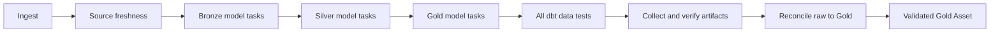

# Plan và thực hành tích hợp Cosmos

## 1. Trạng thái và mục tiêu

Đây là **kế hoạch triển khai kèm code mẫu**, chưa phải cấu hình Cosmos đã cài/chạy trên stack. Các đường dẫn được ghi là “tạo mới” hiện chưa tồn tại. Chỉ thực hiện bước kế tiếp khi checkpoint của bước trước đạt; các lệnh dưới đây chưa được chạy thay bạn.

Baseline ngày 22/10/2026: Airflow 3.3.2/Python 3.13/LocalExecutor, Docker provider 4.6.1, dbt Core 1.12.3/Postgres adapter 1.11.0; 31 model, 47 data tests, 6 sources, 1 dashboard exposure. Hệ thống dùng chung WSL 8 GiB/6 CPU, pool `platform_memory` 4 slot × 512 MiB. Đọc [Docker](../guides/docker.md), [dbt](../guides/dbt.md), [tài nguyên](../guides/resources.md) trước khi thực hành.

Luồng hiện tại:

```text
ingest → freshness → build (31 model + 47 tests) → reconcile → validated Gold Asset
```

Mục tiêu chặng đầu:



Sơ đồ nhóm theo tầng để đọc; dependency thực tế lấy từ manifest, có nhánh đi thẳng Bronze → Gold. Cosmos dựng task graph để xem trạng thái, logs và retry theo model. SQL vẫn thực thi trên PostgreSQL. Không cần thêm Airflow stack hoặc PostgreSQL server.

## 2. Quyết định thiết kế và thứ tự làm

| Chặng | Việc thực hiện | Điều kiện hoàn tất |
|---|---|---|
| A | Kiểm tra package, tạo manifest và render DAG manual | Import được, đúng model/dependency, chưa bật lịch |
| B | Chạy từng model trong Docker, dùng resource policy chung | Một model/task, CPU/RAM/PID đúng policy |
| C | Chạy tests, tổng hợp artifacts, đối soát và thử recovery | Đủ 31 model/47 tests, không phát Gold Asset khi lỗi |
| D | Cutover DAG/lịch chính và cập nhật verifier/docs | Chỉ một DAG được phép ghi warehouse theo lịch |
| Sau nghiệm thu | Cân nhắc `BUILD`/`AFTER_EACH` và tests theo model | Kiểm chứng riêng multi-parent tests và failure propagation |

**Chọn chặng đầu:** `LoadMode.DBT_MANIFEST`, `ExecutionMode.DOCKER`, `TestBehavior.AFTER_ALL`. Cosmos dựng dependency; `node_converters` trả về `BudgetDockerOperator` đang có để giữ đúng CPU quota/pool/guardrails. Đây là adapter tự viết, cần test với phiên bản Cosmos đã pin; không mặc định cho rằng operator Docker native của Cosmos dùng policy của repo.

`AFTER_ALL` tạo task chạy tests sau khi toàn bộ model đã xong. Lựa chọn này giúp các singular tests đối chiếu nhiều bảng chạy khi đủ dữ liệu, và dễ đối chiếu 47 test unique. Đổi lại, test lỗi sẽ được phát hiện sau khi các model downstream đã materialize; chưa có cơ chế chặn sớm như `dbt build`. Gold hiện cũng chưa publish nguyên khối, nên consumer vẫn có thể đọc các bảng trong lúc build. Chặng sau mới đánh giá `BUILD` + `should_detach_multiple_parents_tests=True` hoặc `AFTER_EACH`; không đổi test mode chỉ để graph đẹp hơn. [Test behavior](https://astronomer.github.io/astronomer-cosmos/guides/translate_dbt_to_airflow/testing-behavior.html).

Giữ `max_active_runs=1`, `max_active_tasks=1` của DAG ở lần đầu. Pool chung vẫn 4 slot; task dbt dùng ngân sách `build` (1024 MiB, 1 CPU, 2 slot), ingest giữ 2048 MiB/2 CPU/4 slot. Nhiều task hơn không có nghĩa phải tăng RAM hoặc bật parallel ngay.

Các file dự kiến:

| File/phạm vi | Thay đổi cần làm khi triển khai |
|---|---|
| `infra/airflow-platform/Dockerfile.cosmos`, `compose.cosmos.yaml` | Tạo image/overlay ứng viên, giữ bản trước Cosmos để quay lại |
| `scripts/run_cosmos_node.py`, `infra/laplaptech/cosmos.Dockerfile` | Tạo wrapper/image chạy một model hoặc toàn bộ tests |
| `infra/laplaptech/dags/cosmos_tasks.py`, `laplaptech_cosmos_trial.py` | Soạn ngoài mount live rồi publish helper/DAG manual |
| `scripts/collect_cosmos_results.py` | Viết mới collector bắt buộc trước cutover, theo hợp đồng ở bước 7 |
| `scripts/Start-LocalStack.ps1`, `verify_local_stack.py` | Bổ sung deploy overlay/release và nghiệm thu topology/artifacts mới |
| Tests, docs và SVG | Kiểm chứng failure/retry, cập nhật hướng dẫn sau khi đã chạy thật |

Hiện chỉ guide này được tạo; bảng trên không có nghĩa các file chức năng đã được triển khai.

## 3. Bước 1 — Ghi baseline và chuẩn bị rollback

Tại **root repo**, khi hệ thống đang healthy:

```powershell
python scripts/verify_local_stack.py --output scratch/before-cosmos.json
docker tag laplaptech-runtime:local-v1 laplaptech-runtime:before-cosmos-v1
docker tag airflow-platform:3.3.2-docker4.6.1-py3.13 airflow-platform:before-cosmos-v1
```

Ghi lại commit hoặc snapshot code đã review, image IDs và trạng thái pause của mọi DAG. Thực hiện backup metadata/warehouse và giữ `.env` theo [Docker backup](../guides/docker.md#7-artifacts-và-backup). Trước mọi thay đổi control plane: pause các DAG đang bật, đợi toàn platform hết queued/running runs và task containers; không kill run để cập nhật.

**Checkpoint:** report baseline success, có backup đọc được, giữ source DAG/Compose cũ để rollback. Hai image tags chỉ là mốc khôi phục, không thay database backup.

## 4. Bước 2 — Thử dependency trong image ứng viên

Tạo mới `infra/airflow-platform/Dockerfile.cosmos`:

```dockerfile
FROM apache/airflow:3.3.2-python3.13
USER airflow
RUN pip install --no-cache-dir \
    "apache-airflow==3.3.2" \
    "apache-airflow-providers-docker==4.6.1" \
    "astronomer-cosmos==1.15.1" \
    && pip check
ENV PATH="/home/airflow/.local/bin:/usr/python/bin:/usr/local/sbin:/usr/local/bin:/usr/sbin:/usr/bin:/sbin:/bin"
```

Cosmos **1.15.1 là ứng viên nghiên cứu**: metadata PyPI và API trong wheel được đối chiếu ngày 22/10/2026; chưa chạy dependency resolution/import/integration với baseline này. Không diễn giải `apache-airflow>=2.9.0` trong metadata thành bảo đảm tương thích toàn bộ. [Package chính thức](https://pypi.org/project/astronomer-cosmos/1.15.1/).

Tại **root repo**:

```powershell
docker build -f infra/airflow-platform/Dockerfile.cosmos -t airflow-platform:cosmos-1.15.1-v1 infra/airflow-platform
if ($LASTEXITCODE -ne 0) { throw 'Candidate image failed; keep the current stack.' }
docker run --rm --network none --memory 512m --memory-swap 512m --cpus 1 --entrypoint python airflow-platform:cosmos-1.15.1-v1 -c 'import cosmos; from importlib.metadata import version; print(version("astronomer-cosmos")); print(version("apache-airflow"))'
```

**Checkpoint:** build, `pip check`, import và version đều đúng. Nếu resolver muốn đổi Airflow/provider, dừng để chọn phiên bản phù hợp. Sau khi xác nhận, lưu dependency lock riêng của image Airflow; không đưa Cosmos vào lock runtime ingestion/dbt hiện có. Giữ dbt adapter trong runtime, không cài extra `dbt-postgres` vào Airflow chỉ để render manifest.

## 5. Bước 3 — Tạo một release manifest đồng bộ runtime

`manifest.json` là metadata dependency/resource của dbt, không phải dữ liệu warehouse. Chọn `DBT_MANIFEST` để processor không phải chạy `dbt ls` mỗi lần parse. Manifest phải đến từ **cùng SQL, macros, vars và phiên bản dbt** với runtime. [Parsing methods](https://astronomer.github.io/astronomer-cosmos/guides/translate_dbt_to_airflow/parsing-methods.html).

Tại **root repo**, build một base image riêng rồi dùng chính image đó tạo manifest. Không dùng manifest cũ từ dbt docs hay kết quả production bất kỳ:

```powershell
docker build -f infra/laplaptech/runtime.Dockerfile -t laplaptech-runtime:cosmos-base-v1 .
if ($LASTEXITCODE -ne 0) { throw 'Runtime base build failed.' }
$releaseDir = Join-Path (Get-Location).Path 'scratch/cosmos-release-v1'
if (Test-Path -LiteralPath $releaseDir) { throw 'Use a new release directory or inspect the existing one.' }
New-Item -ItemType Directory -Path $releaseDir | Out-Null
docker run --rm --network none --memory 1024m --memory-swap 1024m --cpus 1 --entrypoint dbt --mount "type=bind,source=$releaseDir,target=/out" -e POSTGRES_HOST=warehouse-laplaptech -e POSTGRES_USER=laplaptech -e POSTGRES_PASSWORD=parse_only -e POSTGRES_DATABASE=laplaptech_pipeline_dev laplaptech-runtime:cosmos-base-v1 parse --no-partial-parse --project-dir /app/dbt --profiles-dir /app/dbt --target-path /out --log-path /out/logs
if ($LASTEXITCODE -ne 0) { throw 'Manifest parse failed.' }
```

Password trên là giá trị giả cho parse không kết nối DB; không thay credential thật. `parse` thành công chưa xác nhận SQL chạy được. Kiểm tra manifest có đúng 31 model enabled, 47 data tests, 6 sources và 1 exposure; exposure là metadata, không biến thành task chạy dashboard.

Publish manifest vào **named volume theo release**, cùng mount read-only ở processor/API/scheduler và runtime task:

```powershell
docker volume create laplaptech-cosmos-release-v1
docker run --rm --network none --memory 256m --memory-swap 256m --cpus 1 --user 0:0 --entrypoint python --mount "type=bind,source=$releaseDir,target=/input,readonly" --mount type=volume,source=laplaptech-cosmos-release-v1,target=/release laplaptech-runtime:cosmos-base-v1 -c 'import os,shutil; shutil.copyfile("/input/manifest.json","/release/manifest.json"); os.chmod("/release/manifest.json",0o444)'
if ($LASTEXITCODE -ne 0) { throw 'Manifest publication failed.' }
```

**Checkpoint:** lưu image ID của base + SHA256 manifest + revision/code snapshot vào release report. Không sửa lại base tag hoặc ghi đè volume của release đã nghiệm thu; dùng `v2` khi SQL thay đổi. Không tái tạo manifest từ một image rồi chạy SQL của image khác.

## 6. Bước 4 — Viết wrapper chạy đúng một node

Tạo mới `scripts/run_cosmos_node.py`. Mẫu dưới là phần thực thi lõi cho LaplapTech; nó dùng lại target guard hiện có, nhận model unique ID từ manifest, lưu artifacts riêng cho mỗi task/attempt và giữ exit code dbt:

```python
import argparse
from datetime import datetime, timezone
import hashlib
import json
import os
from pathlib import Path
import subprocess
from uuid import uuid4
from scripts.run_airflow_stage import lab_environment, verify_database


def main():
    parser = argparse.ArgumentParser()
    parser.add_argument("action", choices=["run-node", "test-all"])
    parser.add_argument("--unique-id")
    args = parser.parse_args()
    if (args.action == "run-node") != bool(args.unique_id):
        parser.error("Only run-node requires --unique-id")
    run_id = os.environ["PIPELINE_RUN_ID"]
    task_id = os.environ["PIPELINE_TASK_ID"]
    attempt = os.environ.get("PIPELINE_ATTEMPT", "1")
    if not attempt.isdigit():
        raise ValueError("Invalid attempt")
    key = lambda value: hashlib.sha256(value.encode()).hexdigest()[:20]
    output = (Path("/artifacts") / key(run_id) / "cosmos" / key(task_id)
              / f"attempt-{attempt}-{uuid4().hex[:8]}")
    output.mkdir(parents=True, exist_ok=False)
    report = dict(run_id=run_id, task_id=task_id, unique_id=args.unique_id,
                  action=args.action, attempt=int(attempt), status="failed", exit_code=1,
                  started_at=datetime.now(timezone.utc).isoformat())
    try:
        raw = Path("/run/cosmos/manifest.json").read_bytes()
        digest = hashlib.sha256(raw).hexdigest()
        if digest != os.environ["COSMOS_MANIFEST_SHA256"]:
            raise RuntimeError("Manifest release mismatch")
        report["manifest_sha256"] = digest
        manifest = json.loads(raw)
        env = lab_environment()
        verify_database(env)
        flags = ["--project-dir", "/app/dbt", "--profiles-dir", "/app/dbt",
                 "--target-path", str(output / "target"),
                 "--log-path", str(output / "logs")]
        command = ["dbt", "test"]
        if args.action == "run-node":
            node = manifest["nodes"][args.unique_id]
            if node["resource_type"] != "model" or not node["config"]["enabled"]:
                raise ValueError("Expected an enabled model")
            command = ["dbt", "run", "--select", "fqn:" + ".".join(node["fqn"])]
            full_refresh = os.environ.get("COSMOS_FULL_REFRESH", "false")
            if full_refresh not in ("true", "false"):
                raise ValueError("Invalid full-refresh parameter")
            if full_refresh == "true":
                command.append("--full-refresh")
        report["resource_limits"] = {
            name: (Path("/sys/fs/cgroup") / name).read_text().strip()
            for name in ("memory.max", "cpu.max", "pids.max")
        }
        code = subprocess.run(command + flags, cwd="/app", env=env, check=False).returncode
        report.update(status="success" if code == 0 else "failed", exit_code=code)
        return code
    finally:
        report["finished_at"] = datetime.now(timezone.utc).isoformat()
        (output / "report.json").write_text(json.dumps(report, indent=2))
        print(f"Cosmos artifacts: {output}", flush=True)


if __name__ == "__main__":
    raise SystemExit(main())
```

`--select` không có dấu `+`: task model không được âm thầm chạy lại upstream/downstream đã giao cho task khác. Mẫu chưa kiểm tra tập `unique_id` trong `run_results.json`; collector ở bước 8 bắt buộc bổ sung việc này, vì dbt có thể exit 0 khi selector không match. Test wrapper phải bao gồm trường hợp đó trước khi cutover.

Tạo mới `infra/laplaptech/cosmos.Dockerfile`, build từ base vừa tạo để giữ nguyên SQL/dependencies:

```dockerfile
FROM laplaptech-runtime:cosmos-base-v1
COPY --chown=pipeline:pipeline scripts/run_cosmos_node.py /app/scripts/run_cosmos_node.py
ENTRYPOINT ["python", "-m", "scripts.run_cosmos_node"]
```

Tại **root repo**:

```powershell
docker build -f infra/laplaptech/cosmos.Dockerfile -t laplaptech-runtime:cosmos-v1 .
```

**Checkpoint:** wrong target/manifest hash/unknown model fail trước khi dbt ghi dữ liệu; một model chạy đúng một model; retry tạo attempt mới. Wrapper không in env/password. Manifest mount bắt buộc tồn tại. Mẫu dành local Linux containers/cgroup v2; fixture CI cần thêm target guard riêng cho đúng database test, không bỏ guard production để thử.

## 7. Bước 5 — Render graph bằng converter có budget

Soạn helper tại **`scratch/cosmos-plan-source/cosmos_tasks.py`** trước; chưa đưa vào mount DAG đang chạy. Đường dẫn cuối khi publish là `infra/laplaptech/dags/cosmos_tasks.py`. Helper không chứa DAG, chỉ trả operator cho Cosmos:

Tại root repo, tạo thư mục soạn bằng `New-Item -ItemType Directory -Path scratch/cosmos-plan-source -Force`, rồi lưu hai file Python ở đó.

```python
from datetime import timedelta
import hashlib
from pathlib import Path
from docker.types import Mount
from budget_docker import BudgetDockerOperator

MANIFEST = Path("/opt/airflow/dbt/laplaptech/manifest.json")


def make_node_task(*, dag, task_group, task_id, action, node=None):
    command = [action]
    if action == "run-node":
        command += ["--unique-id", node.unique_id]
    return BudgetDockerOperator(
        dag=dag, task_group=task_group, task_id=task_id,
        resource_project="laplaptech", resource_stage="build",
        image="laplaptech-runtime:cosmos-v1", command=command,
        docker_url="unix://var/run/docker.sock", api_version="auto",
        network_mode="laplaptech-lab", mount_tmp_dir=False,
        mounts=[
            Mount(source="laplaptech-lab-config", target="/run/laplaptech", type="volume", read_only=True),
            Mount(source="laplaptech-cosmos-release-v1", target="/run/cosmos", type="volume", read_only=True),
            Mount(source="laplaptech-lab-artifacts", target="/artifacts", type="volume"),
        ],
        environment={
            "PIPELINE_RUN_ID": "{{ run_id }}", "PIPELINE_TASK_ID": "{{ ti.task_id }}",
            "PIPELINE_ATTEMPT": "{{ ti.try_number }}",
            "COSMOS_FULL_REFRESH": "{{ 'true' if params.full_refresh else 'false' }}",
            "COSMOS_MANIFEST_SHA256": hashlib.sha256(MANIFEST.read_bytes()).hexdigest(),
        },
        user="10001:10001", auto_remove="force", do_xcom_push=False,
        retries=1 if action == "run-node" else 0,
        retry_delay=timedelta(minutes=2), execution_timeout=timedelta(minutes=30),
        log_opts_max_size="10m", log_opts_max_file="3",
    )


def model_converter(*, dag, task_group, task_id, node, **kwargs):
    return make_node_task(dag=dag, task_group=task_group, task_id=task_id,
                          action="run-node", node=node)


def tests_converter(*, dag, task_group, task_id, **kwargs):
    return make_node_task(dag=dag, task_group=task_group, task_id=task_id,
                          action="test-all")
```

Converter nhận keyword do Cosmos 1.15.1 truyền, trong đó có `task_id`, `node`, `task_group`. Nó cố ý tự xây command/mounts/policy; các `operator_args` kiểu native Cosmos không tự được chuyển vào wrapper này. Khi đổi sang `BUILD`/`AFTER_EACH`, phải viết lại converter và test selector/exclude của tests; **không chỉ đổi enum**. [RenderConfig](https://astronomer.github.io/astronomer-cosmos/guides/translate_dbt_to_airflow/render-config.html), [source bản 1.15.1](https://github.com/astronomer/astronomer-cosmos/tree/v1.15.1/cosmos).

Soạn **`scratch/cosmos-plan-source/laplaptech_cosmos_trial.py`**; bước 6 mới publish vào `infra/laplaptech/dags/laplaptech_cosmos_trial.py`. DAG thử **chỉ transformation** trên raw hiện có:

```python
from pathlib import Path
import pendulum
from airflow.sdk import DAG, Param
from cosmos import DbtTaskGroup, ExecutionConfig, ProjectConfig, RenderConfig
from cosmos.constants import DbtResourceType, ExecutionMode, LoadMode, TestBehavior
from laplaptech.cosmos_tasks import model_converter, tests_converter

with DAG(
    dag_id="laplaptech_cosmos_trial", schedule=None,
    start_date=pendulum.datetime(2026, 10, 22, tz="Asia/Ho_Chi_Minh"),
    catchup=False, is_paused_upon_creation=True,
    max_active_runs=1, max_active_tasks=1,
    params={"full_refresh": Param(False, type="boolean")},
    tags=["laplaptech", "cosmos", "manual-trial"],
) as dag:
    transform = DbtTaskGroup(
        group_id="transform",
        project_config=ProjectConfig(
            manifest_path=Path("/opt/airflow/dbt/laplaptech/manifest.json"),
            project_name="laplaptech_pipeline", install_dbt_deps=False,
        ),
        execution_config=ExecutionConfig(
            execution_mode=ExecutionMode.DOCKER, dbt_project_path=Path("/app/dbt"),
        ),
        render_config=RenderConfig(
            load_method=LoadMode.DBT_MANIFEST, test_behavior=TestBehavior.AFTER_ALL,
            emit_datasets=False, node_conversion_by_task_group=False,
            node_converters={DbtResourceType.MODEL: model_converter,
                             DbtResourceType.TEST: tests_converter},
        ),
    )
```

Đây là trial manual có ghi Silver/Gold trên cùng warehouse, không phải shadow read-only. Production DAG phải paused và hết active runs trước khi trigger trial; không chạy hai DAG writer song song. Không import toàn file DAG production để lấy factory vì có thể làm discover/serialize thêm DAG ngoài ý muốn.

**Checkpoint bước soạn code:** helper và DAG mẫu parse Python được, chưa nằm trong mount live. Sau khi publish ở bước 6, graph phải có 31 task model và một task tests cuối cùng, không có task cho exposure; các cạnh model khớp manifest. Tất cả task executable dùng `BudgetDockerOperator`, pool/slot đúng, model không chạy dbt trong scheduler. Kiểm tra import/serialization trên cả processor và scheduler trước khi trigger.

## 8. Bước 6 — Mount manifest và triển khai thử có kiểm soát

Tạo mới `infra/airflow-platform/compose.cosmos.yaml`:

```yaml
x-cosmos: &cosmos
  image: airflow-platform:cosmos-1.15.1-v1
  build:
    context: .
    dockerfile: Dockerfile.cosmos
  volumes:
    - cosmos-release:/opt/airflow/dbt/laplaptech:ro

services:
  airflow-init:
    <<: *cosmos
  airflow-api-server:
    <<: *cosmos
  airflow-scheduler:
    <<: *cosmos
  airflow-dag-processor:
    <<: *cosmos

volumes:
  cosmos-release:
    external: true
    name: laplaptech-cosmos-release-v1
```

Trước khi đặt trial DAG vào mount đang hoạt động, chuẩn bị đầy đủ image/helper/manifest; nếu không processor sẽ báo import error. Trong lúc maintenance đã drain, copy `Dockerfile.cosmos` và `compose.cosmos.yaml` từ source `infra/airflow-platform` sang workspace platform. Tại **workspace platform**, luôn dùng **ba** Compose file:

```powershell
docker compose --env-file .env -f compose.yaml -f compose.laplaptech.yaml -f compose.cosmos.yaml config --quiet
docker compose --env-file .env -f compose.yaml -f compose.laplaptech.yaml -f compose.cosmos.yaml up -d
docker compose --env-file .env -f compose.yaml -f compose.laplaptech.yaml -f compose.cosmos.yaml exec -T airflow-dag-processor airflow dags list-import-errors
```

Mỗi lệnh phải exit 0 trước khi tiếp tục. `config --quiet` tránh in env đã interpolate. Khi API/scheduler/processor đều dùng image Cosmos và manifest mount đã sẵn sàng, tại **root repo** publish code đã soạn:

```powershell
if (-not (Test-Path -LiteralPath 'infra/laplaptech/dags/__init__.py')) {
    New-Item -ItemType File -Path 'infra/laplaptech/dags/__init__.py' | Out-Null
}
foreach ($name in @('cosmos_tasks.py', 'laplaptech_cosmos_trial.py')) {
    $destination = Join-Path 'infra/laplaptech/dags' $name
    if (Test-Path -LiteralPath $destination) { throw 'Inspect existing candidate code before replacing it.' }
    Copy-Item -LiteralPath (Join-Path 'scratch/cosmos-plan-source' $name) -Destination $destination
}
```

`laplaptech` là package dưới DAG root `/opt/airflow/dags`; dùng absolute import như mẫu, không dựa vào thư mục làm việc của processor. Kiểm tra lại import errors rồi xem Code/Graph và Task Logs của `laplaptech_cosmos_trial`. Trigger manual với `full_refresh=false` khi không có writer khác. Chưa bật lịch trial.

**Checkpoint:** sáu service vẫn healthy, không import error, task model cuối cùng và task tests success. Dùng `docker stats`/`check_resources.py` đối chiếu service limits và cgroup trong node reports. Thời gian có thể tăng vì nhiều lần khởi động dbt/container; chưa tăng parallelism khi chưa đo RAM.

Bootstrap hiện chỉ copy/build/deploy hai Compose file cũ. Trước khi phát hành Cosmos, phải cập nhật `Start-LocalStack.ps1` để copy candidate files, khai báo release volume và dùng overlay thứ ba nhất quán (có thể thêm cờ `-EnableCosmos`). Nếu chưa sửa bootstrap, không chạy lại nó rồi cho rằng Cosmos overlay được giữ nguyên. Cập nhật cả lệnh start/stop/backup và workspace README cùng lúc.

## 9. Bước 7 — Collector, verifier và bài tập recovery

Code ở các bước trên chưa đủ điều kiện cutover. Cần tạo `scripts/collect_cosmos_results.py`, một task chạy **sau toàn TaskGroup**, với các quy tắc:

1. Đọc đúng `run_id`, release SHA và artifacts của các task thuộc run đó. Lấy attempt thành công mới nhất của mỗi task, nhưng phải đối chiếu trạng thái Airflow hiện tại; một attempt lỗi cũ không được che lỗi mới hoặc làm đếm trùng.
2. Lấy tập expected model/test unique IDs từ manifest. Mỗi task `run-node` phải có đúng model được giao trong `run_results.json`; thiếu file, selector rỗng hoặc chạy thừa model đều fail.
3. Tập model thực thi đúng 31 unique IDs, tất cả `success`; tập data tests đúng 47 unique IDs và `pass` theo baseline. Không cộng số task rồi suy ra số tests, không đếm `no-op` exposure thành model/test.
4. Kiểm tra cgroup từng task và SHA release, giữ output attempt cũ. Dataset không đi qua XCom; chỉ truyền metadata nhỏ nếu cần.
5. Ghi summary JSON của run rồi mới cho `reconcile` chạy. Nếu collector/test/model fail, validated Gold Asset không được phát. Không dùng `trigger_rule=all_done` cho đường publish success.

Sửa `verify_local_stack.py`: hiện nó hardcode **bốn task** và **một** file `build/target/run_results.json`, nên sẽ báo lỗi với Cosmos. Verifier mới phải kiểm tra expected task set/graph, node artifacts và summary; vẫn giữ freshness, target identity, đối soát, dashboard và dependency checks. Không sửa verifier chỉ thành “DAG xanh là pass”.

Test trên PostgreSQL fixture riêng theo [testing guide](../guides/testing.md), với wrapper/guard test-mode chỉ cho `laplaptech_pipeline_test`. Các bài tập cần có trước cutover:

| Tình huống | Kết quả cần quan sát |
|---|---|
| Selector không match | Collector fail dù dbt có thể exit 0 |
| Model SQL lỗi | Model task fail; descendants và tests/reconcile không thành công |
| Test đối soát lỗi | Tests task fail; reconcile/validated Gold không phát |
| Sửa lỗi rồi Clear | Chọn task lỗi và downstream cần chạy lại; upstream đã đúng không bị chạy lại vô cớ |
| Manifest/image lệch phiên bản | Guard/release verification fail |
| Sai database/user | Fail trước ghi; fixture runner từ chối warehouse active |
| Hai DAG cùng writer | Quy trình deployment/kiểm tra active runs chặn trigger/cutover |

Sau khi sửa upstream làm thay đổi kết quả, phải Clear các downstream bị ảnh hưởng, kể cả task đã success nếu cần. Cosmos không tự rollback bảng, không tự sửa SQL hoặc tự quyết định mọi downstream cần rebuild. Không cố tình tạo lỗi trên warehouse/dashboard đang dùng để thực hành.

**Checkpoint:** fixture full/replay, targeted retry và toàn bộ assertions trên đạt; sau đó nghiệm thu run thật incremental và full-refresh tại thời điểm phù hợp, 31 model/47 tests và đối soát khớp baseline dữ liệu của run. Ghi report mới trong `docs/validation/`, không sửa report lịch sử thành bằng chứng Cosmos.

## 10. Bước 8 — Cutover luồng đầy đủ và rollback

Khi A–C đã đạt, đưa TaskGroup vào luồng production:

```text
ingest → freshness → transform TaskGroup → collect Cosmos results → reconcile
```

Tách factory stage ra helper dùng chung rồi tái sử dụng ingest/freshness/reconcile, target guards, timeout và raw/Gold Assets. Giữ hai cron 08:15/16:45 Việt Nam, `catchup=False`, param `full_refresh`, một active run/task. Bảo đảm full-refresh được truyền đến từng model, còn ingest vẫn theo watermark; không chạy lại `dbt build` toàn bộ sau TaskGroup vì sẽ materialize lần hai.

Chọn giữ DAG ID cũ hoặc chuyển ID mới một lần có chủ đích; nếu giữ ID cũ, cần kiểm tra task history/serialized DAG version khi thay topology. Pause trial/legacy trước khi bật đúng **một** production writer. Xác nhận lịch, task set, cgroup, tests, summary, reconcile và dashboard bằng verifier mới.

Rollback khi gặp lỗi: pause DAG mới, đợi run/task containers kết thúc, khôi phục source DAG/Compose/images trước Cosmos và kiểm tra import/target trước khi unpause lịch cũ. Giữ nguyên volumes/keys/metadata; không `down -v`. Không restore metadata cũ hoặc hạ Airflow tùy tiện; kế hoạch này không yêu cầu nâng core/migrate metadata. Source rollback không tự rollback những bảng đã materialize: nếu Gold dang dở, dùng flow cũ build/reconcile để đồng bộ dữ liệu trước khi công bố success.

Cuối cùng cập nhật [Airflow](../guides/airflow.md), [Docker](../guides/docker.md), [dbt](../guides/dbt.md), [data flow](../architecture/data_flow.md), sơ đồ SVG, bootstrap, verifier và contract của shared platform. Mỗi project sau có manifest/runtime/namespace riêng, cùng dùng control plane và resource pool; không để manifest LaplapTech trở thành cấu hình mặc định cho mọi project.

## 11. Tự kiểm tra kiến thức

- Manifest khác dataset và runtime image ở điểm nào? Vì sao phải đồng bộ release?
- Vì sao task count không bằng model count + test count trong mọi test mode?
- Pool slot khác Docker memory limit/CPU quota thế nào?
- Vì sao converter dùng `dbt run --select` không có dấu `+`?
- Khi model lỗi rồi sửa, những downstream nào cần Clear? Khi nào phải full-refresh?
- Vì sao tests xanh chưa thay thế reconcile và không bảo đảm Gold publish atomic?

Các API mẫu được đối chiếu với wheel Cosmos 1.15.1; chỉ kiểm tra tài liệu/cú pháp khi viết guide, chưa chạy các sample dưới Cosmos. Đọc thêm [How Cosmos runs dbt](https://astronomer.github.io/astronomer-cosmos/guides/run_dbt/index.html) và [Docker execution](https://astronomer.github.io/astronomer-cosmos/guides/run_dbt/container/docker.html) trước khi thử mode/operator khác.
