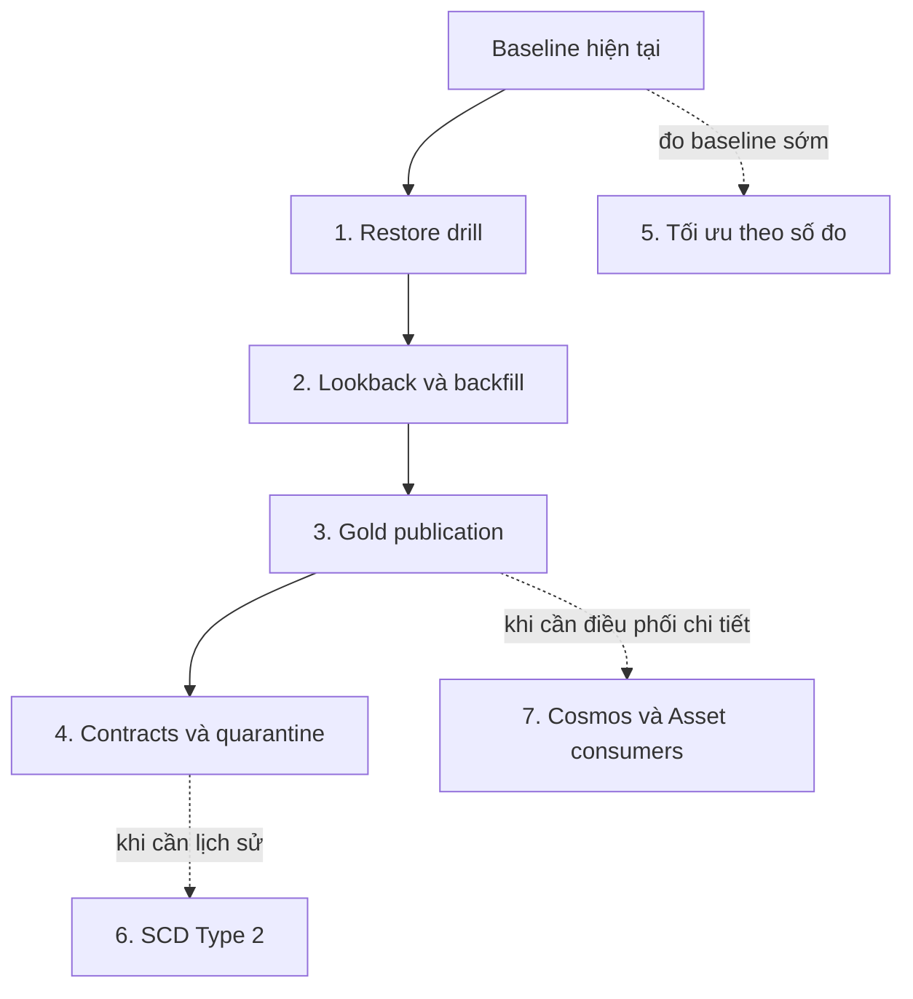
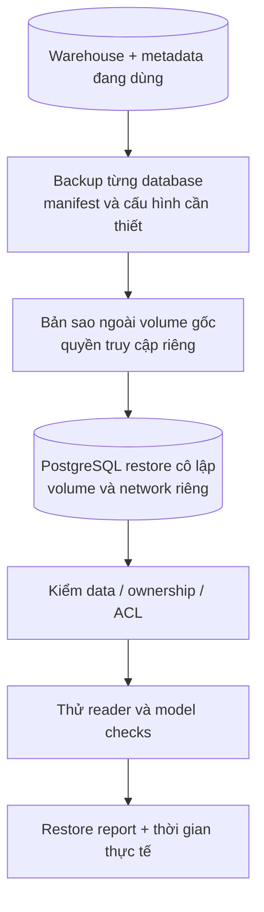
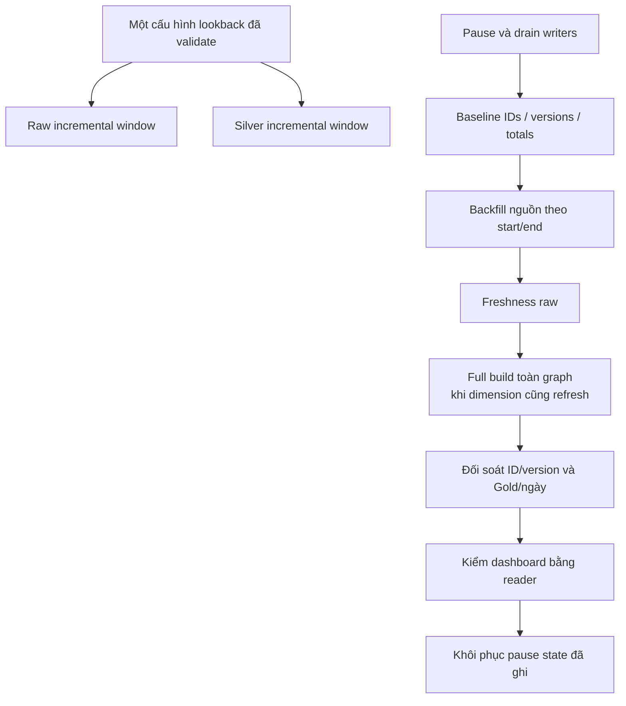
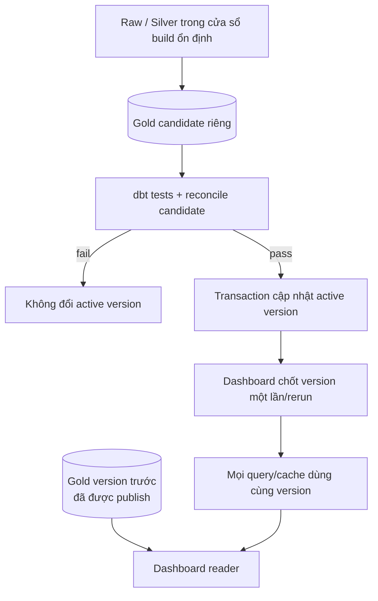
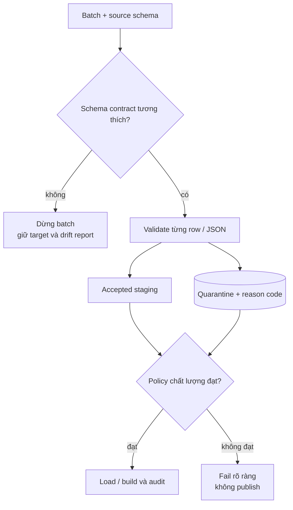
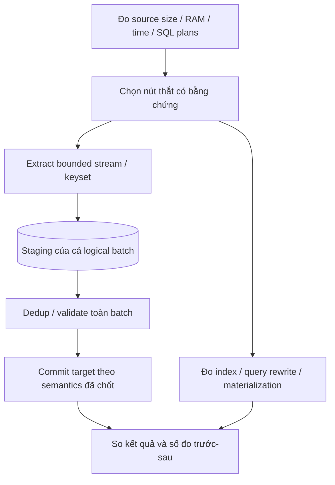
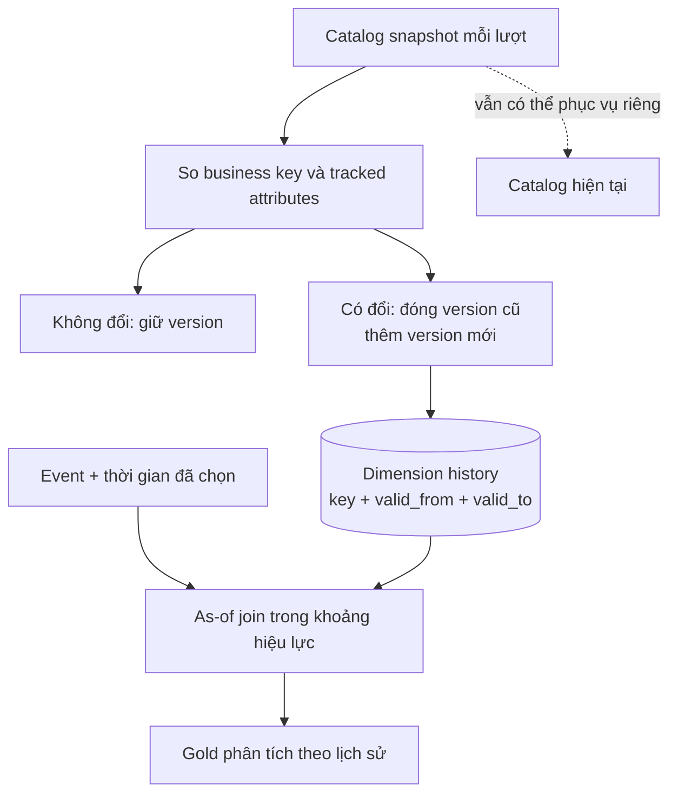
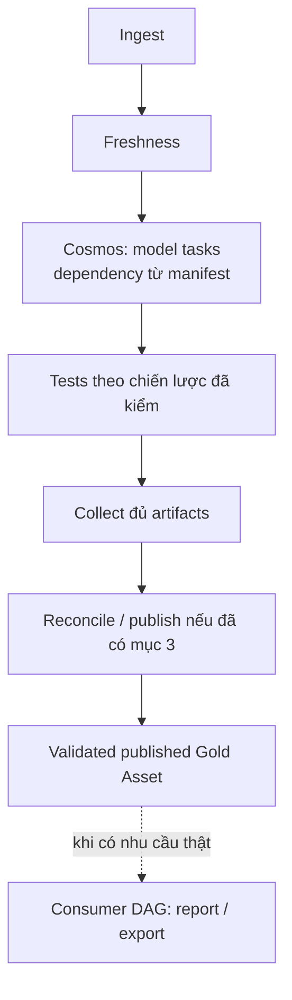

# Roadmap cải tiến LapLapTech

**Trạng thái: kế hoạch, chưa triển khai các hạng mục bên dưới.** Baseline đối chiếu ngày 26/10/2026: Docker local, DAG bốn stage, 31 dbt models/47 data tests, role pipeline và Gold reader riêng. [Data flow](../architecture/data_flow.md) mô tả code đang có; trang này mô tả vấn đề cần sửa, nơi sửa và tiêu chí chứng minh kết quả.

Mục tiêu học tập là làm hệ thống đúng, khôi phục được và dễ vận hành. Không cần hoàn thành cả bảy mục trong một tuần. Các đường dẫn ghi **dự kiến tạo** là thiết kế, không phải file/chức năng đã tồn tại. Giữ một roadmap này và [Cosmos plan](cosmos.md), không tạo thêm nhiều bản plan trùng nội dung.

**Kế hoạch chốt ngày 29/10/2026:** triển khai cấu hình lookback chung, recovery `backfill → rebuild → reconcile` và correction không còn hợp lệ trong đợt tiếp theo, dự kiến trong 3–4 ngày tới. Đợt push hiện tại chỉ đưa lên lịch 07:00/19:00, công cụ kiểm định, kết quả test và tài liệu; ba thay đổi xử lý dữ liệu này vẫn chưa triển khai.

## Chọn thứ tự và phạm vi

| Thứ tự | Hạng mục | Cải thiện điều gì? | Kiến thức chính | Ưu tiên |
|---|---|---|---|---|
| 1 | [Backup/restore có kiểm chứng](#1-backup-và-restore-có-kiểm-chứng) | Có thể phục hồi data, quyền và điều phối khi sự cố | RPO/RTO, logical backup, restore drill | Làm trước |
| 2 | [Lookback thống nhất và recovery backfill](#2-lookback-thống-nhất-và-recovery-backfill) | Event đến muộn/sửa dữ liệu cũ đi đúng từ nguồn đến Gold | Incremental correctness, idempotency, writer coordination | Làm tiếp |
| 3 | [Publish Gold nhất quán](#3-publish-gold-nhất-quán-và-cache-theo-phiên-bản) | Dashboard chỉ đọc một bản đã kiểm chứng | Transactions, versioned data, cache invalidation | Làm sau mục 2 |
| 4 | [Data contracts và quarantine](#4-data-contracts-và-quarantine-có-lý-do) | Biết dữ liệu nào bị từ chối và vì sao | Schema evolution, validation, audit | Sau khi recovery ổn định |
| 5 | [Đo và tối ưu extraction/query](#5-đo-và-tối-ưu-extraction-cùng-truy-vấn) | Hạn chế OOM và biết nút thắt thực tế | Streaming, indexing, query plans, measurement | Đo sớm; sửa theo bằng chứng |
| 6 | [Lịch sử catalog/SCD Type 2](#6-lịch-sử-catalog-và-scd-type-2) | Phân tích theo catalog tại thời điểm phù hợp | Temporal modeling, surrogate keys, as-of joins | Khi có nhu cầu lịch sử |
| 7 | [Cosmos và consumer theo Asset](#7-cosmos-và-consumer-theo-asset) | Quan sát/retry từng model, tách producer/consumer có kiểm soát | dbt graph orchestration, event-driven scheduling | Nhánh tùy chọn |

Sơ đồ là thứ tự khuyến nghị, không phải dependency phần mềm bắt buộc. Trước thay shared Docker/Airflow/warehouse/budget phải đọc contract platform hiện hành, drain mọi project liên quan và giữ registrations/keys/pause states. Mọi fixture/failure injection dùng PostgreSQL test hoặc môi trường cô lập; không reset database vận hành.

## 1. Backup và restore có kiểm chứng

### Vấn đề và kết quả cần đạt

Đã có hướng dẫn và backup local, nhưng chưa có bài diễn tập hoàn chỉnh chứng minh có thể restore data/quyền/metadata. Named volume giữ dữ liệu qua stop không phải backup độc lập; Git private chỉ giữ source, không chứa database và secrets cần phục hồi.

Cần trả lời được: mất tối đa bao nhiêu dữ liệu chấp nhận được (**RPO**), mất bao lâu để phục hồi (**RTO**), và phục hồi từ những thành phần nào. Đặt mục tiêu thực tế sau lần đo đầu, không tự gắn nhãn có HA/DR.

### Sửa ở đâu?

| Hiện có | Thay đổi dự kiến |
|---|---|
| [Docker guide](../guides/docker.md), [testing](../guides/testing.md) | Bổ sung quy trình restore và cách đọc kết quả |
| [Provisioning roles](../../scripts/provision_access.py) | Tham chiếu quyền mong đợi; không tự chạy admin migration lên target lạ |
| [System verifier](../../scripts/verify_local_stack.py) | Tách probe nào dùng được trên restore target khỏi probe bắt buộc live platform |
| Dự kiến tạo `scripts/restore_drill.py` | Wrapper/probe có allowlist target cô lập, manifest và report; không tự xóa volume |
| Tests trong `tests/` | Kiểm target guard, backup thiếu thành phần và quyền sau restore |

### Làm như thế nào?

1. Ghi source commit/image IDs, phiên bản PostgreSQL, inventory, counts, watermark, owners và quyền reader/pipeline. Ghi cả danh sách DAG/pause state trước bảo trì.
2. Backup riêng database LapLapTech và database metadata Airflow; lưu manifest checksum/thời gian/source version. `pg_dump` một database không chứa toàn bộ roles cấp cluster: cần phương án tạo lại đúng role/ACL và giữ bí mật credential cần thiết.
3. Giữ `.env`, Fernet/key/config cần phục hồi ở nơi private có quyền truy cập phù hợp, tách khỏi report công khai. Không upload database/role hashes/password vào CI artifact hay Git. Không restore toàn bộ globals của shared cluster chỉ để khôi phục LapLapTech.
4. Restore sang instance/volume/network riêng, host port riêng. Có thể giữ tên database trong instance cô lập để kiểm ownership; điều đó không làm wrapper live mặc nhiên chấp nhận endpoint mới. Viết guard restore riêng, không tắt guard production để chạy thử.
5. Kiểm row counts, ID/version/payload đại diện, schemas/views, ownership và default privileges. Thử reader SELECT Gold, bị chặn raw/ghi; thử pipeline không có quyền admin.
6. Diễn tập metadata ở đợt riêng: instance Airflow thử nghiệm tương thích, giữ DAG paused, không mount Docker socket hoặc source config cho phép ghi warehouse thật. Kiểm run history, login và khả năng giải mã thông tin cần Fernet key.
7. Ghi report: những gì đã restore, phần chưa thử, thời gian, sai khác và thao tác cần thiết. Dọn chỉ tài nguyên test do bài này tạo sau khi giữ bằng chứng.

**Nghiệm thu:** có restore thực sự và probe thành công, không chỉ liệt kê được archive; live data/keys/pause states và project khác không đổi. **Quay lại:** dừng target test, giữ source/backup gốc; không có bước ghi ngược vào live trong bài diễn tập.

Tài liệu nền: [PostgreSQL backup/restore](https://www.postgresql.org/docs/16/backup.html), [pg_dump và phạm vi roles](https://www.postgresql.org/docs/16/app-pgdump.html).

## 2. Lookback thống nhất và recovery backfill

**Bằng chứng ngày 29/10/2026:** đã chạy [kiểm định chức năng](../validation/functional_check_2026-10-29.json), chưa sửa logic lookback/recovery. 60 Python tests pass; source fixture đi qua loader/dbt thật. Trong cửa sổ và đúng biên 2 giờ đều tới Gold, replay giữ ID/version/payload/tổng ngày. Event client-time cũ một ngày vẫn nhận được khi server timestamp mới.

| Quan sát trên fixture | Quyết định tiếp theo |
|---|---|
| Event ngoài cửa sổ bị bỏ từ nguồn, nhưng 31 models/47 dbt tests vẫn có thể pass | Cần recovery/backfill; đối soát nội bộ không chứng minh source completeness |
| Backfill đã vào raw nhưng ngoài cửa sổ Silver bị bỏ ở incremental | Hoàn thiện wrapper backfill → rebuild → reconcile; chưa coi `dbt build` thường là recovery |
| Correction từ hợp lệ sang thiếu session để lại row Silver cũ | Full rebuild phục hồi; cần xử lý invalidation rõ nếu muốn recovery incremental |
| Raw đổi sang 10800 giây nhưng Silver vẫn 2 giờ | Ưu tiên dùng một cấu hình lookback đã validate |
| Bốn lượt incremental gây lệch đều bị `assert_raw_to_silver` chặn | Giữ test này làm acceptance gate, không bỏ test để pipeline xanh |

Do đã có bằng chứng correctness gap, tiếp tục mục 2 trước tối ưu hiệu năng/Cosmos. Thời gian fixture hiện chỉ mô tả bài thử nhỏ; chưa đủ cơ sở tăng RAM, thêm index hay suy tỷ lệ late data thực tế. Cách chạy lại ở [testing mục 9](../guides/testing.md#9-kiểm-định-lookback-và-late-arriving-data).

### Vấn đề và kết quả cần đạt

Raw dùng `INGESTION_LOOKBACK_SECONDS` mặc định 7200; Silver event hardcode `INTERVAL '2 hour'` và có MAX watermark riêng. CLI đã có `[start,end)` nhưng DAG chỉ có `full_refresh`. Event ngoài cửa sổ có thể thiếu ở raw hoặc Silver; full-refresh dbt không đọc lại ClickHouse.

Một raw event được sửa từ hợp lệ sang thiếu name/session có thể để lại bản Silver cũ do bộ lọc incremental. Backfill hiện còn refresh năm dimension bằng catalog hiện tại. Cần một quy trình phục hồi **nguồn → raw → toàn graph → đối soát**, có bằng chứng ID/version, không chỉ counts.

### Sửa ở đâu?

| Source hiện có | Thay đổi dự kiến |
|---|---|
| [Ingestion](../../ingestion/clickhouse_to_postgres.py) | Hàm đọc/validate lookback thống nhất, giữ ngữ nghĩa version và range |
| [Stage entrypoint](../../scripts/run_airflow_stage.py) | Truyền cấu hình đã validate vào dbt và mở rộng report recovery |
| [Silver event](../../dbt/models/silver/silver_user_event_tracking.sql), [dbt config](../../dbt/dbt_project.yml) | Bỏ literal 2 giờ, dùng cùng giá trị qua dbt var/env đã kiểm |
| [Fixture](../../scripts/dev_fixtures.py), [ingestion tests](../../tests/test_ingestion.py), [dev runner](../../scripts/run_dev_pipeline.py) | Thêm tình huống late/correction, so ID/version/payload và Gold |
| Dự kiến tạo `scripts/recover_pipeline.py` | Wrapper manual trong Docker, range/target guards, baseline và report |
| [Ingestion guide](../guides/ingestion.md), [dbt guide](../guides/dbt.md) | Một đường recovery có checkpoint; ghi rõ phạm vi dimension/full graph |

### Làm như thế nào?

1. Viết fixture tái hiện lỗi trước. Giữ test rollback, replay và concurrency hiện có; không dùng nguồn thật để tạo dữ liệu lỗi giả.
2. Dùng một cấu hình số nguyên không âm, mặc định 7200, validate cả lượt đầu/backfill và incremental. Thử 0, 7200 và một giá trị khác; giá trị lỗi phải fail, không âm thầm thành 0. Không ghép chuỗi chưa validate vào SQL.
3. Giữ watermark là server-received timestamp, điều kiện đầu cửa sổ bao gồm và timezone ngày/tháng hiện hành. Chưa thay nó thành event-time hoặc thêm checkpoint ledger trong cùng thay đổi nhỏ này.
4. Wrapper recovery đọc đủ start/end có timezone, kiểm đúng target và chạy theo trần Docker hiện có. Chặng đầu dùng cửa sổ bảo trì: pause DAG, đợi hết runs/tasks và kiểm CLI writers; không chạy recovery chồng lịch.
5. Backfill raw rồi full build toàn graph khi giữ hành vi refresh năm dimension. Chỉ rebuild nhánh event không cập nhật các Gold chỉ phụ thuộc catalog. Full-refresh cũng loại row Silver cũ nay không còn đạt bộ lọc.
6. Ghi run/attempt, range, lookback, counts/watermarks trước–sau, ID/version fixture, kết quả dbt/reconcile và reader check. Không đưa payload thật nhạy cảm vào report.
7. Lỗi ở bước nào dừng tại đó, giữ pause state để điều tra; chỉ resume sau kiểm chứng thành công. Bản catalog quá khứ và source deletes vẫn ngoài phạm vi mục này.

| Fixture bắt buộc | Kỳ vọng |
|---|---|
| Event trong cửa sổ, kể cả mốc đầu | Được đọc; replay không tăng ID |
| Event mới xuất hiện nhưng timestamp ngoài cửa sổ | Lượt thường bỏ qua có chủ đích; backfill phục hồi |
| Event đúng `start` / đúng `end` | Bao gồm start, loại end |
| Correction có version mới hơn nhưng vẫn ngoài cửa sổ thường | Raw nhận bản mới; rebuild cập nhật Silver/Gold đúng |
| Cùng ID/timestamp nhưng payload khác | Giữ hành vi fail, không tự chọn một bản |
| Event hợp lệ bị sửa thành thiếu name/session | Recovery loại bản Silver cũ, tổng ngày được sửa |
| Event qua nửa đêm Việt Nam | Event/session-day đi đúng ngày |
| Sai database, range lỗi hoặc đọc watermark lỗi | Fail đúng điểm, không full extraction bất ngờ |

**Nghiệm thu:** có chuỗi thường → backfill → rebuild → reconcile → replay chứng minh đúng ID/version/payload và KPI ngày; inventory/tests hiện có vẫn đạt. **Quay lại:** cấu hình mặc định 7200 vẫn tương thích; giữ backup/baseline trước recovery, không rollback bằng xóa raw tùy tiện.

Trước khi thêm backfill DAG độc lập cần thiết kế phối hợp writer xuyên DAG/CLI. `max_active_runs=1` của hai DAG không khóa lẫn nhau; advisory transaction lock của một bảng không giữ qua nhiều task/container. Không giữ lock bằng XCom hay giả định pause một DAG chặn mọi writer. [Incremental models của dbt](https://docs.getdbt.com/docs/build/incremental-models).

## 3. Publish Gold nhất quán và cache theo phiên bản

### Vấn đề và kết quả cần đạt

Gold đang được thay từng model, dashboard đọc từng bảng với cache 300 giây. Build/test/reconcile lỗi giữa chừng có thể để consumer thấy nhiều phiên bản. Gold Asset không phải cổng publish. Cần giữ bản đã kiểm chứng trước đó cho đến khi ứng viên mới đủ điều kiện.

### Sửa ở đâu?

- [dbt config](../../dbt/dbt_project.yml) và macros: route **Gold candidate** vào schema/version riêng; giữ dependency raw/Silver đúng phạm vi.
- [Stage entrypoint](../../scripts/run_airflow_stage.py): reconcile candidate rõ target, publish sau validation; không đổi pointer trong bước build.
- Dự kiến tạo `scripts/publish_gold.py`: validate token/version, publish transaction, report và rollback pointer.
- [Dashboard data](../../streamlit_app/data.py), [app](../../streamlit_app/app.py), [health](../../streamlit_app/health.py): chốt version, query/cache theo version, hiển thị thời điểm publish.
- [Provisioning](../../scripts/provision_access.py), [verifier](../../scripts/verify_local_stack.py), tests/dbt exposure: điều chỉnh quyền, inventory và cách xác nhận release.

### Làm như thế nào?

1. POC trên hai bảng có tổng liên quan, trong DB test. Candidate tách khỏi bảng đang phục vụ; cấu hình schema phải có allowlist, không bỏ guard target/role.
2. Thiết kế version bất biến sau validation và một active-version pointer. Tên như `public_gold_release_<token>` chỉ là phương án dự kiến; chốt naming sau POC. Reconciler hiện hardcode `public_gold` phải đọc candidate rõ ràng, không vô tình kiểm bản live.
3. Build candidate dưới writer coordination để raw/Silver không bị writer khác thay đổi giữa các model và lúc đối soát. Publication nhất quán không tự làm dữ liệu nguồn nhất quán nếu writer vẫn chạy chồng.
4. Sau tất cả tests/reconcile đạt, cấp reader đúng quyền cần thiết và chuyển pointer trong transaction ngắn. Phân biệt auxiliary control objects với 12 business models khi kiểm inventory. Gold Asset chỉ phát sau publish thành công.
5. Dashboard đọc pointer **một lần cho mỗi lượt render**, rồi query mọi bảng bằng version đó. Cache key gồm version và model; version cũ còn giữ để render đang dở không bị mất bảng. Chỉ đổi view/swap schema trong một transaction chưa đủ bảo đảm nhiều query/cache độc lập cùng một bản.
6. Thử crash trước/sau publish; thao tác lặp lại cùng version phải có kết quả xác định. Rollback về pointer cũ được kiểm quyền và ghi report.
7. Sau POC mới mở rộng đủ 12 bảng, update verifier/health/exposure nếu cần. Dọn phiên bản cũ có retention và thời gian chờ readers, không DROP ngay sau switch.

**Nghiệm thu:** gây lỗi có chủ đích giữa build, trong validation và quanh publish; dashboard vẫn đọc trọn bản cũ hoặc trọn bản mới. Reader không được DDL/ghi/raw. **Quay lại:** giữ version cũ và chuyển pointer có kiểm soát; rollback code/app và metadata version theo cùng kế hoạch.

[Tài liệu transaction isolation](https://www.postgresql.org/docs/16/transaction-iso.html) giúp phân biệt transaction publication với consistency của nhiều request.

## 4. Data contracts và quarantine có lý do

### Vấn đề và kết quả cần đạt

Snapshot mới kiểm tập tên cột; type/nullability chưa có hợp đồng đầy đủ. Event kiểm ID/timestamp nhưng chuỗi JSON sai hoặc shape bất ngờ vẫn có thể làm dbt lỗi. Event thiếu name/session bị lọc khỏi Silver mà chưa có nơi thống kê nguyên nhân.

Cần nhận biết schema drift trước khi thay target và phân loại chính xác row hợp lệ/bị từ chối. Quarantine là vùng cách ly phục vụ điều tra/replay, không phải cách âm thầm bỏ lỗi cho task xanh.

### Sửa ở đâu?

| Source hiện có | Thay đổi dự kiến |
|---|---|
| [Ingestion](../../ingestion/clickhouse_to_postgres.py) | Thay so tên cột đơn thuần bằng compatible schema validation và row validation |
| Dự kiến tạo `ingestion/contracts.py` | Contract version, column/type/nullability và reason codes |
| [Silver event](../../dbt/models/silver/silver_user_event_tracking.sql), [source/model tests](../../dbt/models/model_tests.yml) | Đồng bộ điều kiện hợp lệ, kiểm accepted/rejected và không còn filter mơ hồ |
| [Provisioning](../../scripts/provision_access.py), [reconcile](../../scripts/run_airflow_stage.py) | Nếu thêm quarantine/audit objects thì cấp quyền và kiểm inventory đúng loại |
| Fixture, tests, [ingestion guide](../guides/ingestion.md) | Test drift, JSON shape, reason count và replay sau sửa |

### Làm như thế nào?

1. Liệt kê schema thực tế và phân loại thay đổi: thêm cột được chấp nhận hay fail, đổi kiểu có mất dữ liệu không, cột nào bắt buộc. Không tự động cast mọi thứ sang text cho qua contract.
2. Validate ID/timestamp/JSON trước ghi. Phân biệt JSON syntax sai, shape sai, device ID không hợp lệ, thiếu session/name và missing dimension reference. Timestamp hữu hạn chưa đủ: chốt policy cho timestamp tương lai bất thường để tránh đẩy MAX watermark sai.
3. Chốt nơi cách ly và semantics trước code: dự kiến lưu run/source ID/version, reason code, contract version, thời điểm phát hiện; payload chỉ giữ khi cần và có quyền/retention phù hợp. Dashboard reader không được đọc quarantine.
4. Chọn fail policy rõ theo loại dữ liệu. Schema drift phá vỡ contract hoặc snapshot catalog không đầy đủ nên dừng; không publish catalog thiếu hàng chỉ vì đã tách hàng lỗi. Nếu cho phép partial event batch phải ghi tỷ lệ/reasons và completeness status, không gọi đó là full success không điều kiện.
5. Với mỗi batch phải đối chiếu input = accepted + rejected theo đơn vị row đã chốt; dedup/version filtering là số đo riêng để không đếm lẫn. Bổ sung cảnh báo/report dễ điều tra.
6. Replay row đã sửa qua cùng dedup/version rules. Không làm mất event chỉ vì quarantine chứa cùng ID; không tự thay payload khi version bằng nhau xung đột.

**Nghiệm thu:** fixtures thêm/xóa/đổi kiểu cột, malformed JSON, sai shape, NULL fields và future timestamp cho kết quả policy dự kiến; không truncate target trước validation lỗi; rejected rows có lý do truy vết. **Quay lại:** giữ target/backup cũ và contract version trước, không DROP quarantine khi rollback code.

## 5. Đo và tối ưu extraction cùng truy vấn

### Vấn đề và kết quả cần đạt

Extraction hiện đọc toàn result rồi tạo DataFrame; chia insert thành batch 1000 dòng không biến việc extract thành streaming. Source lớn có thể vượt trần ingest 2048 MiB. Các join/MAX/group-by cũng tiêu thụ tài nguyên ở PostgreSQL, không nằm hết trong trần RAM runtime.

Mục tiêu đầu tiên là biết peak RAM/thời gian/I/O và truy vấn nào chậm; chỉ tối ưu sau baseline. Không mặc định thêm index/partition hoặc tăng RAM sẽ giải quyết đúng nút thắt.

### Sửa ở đâu?

- [Ingestion](../../ingestion/clickhouse_to_postgres.py): extraction và batch loading, chỉ sửa chiến lược sau khi chọn được thứ tự/version ổn định.
- [Stage report](../../scripts/run_airflow_stage.py): metrics duration, rows/bytes, watermark và số đo RAM phù hợp; report cgroup hiện chỉ ghi limit, chưa phải peak usage đầy đủ.
- [dbt models](../../dbt/dbt_project.yml): chọn truy vấn chậm từ run results, đọc SQL compiled và kế hoạch PostgreSQL.
- Dự kiến tạo `scripts/benchmark_pipeline.py`: cùng fixture/dataset mục tiêu, lưu số đo có phương pháp thay vì test thời gian quá nhạy trong CI.
- [Resource guide](../guides/resources.md), [testing](../guides/testing.md): ghi cách đo và workload mục tiêu; policy shared chỉ đổi sau review platform.

### Làm như thế nào?

1. Đo riêng full load, incremental, replay, full dbt build và query dashboard. Ghi số row/cột, image/code version, giới hạn task/warehouse, threads và trạng thái cold/warm cache.
2. Chọn streaming API hoặc keyset pagination phù hợp source. Nếu phân trang phải có thứ tự deterministic và xử lý ID/version trùng qua ranh giới page; OFFSET trên nguồn đang thay đổi không tự bảo đảm đủ dữ liệu. Chốt consistency/cutoff của source và báo giới hạn nếu nguồn không cung cấp snapshot.
3. Snapshot dimension vẫn giữ target cũ cho tới khi hoàn tất batch mới. Load từng chunk vào staging rồi validate/swap trong transaction phù hợp; không TRUNCATE target rồi commit từng chunk khiến người đọc thấy snapshot dở.
4. Event chunks phải giữ quy tắc newest version và conflict cùng ID/timestamp trên **toàn logical batch**. Không để chunk sau fail nhưng chunk trước đã publish khác semantics mà không ghi nhận.
5. Đo `EXPLAIN`/`EXPLAIN ANALYZE` trên test/staging cho watermark lookup, ID join và Gold nặng. `ANALYZE` thực thi query: không chạy câu ghi thử trên live. Đánh giá index ID/timestamp và tradeoff ghi; nếu thêm unique constraint phải kiểm/khắc phục duplicate trước.
6. So sánh data checksums/ID-version, counts/metrics, peak RAM và duration trên cùng workload. Khôi phục staging dở khi lỗi; retry không làm duplicate hoặc mất phiên bản.

**Nghiệm thu:** volume mục tiêu chạy trong budget có headroom, có số đo trước/sau và dữ liệu tương đương; fault giữa chunks không phá atomicity đã cam kết. **Quay lại:** giữ đường extraction cũ hoặc feature flag đã kiểm, dọn đúng staging thất bại sau điều tra; không tăng budget shared âm thầm.

## 6. Lịch sử catalog và SCD Type 2

### Vấn đề và kết quả cần đạt

Catalog hiện full refresh; Silver/Gold join hành vi cũ với catalog hiện tại. Nếu tên/spec/brand thay đổi, rebuild có thể đổi cách phân loại lịch sử. Cần quyết định có thật sự cần câu hỏi “tại thời điểm đó laptop có thông tin gì” hay vẫn chủ đích dùng catalog hiện tại.

SCD Type 2 giữ nhiều version dimension theo khoảng hiệu lực. **Bắt đầu lưu snapshot hôm nay không khôi phục được lịch sử trước hôm nay.** Nếu nguồn không có timestamp thay đổi tin cậy thì chỉ biết thời điểm pipeline quan sát thay đổi, không được gọi đó là thời gian thay đổi thực tế ở nguồn.

### Sửa ở đâu?

| Source/phạm vi | Thay đổi dự kiến |
|---|---|
| [Ingestion snapshot](../../ingestion/clickhouse_to_postgres.py) | Giữ raw current nếu còn cần; thêm đầu vào history/run identity có kiểm soát |
| Dự kiến tạo `dbt/snapshots/` hoặc history loader | Chọn một cơ chế history đã thử; hiện repo chưa có snapshot implementation |
| [Silver laptop](../../dbt/models/silver/silver_laptop_model.sql), các dimension liên quan | Dự kiến thêm history model, surrogate key, valid intervals; giữ current model tương thích |
| Gold CPU/GPU/spec/brand | Phân biệt metric theo current catalog với historical attributes |
| Tests, fixture, docs và exposure | Kiểm interval, as-of join, định nghĩa metric và lineage mới |

### Làm như thế nào?

1. Chọn vài thuộc tính có ý nghĩa để POC và business key ổn định. Quyết định theo server-received time hay client event-time; hiện metric dùng server time nên đổi phải có lý do/nghiệm thu riêng.
2. Đánh giá dbt snapshot check/timestamp strategy hoặc loader history. Chọn theo dữ liệu nguồn thực tế; không suy timestamp từ ID benchmark. Nếu chỉ có observed time, đặt tên/giới hạn đúng nghĩa đó.
3. Với thay đổi, đóng version cũ và mở version mới; chốt interval `[valid_from,valid_to)`, khóa/version key và cách xử lý NULL. Replay cùng snapshot không tạo version mới vô nghĩa.
4. Join event vào đúng một dimension version. Event trước mốc bắt đầu lưu history phải được đánh dấu unknown/current fallback theo policy rõ ràng, không bịa valid_from quá khứ.
5. Chốt xử lý catalog biến mất khỏi snapshot: source delete, inactive hay extraction thiếu? Không tự đóng toàn bộ history khi snapshot nguồn bị lỗi/rỗng.
6. Kiểm fanout và relationship trên temporal join; đưa model lịch sử qua publication/tests trước khi dashboard dùng. Benchmark history là bài riêng nếu cần, không gộp ID lớn nhất thành “latest by time”.

**Nghiệm thu:** fixture một laptop đổi spec/brand qua hai mốc; event hai phía và đúng ranh giới join đúng một version, replay không thêm version, tổng events không bị nhân đôi. **Quay lại:** giữ current models/Gold version trước; history mới không bị xóa khi tắt consumer thử nghiệm.

## 7. Cosmos và consumer theo Asset

### Vấn đề và kết quả cần đạt

Airflow hiện có một task `build` bao toàn bộ dbt; muốn thấy model nào lỗi phải mở dbt artifacts. Cosmos có thể dựng task dependency từ dbt graph để quan sát/retry theo model. Hai Assets raw/validated Gold đã tồn tại, nhưng chưa có consumer DAG và lịch chính vẫn theo cron.

Đây là hai khả năng liên quan nhưng **không phải cùng một tính năng**: Cosmos chia graph transformation; Asset nối producer và consumer khi dữ liệu đạt trạng thái yêu cầu. Chỉ thêm consumer khi có công việc downstream thật, tránh tách thành nhiều DAG chỉ để sơ đồ nhiều node.

Sơ đồ là kiến trúc dự kiến. Nếu publication mục 3 chưa triển khai thì không gọi Asset hiện tại là “published Gold”; nó mới xác nhận reconcile của lượt build hiện hành.

### Sửa ở đâu?

- Đọc và thực hiện [Cosmos plan](cosmos.md): đã có các bước candidate image, manifest, converter/operator, collector và cutover; không tạo guide thứ hai.
- [DAG hiện tại](../../infra/laplaptech/dags/laplaptech_pipeline.py): thử DAG manual ngoài lịch chính, giữ stage ingest/freshness và final validation.
- Platform image/overlays/operator policy: thay đúng scope sau drain và theo contract platform; runtime project vẫn riêng, giữ `BudgetDockerOperator`/`platform_memory`.
- Dự kiến tạo wrapper node/collector như Cosmos plan; [verifier](../../scripts/verify_local_stack.py), tests và artifact handling phải hiểu nhiều task/attempt.
- [Airflow guide](../guides/airflow.md), [dbt exposure](../../dbt/models/exposures.yml): giải thích consumer/producer và lineage sau khi đã chạy thử.

### Làm như thế nào?

1. Pin và thử dependency trong image ứng viên; parse manifest và đối chiếu graph thật, gồm nhánh không đi qua đủ ba tầng. Giữ image/DAG cũ để quay lại.
2. Chặng đầu dùng manifest load và Docker tasks theo [Cosmos plan](cosmos.md); model tasks dùng resource policy đang có. Nhiều task không mặc định tăng parallelism/RAM hoặc chia sẻ Python dependencies vào Airflow.
3. Chọn/test vị trí data tests. Singular tests nhiều parent phải chờ đủ dữ liệu; tách Bronze/Silver/Gold tùy ý có thể chạy kiểm tra chéo quá sớm. Chặng đầu của plan chọn tests sau tất cả models và ghi rõ tradeoff phát hiện lỗi muộn.
4. Collector phải xác nhận đủ model/test results của đúng run/attempt. Retry một model chỉ an toàn khi upstream/input và downstream invalidation đã được kiểm; không mặc định retry một node là toàn graph đã đồng bộ.
5. Thử một model fail, một test fail, task timeout và retry; không phát validated Gold Asset khi thiếu results hoặc final validation lỗi.
6. Chỉ khi có report/export/consumer thực tế mới tạo consumer theo Gold Asset, giữ namespace riêng và tránh vòng kích hoạt. Consumer vẫn cần quyền đọc/target guard và phải biết version được publish.
7. Cutover sau checkpoint: chỉ một DAG/lịch được quyền ghi warehouse, giữ/khôi phục pause state các project khác. Nếu thêm writer/recovery DAG phải hoàn thành coordination ở mục 2 trước.

**Nghiệm thu:** graph khớp manifest, model/test coverage đầy đủ theo inventory tại thời điểm đó, lỗi/retry/pool/cgroup và final Asset được kiểm; không có hai lịch writer hoạt động. **Quay lại:** pause/drain DAG mới, quay về image/DAG cũ và đúng pause states; giữ artifacts để điều tra.

Tài liệu nền: [Cosmos](https://astronomer.github.io/astronomer-cosmos/), [Airflow Assets](https://airflow.apache.org/docs/apache-airflow/3.3.2/authoring-and-scheduling/assets.html).

## Quy tắc hoàn tất áp dụng cho cả bảy mục

1. Ghi baseline và viết fixture/failure case trước phần thay đổi có rủi ro dữ liệu. Không đổi nhiều semantics cùng lúc nếu chưa chứng minh riêng từng phần.
2. Giữ target guards, reader/pipeline separation và resource budgets; không dùng admin để che lỗi quyền runtime.
3. Chạy kiểm tra đúng phạm vi: unit/guard → isolated PostgreSQL integration → fixture full build/replay → live run có kiểm soát nếu cần. Parse thành công không thay execution; test bị skip phải ghi rõ.
4. Sau nghiệm thu cập nhật [data flow](../architecture/data_flow.md), guide liên quan, verifier/CI và inventory. Model/tests tăng hợp lý thì cập nhật baseline, không cố giữ số 31/47 bằng bỏ test.
5. Báo cáo ghi commit/image, target, phạm vi, kết quả và giới hạn, không secrets. Chỉ đánh dấu hoàn tất sau khi có bằng chứng thực thi.

Bảo trì đi cùng các mục: pin image digest khi phát hành; giữ backup mới và bản trước đã restore được; lập retention dry-run cho logs/artifacts/candidates theo run/version và chỉ xóa sau khi xác định không còn dùng. Không tự xóa database volume, key/config hay backup cuối cùng. Clean-machine smoke cần kiểm riêng trước khi tuyên bố người khác clone là chạy được trên mọi môi trường.

**Lượt triển khai tiếp theo đề xuất:** hoàn thành mục 1, sau đó bắt đầu fixtures và cấu hình lookback của mục 2. Mục 3 có thể bắt đầu bằng POC hai bảng; SCD/Cosmos để sau khi correctness và recovery đã có bằng chứng.
