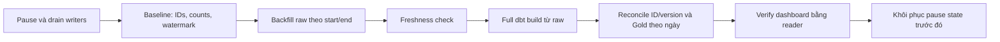

# Roadmap cải tiến LapLapTech

Project **đã chạy được end-to-end trên Docker local**. Đây là danh sách việc tiếp theo, không phải chức năng đang có. Chỉ làm mục mới khi có nhu cầu hoặc số đo chỉ ra vấn đề; mỗi mục có tiêu chí kiểm chứng để tránh thêm tool cho đẹp hồ sơ.

Đợt 26/10/2026: bootstrap phân biệt khởi tạo mới/tích hợp có sẵn; runtime chuyển sang `laplaptech_pipeline`, dashboard sang reader `laplaptech_dashboard`. Quy trình vận hành và đăng nhập nằm trong [Docker guide](../guides/docker.md). Các mục dữ liệu bên dưới vẫn là việc tiếp theo.

| Ưu tiên | Vấn đề hiện tại | Hướng xử lý | Khi nào xem là xong |
|---|---|---|---|
| 1 | Chưa diễn tập khôi phục từ backup | Backup warehouse + Airflow metadata và key/config cần thiết; restore vào volume/database **riêng** | Restore được, đối chiếu row counts và lịch sử DAG; không đụng DB đang dùng |
| 2 | Event quá cũ có thể nằm ngoài lookback raw/Silver | Bounded backfill `[start,end)`, ghi row count/watermark trước–sau và rebuild nhánh Silver cần thiết | Fixture có late event ngoài 2 giờ được sửa đúng từ raw đến Gold |
| 3 | Gold build từng model, lỗi giữa chừng có thể để dashboard thấy các phiên bản khác nhau | Nghiên cứu build staging schema rồi publish nhất quán, hoặc khóa/đánh dấu phiên bản được phục vụ | Test gây lỗi giữa build chứng minh dashboard vẫn thấy bản Gold đã kiểm chứng trước đó |
| 4 | Snapshot mới kiểm tập tên cột; event lỗi chưa có nơi cách ly | Contract cột/type/JSON, quarantine có lý do và test schema drift | Batch lỗi được báo rõ; dữ liệu tốt không bị nhầm với dữ liệu bị bỏ |
| 5 | Extract tạo DataFrame toàn bộ trong RAM | Đo RAM/time theo kích thước nguồn; chọn pagination/streaming và batch insert nếu cần | Chạy volume mục tiêu dưới trần RAM, có số đo trước/sau |
| Theo nhu cầu | Airflow chỉ có một task `build` cho toàn dbt | [Cosmos plan](cosmos.md): tách task theo model, giữ guard/limits/CI | DAG graph, retries, artifacts và đối soát được kiểm chứng trên stack mới |
| Theo nhu cầu | Image tags, logs/artifacts và cài máy mới chưa có quy trình dài hạn hoàn chỉnh | Pin digest khi release, retention có backup, clean-machine smoke và restore drill | Người khác clone/build/run được theo README; báo cáo nêu rõ môi trường và kết quả |

Không cần triển khai hết để gọi project hiện tại là hoàn thiện cho mục tiêu học tập. Trước khi làm một hạng mục, đọc [kiến trúc và giới hạn hiện tại](../architecture/data_flow.md), viết fixture/lỗi mô phỏng, rồi cập nhật đúng guide vận hành liên quan. Kế hoạch Cosmos là một nhánh **tùy chọn**, không phải bước bắt buộc sau Docker.

## Vòng dữ liệu tiếp theo: lookback và backfill raw → Gold

**Trạng thái: đã lập kế hoạch, chưa triển khai.** Mục tiêu là có cách khôi phục event đến muộn được kiểm chứng, trước khi tách dbt thành nhiều task Cosmos. Backup/restore vẫn là công việc bảo trì ưu tiên ở bảng trên; vòng dữ liệu này không yêu cầu thay Airflow/PostgreSQL hoặc tăng ngân sách máy.

### 1. Chốt hành vi đang có

- Raw lấy MAX server-received timestamp làm watermark; `INGESTION_LOOKBACK_SECONDS` mặc định 7200.
- Silver event có watermark riêng nhưng SQL cố định `INTERVAL '2 hour'`. Thay lookback raw hiện không tự thay Silver.
- CLI ingestion đã có backfill `[start,end)` có timezone. DAG hiện chỉ có `full_refresh`; chưa có start/end backfill.
- Backfill hiện vẫn refresh năm dimension bằng snapshot **hiện tại**, không khôi phục catalog theo thời điểm quá khứ.
- `dbt --full-refresh` chỉ xây lại từ raw đã có; không lấy lại dữ liệu bị bỏ ở ClickHouse.

### 2. Viết fixture tái hiện trước khi sửa

Tạo trên PostgreSQL test riêng theo [testing guide](../guides/testing.md), không đưa fixture vào warehouse đang phục vụ. Các tình huống cần có:

| Tình huống | Kỳ vọng |
|---|---|
| Event nằm trong lookback, kể cả đúng mốc đầu | Được đọc; replay không tăng số ID |
| Event mới xuất hiện ở nguồn nhưng server timestamp cũ hơn cửa sổ | Lượt thường bỏ qua có chủ đích; backfill lấy đúng khoảng |
| Event ở đúng `start` / đúng `end` | Bao gồm `start`, loại `end` |
| Event cũ được sửa bằng version mới hơn nhưng vẫn ngoài cửa sổ thường | Raw nhận version mới qua backfill; Silver/Gold được rebuild đúng |
| Cùng ID/timestamp nhưng payload khác | Giữ hành vi fail để điều tra, không tự chọn một payload |
| Một event từng hợp lệ nay thiếu session/name | Kiểm chứng nhánh recovery loại bản Silver cũ theo bộ lọc hiện hành |
| Event đi qua nửa đêm Việt Nam | Tổng event/session-day và ngày Gold vẫn đúng |

Không chỉ kiểm row count: đối chiếu đúng ID, version/timestamp, payload và KPI của ngày bị ảnh hưởng. Giữ test rollback/replay hiện có.

### 3. Dùng một cấu hình lookback cho cả hai tầng

1. Giữ giá trị mặc định 7200 giây, không đổi ngữ nghĩa watermark hoặc timezone.
2. Validate số nguyên không âm; giá trị lỗi phải fail, không âm thầm ép thành 0.
3. Truyền cùng cấu hình đã validate từ env/runtime tới điều kiện incremental Silver; bỏ literal 2 giờ trong model.
4. Kiểm raw và Silver với 0, 7200 và một giá trị khác để chứng minh không còn lệch cấu hình. Lookback hữu hạn vẫn không thay cho historical backfill.

Source dự kiến sửa: ingestion config, `scripts/run_airflow_stage.py`, `dbt/models/silver/silver_user_event_tracking.sql` và tests tương ứng. Config của project đi qua env/config volume; không ghi lại resource policy hay keys của shared platform.

### 4. Hoàn thiện một quy trình recovery có bằng chứng

Chặng đầu giữ recovery thủ công trong Docker để dễ kiểm soát; chưa thêm lịch/backfill DAG mới:

Wrapper phải dùng role pipeline, target guard và trần RAM/CPU hiện có; không chạy chồng với DAG hoặc CLI writer khác. Nếu giữ việc refresh dimension như CLI hiện hành, build lại **toàn bộ graph** để các Gold chỉ phụ thuộc catalog cũng được cập nhật. Không chỉ rebuild nhánh event rồi mặc định các bảng Gold khác vẫn đồng bộ.

Ghi report theo run/attempt: khoảng `[start,end)`, lookback, watermark/counts trước–sau, IDs/version của fixture và kết quả dbt/reconcile. Không ghi credentials hoặc payload thật nhạy cảm. Lỗi ở bước nào thì dừng và giữ trạng thái dễ điều tra; chỉ khôi phục lịch sau khi xác minh thành công. Bản catalog quá khứ và source deletes vẫn nằm ngoài phạm vi này.

### 5. Nghiệm thu và việc sau đó

- Fixture chứng minh lượt thường → backfill → rebuild → reconcile sửa đúng late event và replay không nhân đôi.
- Guard sai target, khoảng thời gian lỗi và xung đột version đều fail trước bước ghi không hợp lệ.
- Full build vẫn đủ 31 models/47 tests theo inventory hiện hành; dashboard chỉ đọc Gold bằng role riêng.
- Cập nhật [ingestion](../guides/ingestion.md), [dbt](../guides/dbt.md) và [data flow](../architecture/data_flow.md); giữ một roadmap này, không sinh thêm nhiều file plan trùng nhau.

Sau vòng này, ưu tiên **publish Gold nhất quán**: build bản ứng viên, kiểm chứng rồi mới phục vụ dashboard; thử lỗi giữa build để chứng minh bản đã kiểm chứng trước đó vẫn đọc được. Cosmos tiếp tục để sau hai vấn đề về tính đúng đắn dữ liệu này.
